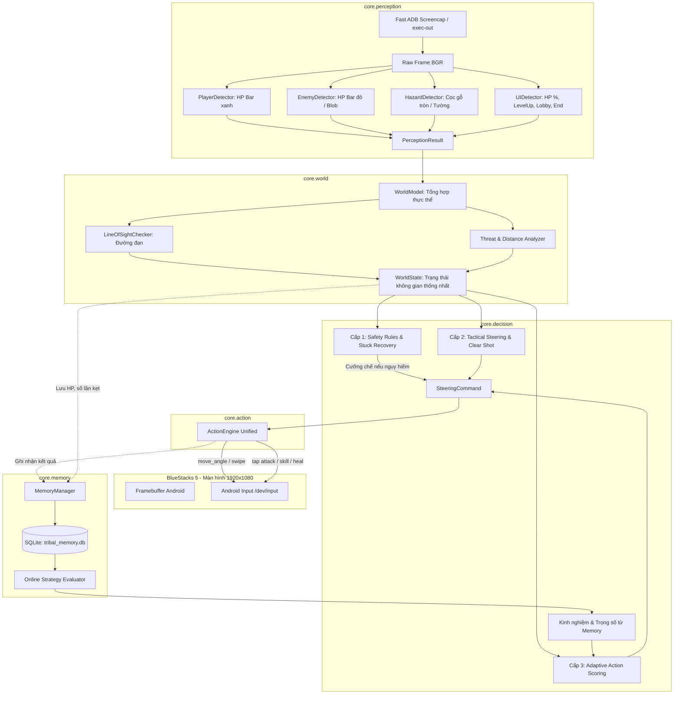
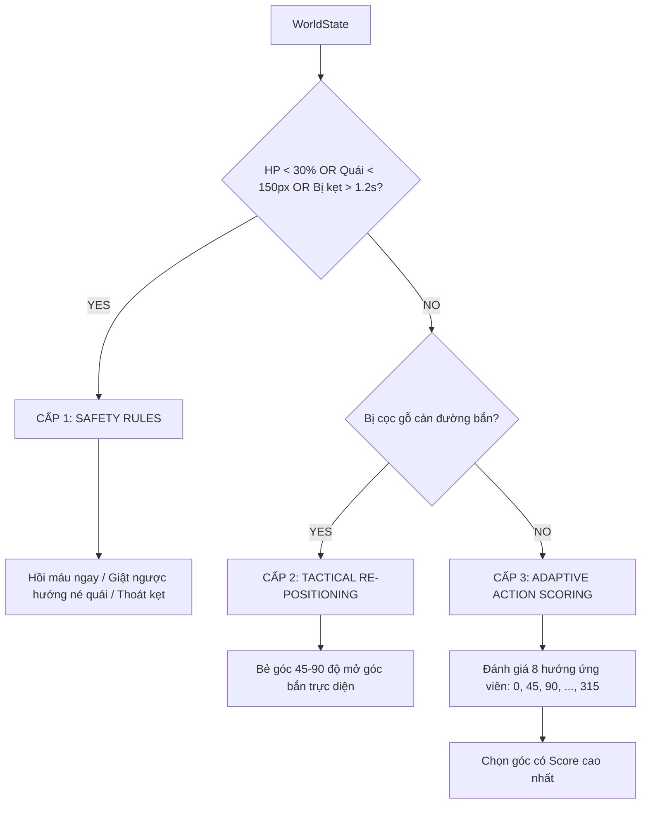
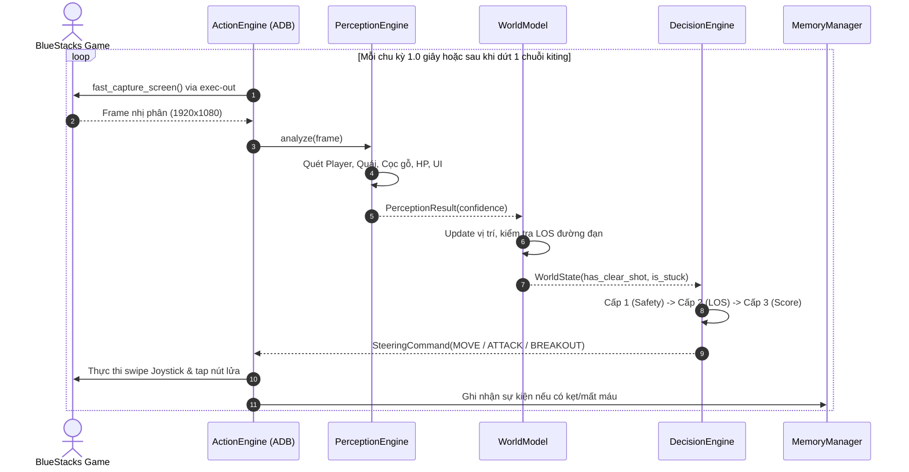

# ĐẶC TẢ KIẾN TRÚC KỸ THUẬT VÀ QUY CHUẨN TRIỂN KHAI
# TRIBAL ISLAND BOT – AUTONOMOUS HYBRID AGENT (LEVEL 3)

**Tên tài liệu:** `TRIBAL_ISLAND_BOT_HYBRID_AI_ARCHITECTURE.md`  
**Phiên bản:** 3.0 (Autonomous Hybrid Agent with Persistent Experience Memory)  
**Ngày phê duyệt:** 17/11/2026  
**Môi trường chuẩn:** BlueStacks 5 (Android 11 x86_64, 1920x1080), Python 3.11+, Windows 11, SQLite 3, OpenCV 4.x.

---

## MỤC LỤC
1. [Triết lý thiết kế & Nguyên tắc cốt lõi](#1-triết-lý-thiết-kế--nguyên-tắc-cốt-lõi)
2. [Kiến trúc tổng thể & Sơ đồ phụ thuộc (Dependency Graph)](#2-kiến-trúc-tổng-thể--sơ-đồ-phụ-thuộc-dependency-graph)
3. [Đặc tả Interface & Dataclass dùng chung](#3-đặc-tả-interface--dataclass-dùng-chung)
4. [Tối ưu hóa tầng thực thi Action Engine (Thay thế hoàn toàn pydirectinput)](#4-tối-ưu-hóa-tầng-thực-thi-action-engine)
5. [Đặc tả World Model & Hàm chấm điểm hành động (Action Scoring)](#5-đặc-tả-world-model--hàm-chấm-điểm-hành-động-action-scoring)
6. [Thiết kế Cơ sở dữ liệu Bộ nhớ Dài hạn (SQLite Schema)](#6-thiết-kế-cơ-sở-dữ-liệu-bộ-nhớ-dài-hạn-sqlite-schema)
7. [Luồng vòng lặp xử lý (Frame Loop & Run Loop)](#7-luồng-vòng-lặp-xử-lý-frame-loop--run-loop)
8. [Lộ trình triển khai P1 – P8 & Tiêu chuẩn nghiệm thu chi tiết](#8-lộ-trình-triển-khai-p1--p8--tiêu-chuẩn-nghiệm-thu-chi-tiết)
9. [Nguyên tắc bảo vệ bộ nhớ & Cơ chế Rollback an toàn](#9-nguyên-tắc-bảo-vệ-bộ-nhớ--cơ-chế-rollback-an-toàn)

---

## 1. TRIẾT LÝ THIẾT KẾ & NGUYÊN TẮC CỐT LÕI

Hệ thống TribalIslandBot được xây dựng dựa trên vòng lặp điều khiển khép kín:
$$\text{Quan sát} \longrightarrow \text{Hiểu trạng thái} \longrightarrow \text{Ra quyết định} \longrightarrow \text{Hành động} \longrightarrow \text{Đánh giá} \longrightarrow \text{Ghi nhớ} \longrightarrow \text{Cải thiện}$$

### 6 Nguyên tắc bất khả xâm phạm:
1. **Một Action Engine duy nhất:** Thống nhất điều khiển 100% ngầm qua ADB (không chiếm chuột, bàn phím, không dùng `pydirectinput` gây mất focus).
2. **Safety Rules có quyền tối cao (Override Rule):** Mọi hành động né nguy hiểm, hồi máu khẩn cấp hay giải cứu kẹt góc đều có quyền ngắt ngang (override) các thuật toán chấm điểm hay chiến thuật dài hạn.
3. **OpenCV trước, Deep Learning sau:** Chỉ áp dụng Template Matching, HSV Segmentation, Contour Analysis, Optical Flow/Tracking. Tuyệt đối không nhồi nhét mô hình Neural Network nặng nề khi chưa cần thiết.
4. **Mọi nhận diện phải có Confidence Score:** Không bao giờ truyền một tọa độ có độ tin cậy thấp vào hệ thống điều khiển nguy hiểm. Nếu confidence < 40%, bot tự động lùi về chế độ Kiting dự phòng (Graceful Fallback).
5. **Memory không trực tiếp gửi lệnh vào game:** Memory chỉ lưu trữ dữ liệu, tính toán thống kê và cập nhật trọng số cho Decision Engine.
6. **Bảo toàn dữ liệu & Chống tự hỏng:** Không bao giờ cho bot tự sửa code. Chỉ cập nhật tham số cấu hình có kiểm soát và luôn duy trì bản cấu hình gốc (Baseline) để Rollback.

---

## 2. KIẾN TRÚC TỔNG THỂ & SƠ ĐỒ PHỤ THUỘC (DEPENDENCY GRAPH)



---

## 3. ĐẶC TẢ INTERFACE & DATACLASS DÙNG CHUNG

Tất cả các module trong hệ thống bắt buộc phải giao tiếp qua các cấu trúc dữ liệu chuẩn (`dataclass`) sau, định nghĩa tại `core/common_types.py`:

```python
# FILE: core/common_types.py
from dataclasses import dataclass, field
from typing import List, Tuple, Optional, Dict, Any
import time

@dataclass
class Entity:
    """Đại diện cho một thực thể trên màn hình 1920x1080."""
    id: int
    category: str        # 'player', 'enemy', 'boss', 'obstacle_stump', 'portal'
    center_x: int
    center_y: int
    radius: int = 40
    confidence: float = 1.0
    hp_percent: float = 100.0
    velocity: Tuple[float, float] = (0.0, 0.0)  # (vx, vy) pixel/frame

@dataclass
class PerceptionResult:
    """Kết quả phân tích thị giác toàn diện của 1 khung hình."""
    timestamp: float = field(default_factory=time.time)
    frame_id: int = 0
    player: Optional[Entity] = None
    enemies: List[Entity] = field(default_factory=list)
    obstacles: List[Entity] = field(default_factory=list)
    portal: Optional[Entity] = None
    
    # UI states
    hp_percent: float = 100.0
    current_floor: int = 1
    is_level_up: bool = False
    is_lobby: bool = False
    is_battle_end: bool = False
    overall_confidence: float = 1.0

@dataclass
class WorldState:
    """Trạng thái thế giới game được tổng hợp cho Decision Engine."""
    timestamp: float
    player_pos: Tuple[int, int]
    player_hp: float
    current_floor: int
    game_state: str                    # 'LOBBY', 'FIGHTING', 'LEVEL_UP', 'FLOOR_EXIT', 'DEAD'
    
    nearest_enemy: Optional[Entity] = None
    nearest_enemy_dist: float = 9999.0
    enemies_count: int = 0
    
    has_clear_shot: bool = True        # Đường bắn tới quái gần nhất có thông suốt không
    blocking_obstacle: Optional[Entity] = None
    
    is_stuck: bool = False
    stuck_duration: float = 0.0
    suggested_escape_angle: Optional[float] = None
    
    confidence: float = 1.0

@dataclass
class SteeringCommand:
    """Lệnh hành động gửi xuống Action Engine."""
    action_type: str                   # 'MOVE', 'ATTACK', 'SKILL', 'HEAL', 'SELECT_PERK', 'HOLD'
    angle_degrees: float = 90.0        # 0=Phải, 90=Lên, 180=Trái, 270=Xuống
    distance_ratio: float = 1.0        # 0.2 -> 1.0 (độ lệch cần gạt)
    duration_ms: int = 400             # Thời gian giữ phím/swipe
    perk_index: int = 1                # Dùng khi SELECT_PERK (1, 2, 3)
    reason: str = "normal_kiting"      # Lý do ra quyết định (phục vụ log & debug)
```

---

## 4. TỐI ƯU HÓA TẦNG THỰC THI ACTION ENGINE

### 4.1. Loại bỏ hoàn toàn `pydirectinput`
Hợp nhất toàn bộ vào `core/action/action_engine.py` dựa trên nền tảng của `ADBController`:
- **Chụp ảnh tốc độ cao (Fast Screencap):** Sử dụng `adb exec-out screencap -p` để nhận raw PNG stream trực tiếp qua pipe stdout, decode thẳng bằng OpenCV trong RAM, triệt tiêu hoàn toàn bước ghi file ra `/sdcard/` và lệnh `adb pull`. Tốc độ tăng từ ~600ms lên **< 90ms/frame**.
- **Điều khiển Joystick Analog 360°:** `move_angle(angle_deg, distance_ratio, duration_ms)` tính toán chuẩn xác vector swipe từ tâm `(350, 750)`.
- **Tọa độ cố định 1080p chuẩn xác:**
  - Tấn công thường: `(1757, 929)`
  - Kỹ năng tím: `(1761, 643)`
  - Đùi gà hồi máu: `(1445, 956)`
  - Bắt đầu / Tiếp tục: `(980, 950)`
  - Kết thúc trận: `(1442, 1000)`
  - 3 Thẻ Perk: `[(755, 701), (943, 701), (1132, 701)]`

---

## 5. ĐẶC TẢ WORLD MODEL & HÀM CHẤM ĐIỂM HÀNH ĐỘNG (ACTION SCORING)

### 5.1. Kiến trúc 3 tầng quyết định (Hybrid Decision Engine)



### 5.2. Công thức chấm điểm ứng viên hướng di chuyển
Với mỗi hướng ứng viên $\theta \in \{0^\circ, 45^\circ, 90^\circ, 135^\circ, 180^\circ, 225^\circ, 270^\circ, 315^\circ\}$:
$$\text{Score}(\theta) = w_s \cdot S(\theta) + w_d \cdot D(\theta) + w_l \cdot L(\theta) + w_m \cdot M(\theta)$$

* $S(\theta) \in [0, 100]$: **Điểm an toàn** (Khoảng cách từ vị trí dự kiến đến tất cả quái vật và rìa bản đồ).
* $D(\theta) \in [0, 100]$: **Điểm duy trì cự ly** (Độ lệch so với cự ly bắn lý tưởng $R_{\text{ideal}} \approx 450\text{px}$).
* $L(\theta) \in [0, 100]$: **Điểm tầm nhìn đạn** (100 nếu đường đạn không vướng cọc gỗ, 10 nếu bị chắn).
* $M(\theta) \in [0, 100]$: **Điểm kinh nghiệm** (Trọng số thành công từ Memory của các tầng tương tự).

Trọng số mặc định ban đầu:
$$w_s = 0.35, \quad w_d = 0.25, \quad w_l = 0.25, \quad w_m = 0.15$$

---

## 6. THIẾT KẾ CƠ SỞ DỮ LIỆU BỘ NHỚ DÀI HẠN (SQLITE SCHEMA)

File database: `data/tribal_memory.db`

### 6.1. Bảng `runs` (Lịch sử mỗi lượt chạy)
```sql
CREATE TABLE IF NOT EXISTS runs (
    run_id INTEGER PRIMARY KEY AUTOINCREMENT,
    start_time TIMESTAMP DEFAULT CURRENT_TIMESTAMP,
    end_time TIMESTAMP,
    target_floor INTEGER DEFAULT 71,
    reached_floor INTEGER DEFAULT 1,
    duration_seconds REAL DEFAULT 0.0,
    result TEXT,                     -- 'SUCCESS', 'DIED', 'MANUAL_STOP'
    total_stuck_count INTEGER DEFAULT 0,
    total_heals_used INTEGER DEFAULT 0,
    final_hp_percent REAL DEFAULT 0.0
);
```

### 6.2. Bảng `floor_records` (Hiệu suất từng tầng)
```sql
CREATE TABLE IF NOT EXISTS floor_records (
    record_id INTEGER PRIMARY KEY AUTOINCREMENT,
    run_id INTEGER,
    floor_number INTEGER,
    start_hp_percent REAL,
    end_hp_percent REAL,
    duration_seconds REAL,
    stuck_count INTEGER DEFAULT 0,
    primary_strategy TEXT,           -- 'circular_kiting', 'adaptive_kiting', 'safe_distance'
    result TEXT,                     -- 'CLEARED', 'DIED'
    FOREIGN KEY(run_id) REFERENCES runs(run_id)
);
```

### 6.3. Bảng `battle_events` (Sự kiện bất thường & điểm chết)
```sql
CREATE TABLE IF NOT EXISTS battle_events (
    event_id INTEGER PRIMARY KEY AUTOINCREMENT,
    run_id INTEGER,
    floor_number INTEGER,
    event_type TEXT,                 -- 'BLOCKED_LOS', 'STUCK_CORNER', 'CRITICAL_HP', 'DEATH'
    player_x INTEGER,
    player_y INTEGER,
    details TEXT,
    timestamp TIMESTAMP DEFAULT CURRENT_TIMESTAMP,
    FOREIGN KEY(run_id) REFERENCES runs(run_id)
);
```

### 6.4. Bảng `strategy_stats` (Hồ sơ hiệu quả chiến thuật)
```sql
CREATE TABLE IF NOT EXISTS strategy_stats (
    strategy_name TEXT PRIMARY KEY,
    total_uses INTEGER DEFAULT 0,
    success_count INTEGER DEFAULT 0,
    avg_hp_remaining REAL DEFAULT 0.0,
    avg_duration_sec REAL DEFAULT 0.0,
    utility_score REAL DEFAULT 0.0,
    last_updated TIMESTAMP DEFAULT CURRENT_TIMESTAMP
);
```

### 6.5. Công thức tính Utility Score ($U$) của chiến thuật:
$$U = 0.4 \cdot C + 0.3 \cdot S + 0.2 \cdot E + 0.1 \cdot T$$
* $C$: Tỷ lệ hoàn thành phòng (Completion Rate: $0.0 \rightarrow 1.0$).
* $S$: Lượng máu bảo toàn trung bình (Survival HP: $0.0 \rightarrow 1.0$).
* $E$: Hiệu quả tiết kiệm đùi gà hồi máu ($0.0 \rightarrow 1.0$).
* $T$: Điểm thời gian hoàn thành (Thời gian càng ngắn điểm càng cao).

---

## 7. LUỒNG VÒNG LẶP XỬ LÝ (FRAME LOOP & RUN LOOP)



---

## 8. LỘ TRÌNH TRIỂN KHAI P1 – P8 & TIÊU CHUẨN NGHIỆM THU CHI TIẾT

| Giai đoạn | Mục tiêu & Nội dung kỹ thuật | Module sinh ra / cập nhật | File kiểm thử độc lập | Tiêu chuẩn nghiệm thu (Pass/Fail) |
| :---: | :--- | :--- | :--- | :--- |
| **P1** | **Chuẩn hóa ActionEngine & ADB Fast Capture** | `core/action/action_engine.py` | `tests/test_p1_action.py` | Chụp màn hình qua `exec-out` < 120ms. Thao tác di chuyển 360° và đánh không chiếm chuột/phím. |
| **P2** | **Bộ phát hiện thị giác (Perception)** | `core/perception/detector_enemy.py`<br>`core/perception/detector_hazard.py` | `tests/test_p2_perception.py` | Độ chính xác nhận diện Cọc gỗ & Player > 95% trên bộ ảnh mẫu `assets/`. Có `confidence score`. |
| **P3** | **Xây dựng World Model & Tích hợp LOS** | `core/world/world_model.py` | `tests/test_p3_world_model.py` | Xuất đúng `has_clear_shot=False` khi có cọc gỗ chắn ngang giữa player và quái. |
| **P4** | **Stuck Recovery & Điều hướng thích ứng** | `core/navigation/vector_steering.py`<br>`core/navigation/stuck_detector.py` | `tests/test_p4_navigation.py` | Khi bị cọc che đường đạn, tự động đổi góc di chuyển để mở góc bắn trong vòng 1.2s. |
| **P5** | **Hybrid Combat & Phân tầng Quyết định** | `core/decision/decision_engine.py`<br>`core/decision/safety_rules.py` | `tests/test_p5_decision.py` | Đạt điều kiện: Vừa đi vừa bắn liên tục, tự bơm đùi gà khi HP < 30%, không bao giờ đứng yên. |
| **P6** | **Persistent Memory (SQLite)** | `core/memory/memory_manager.py`<br>`core/memory/database.py` | `tests/test_p6_memory.py` | Chạy 1 lượt chơi mẫu, tắt bot mở lại → Đọc lại toàn bộ dữ liệu lịch sử ván đấu toàn vẹn. |
| **P7** | **Adaptive Strategy Evaluator** | `core/memory/strategy_updater.py` | `tests/test_p7_adaptive.py` | Bot tính toán đúng điểm $U$ của 3 chiến thuật và tự động tăng trọng số cho chiến thuật hiệu quả nhất. |
| **P8** | **Tích hợp toàn diện vào RunManager & GUI** | `core/manager_run.py`<br>`gui/app_window.py` | `main.py` | Chạy tự động khép kín liên tục 5 lượt từ Sảnh → Tầng mục tiêu → Chết nhận rương mà không crash. |

---

## 9. NGUYÊN TẮC BẢO VỆ BỘ NHỚ & CƠ CHẾ ROLLBACK AN TOÀN

1. **Khóa an toàn cấu hình (Config Guard):** Bot không bao giờ ghi đè file `settings.json` gốc. Mọi điều chỉnh thích ứng chỉ được ghi vào bảng `strategy_stats` trong SQLite.
2. **Cơ chế Rollback tức thì (Automatic Rollback):**
   - Nếu trong 3 ván liên tiếp, tỷ lệ chết sớm ở tầng thấp tăng > 25% so với mức trung bình, hệ thống lập tức kích hoạt:
   ```python
   memory_manager.rollback_to_baseline()
   ```
   Khôi phục toàn bộ trọng số về cấu hình chuẩn ban đầu ($w_s=0.35, w_d=0.25, w_l=0.25, w_m=0.15$).
3. **Chế độ kiểm thử (Shadow Testing):** Một chiến thuật mới chỉ được áp dụng với xác suất thử nghiệm 20% (Epsilon-Greedy $\epsilon = 0.2$), 80% thời lượng vẫn sử dụng chiến thuật đã được chứng minh hiệu quả.

---
**Tài liệu này là cam kết kỹ thuật chuẩn xác và bắt buộc tuân thủ cho toàn bộ các bước triển khai mã nguồn của TribalIslandBot.**

