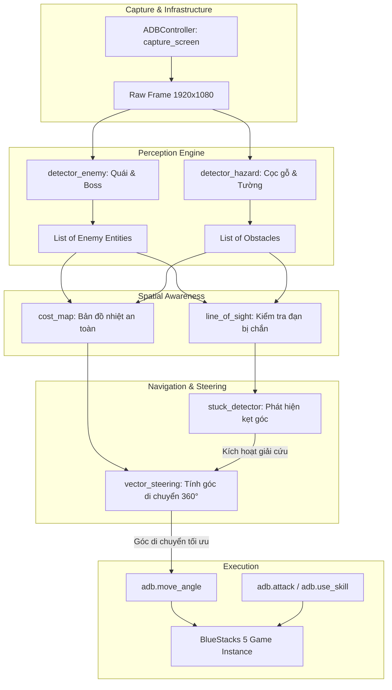

# TÀI LIỆU KỸ THUẬT & LỘ TRÌNH TRIỂN KHAI HỆ THỐNG
# TRIBAL ISLAND BOT (AUTONOMOUS PERCEPTION ARCHITECTURE)

**Dự án:** TribalIslandBot - Nện Private Auto Bot  
**Phiên bản thiết kế:** 2.0 (Nâng cấp từ Automation Bot sang Perception-driven Autonomous Bot)  
**Ngày lập tài liệu:** 17/11/2026  
**Môi trường vận hành:** BlueStacks 5 (Android 11/x86_64, 1920x1080), Windows 11, Python 3.11+, ADB (HD-Adb.exe).

---

## MỤC LỤC
1. [Tổng quan mục tiêu & Triết lý kiến trúc](#1-tổng-quan-mục-tiêu--triết-lý-kiến-trúc)
2. [Danh mục module hiện hữu (Giữ nguyên - Không viết lại)](#2-danh-mục-module-hiện-hữu-giữ-nguyên---không-viết-lại)
3. [Danh mục các module mới cần bổ sung](#3-danh-mục-các-module-mới-cần-bổ-sung)
4. [Sơ đồ phụ thuộc & Luồng dữ liệu (Dependency Graph)](#4-sơ-đồ-phụ-thuộc--luồng-dữ-liệu-dependency-graph)
5. [Đặc tả Interface & Giao thức truyền dữ liệu](#5-đặc-tả-interface--giao-thức-truyền-dữ-liệu)
6. [Thứ tự triển khai & Kế hoạch kiểm thử từng giai đoạn (P1 -> P8)](#6-thứ-tự-triển-khai--kế-hoạch-kiểm-thử-từng-giai-đoạn-p1---p8)
7. [Tiêu chí nghiệm thu (Acceptance Criteria)](#7-tiêu-chí-nghiệm-thu-acceptance-criteria)
8. [Ma trận rủi ro tương thích & Phương án xử lý (Risk & Mitigation)](#8-ma-trận-rủi-ro-tương-thích--phương-án-xử-lý-risk--mitigation)

---

## 1. TỔNG QUAN MỤC TIÊU & TRIẾT LÝ KIẾN TRÚC

### 1.1. Hiện trạng & Bài toán thực tế
- Bot hiện tại đã vượt qua rào cản kỹ thuật lớn nhất: **Điều khiển chạy ngầm 100% qua ADB** (không chiếm chuột/bàn phím), nhận diện các trạng thái sảnh, chọn kỹ năng đa lần, hồi máu và kiting cơ bản.
- **Vấn đề cốt tử mới phát sinh (Minh chứng từ ảnh thực tế):** Khi nhân vật di chuyển theo mẫu hình cứng (Fixed Pattern W-D-S-A), nhân vật dễ bị lọt vào góc hẹp bị che khuất bởi vật cản (như hàng cọc gỗ tròn, bờ tường băng). Do cơ chế tự ngắm (Auto-aim) của game, đạn bắn thẳng vào cọc gỗ thay vì trúng quái, và bot không biết tự thoát khỏi góc kẹt này để mở góc bắn.
- **Mục tiêu:** Bổ sung tầng **Nhận thức không gian (Perception)**, **Bản đồ hóa chi phí (Cost Grid Map)** và **Điều hướng thích ứng (Adaptive Navigation)** để bot tự biết quái ở đâu, vật cản ở đâu, và tự tìm góc bắn thông thoáng nhất.

### 1.2. Triết lý kiến trúc
1. **Preserve Working Core (Bảo toàn lõi):** Giữ nguyên toàn bộ mã nguồn ADB Controller, Vision Engine cơ bản, và GUI. Tuyệt đối không viết lại các tính năng đã chạy chuẩn.
2. **Loosely Coupled, Interface-driven:** Mỗi module mới chỉ làm một việc duy nhất và giao tiếp qua dataclass chuẩn.
3. **Graceful Fallback (Dự phòng an toàn):** Nếu tầng AI nhận diện gặp sự cố hoặc độ tin cậy < 40%, bot lập tức kích hoạt cơ chế lùi về Fixed Kiting để tiếp tục chiến đấu mà không bao giờ bị đứng im.

---

## 2. DANH MỤC MODULE HIỆN HỮU (GIỮ NGUYÊN - KHÔNG VIẾT LẠI)

Các thành phần sau đây đã được kiểm thử thực tế và đạt độ ổn định 100%, **nghiêm cấm viết lại hoặc thay thế cấu trúc nội tại**:

| Tên File | Module | Chức năng đang đảm nhận | Trạng thái kỹ thuật |
| :--- | :--- | :--- | :--- |
| `core/engine_adb.py` | `ADBController` | Giao tiếp Socket ADB với BlueStacks: `tap()`, `swipe()`, `capture_screen()`, `move_angle()` 360°, tọa độ chuẩn 1080p (Đùi gà: 1445,956; Lửa: 1757,929; Tím: 1761,643; Sảnh: 980,950; 3 Perk). | **Hoàn chỉnh 100%** |
| `core/engine_vision.py`| `VisionEngine` | OpenCV Template matching dải băng Level Up (mẫu 1080p chuẩn xác 1.000), đếm viền tròn perk dự phòng, đọc % thanh máu HP (HSV đỏ/hồng), OCR số tầng (Tesseract), nhận diện nút Sảnh. | **Hoàn chỉnh 100%** |
| `gui/app_window.py` | `AppWindow` | Giao diện đồ họa PySide6: Nút Start/Pause/Stop, cấu hình tầng mục tiêu (Target Floor), ngưỡng hồi máu (HP Threshold), log thời gian thực. | **Hoàn chỉnh 100%** |
| `config/settings.json`| Config JSON | Chứa toàn bộ tham số cấu hình: device ID, target floor, attack speed, delay... | **Hoàn chỉnh 100%** |

---

## 3. DANH MỤC CÁC MODULE MỚI CẦN BỔ SUNG

Hệ thống sẽ được mở rộng thêm 3 package chuyên biệt:

```
TribalIslandBot/
├── core/
│   ├── perception/             # TẦNG 1: NHẬN THỨC MÔI TRƯỜNG
│   │   ├── __init__.py
│   │   ├── detector_enemy.py   # Phát hiện vị trí quái, boss, thanh máu quái
│   │   ├── detector_hazard.py  # Phát hiện cọc gỗ, tảng đá, bẫy gai
│   │   └── analyzer_density.py # Tính trọng tâm đàn quái và vùng nguy hiểm
│   │
│   ├── mapping/                # TẦNG 2: BẢN ĐỒ HÓA KHÔNG GIAN
│   │   ├── __init__.py
│   │   ├── grid_local_map.py   # Lưới ô cờ 2D cục bộ quanh người chơi
│   │   └── cost_map.py         # Bản đồ nhiệt tính toán chi phí di chuyển
│   │
│   └── navigation/             # TẦNG 3: ĐIỀU HƯỚNG THÍCH ỨNG
│       ├── __init__.py
│       ├── line_of_sight.py    # Kiểm tra đường đạn thẳng (tránh cọc gỗ cản đạn)
│       ├── stuck_detector.py   # Phát hiện kẹt góc / kẹt cọc gỗ
│       └── vector_steering.py  # Tính vector di chuyển 360° gửi vào ADB
```

### Chi tiết nhiệm vụ từng module:
1. **`detector_enemy.py`:**
   - Dựa trên dải màu đặc trưng của quái (thanh máu đỏ mini trên đầu quái, thân quái xanh/đỏ/xám) để trích xuất danh sách tọa độ quái $(x_i, y_i)$ trên màn hình 1920x1080.
2. **`detector_hazard.py`:**
   - Phân đoạn nhận diện cọc gỗ tròn (đầu cọc có vân gỗ tròn xoắn ốc) và bẫy gai trên sàn cỏ.
3. **`line_of_sight.py`:**
   - Dựng đoạn thẳng nối từ Người chơi $\rightarrow$ Quái mục tiêu gần nhất. Kiểm tra xem đoạn thẳng này có cắt qua bất kỳ cọc gỗ/vật cản nào không. Nếu có $\rightarrow$ Báo động **Blocked LOS (Mất tầm nhìn đạn)**.
4. **`stuck_detector.py`:**
   - Nếu trong 2.0 giây người chơi không thay đổi vị trí đáng kể hoặc bị Blocked LOS liên tục $\rightarrow$ Sinh vector giải cứu (Break-out Vector) giật ngược hướng để thoát ra bãi đất trống.
5. **`vector_steering.py`:**
   - Sử dụng giải thuật trường thế nhân tạo (Artificial Potential Field):
     - **Lực đẩy (Repulsion):** Bị đẩy ra xa khỏi quái quá gần, cọc gỗ, bờ tường.
     - **Lực hút (Attraction):** Bị hút về vùng cỏ trống và góc có đường đạn thông thoáng (Clear LOS).
     - Kết quả: Góc $\theta \in [0^\circ, 360^\circ)$ tối ưu được truyền thẳng vào `adb.move_angle()`.

---

## 4. SƠ ĐỒ PHỤ THUỘC & LUỒNG DỮ LIỆU (DEPENDENCY GRAPH)



---

## 5. ĐẶC TẢ INTERFACE & GIAO THỨC TRUYỀN DỮ LIỆU

Để đảm bảo tính độc lập và khả năng kiểm thử đơn vị (Unit Test), toàn bộ giao tiếp giữa các tầng sử dụng cấu trúc dữ liệu chuẩn (`dataclass`):

```python
from dataclasses import dataclass, field
from typing import List, Tuple, Optional

@dataclass
class Entity:
    """Thực thể trong game (Quái, Người chơi, Cọc gỗ)."""
    id: int
    category: str        # 'player', 'enemy', 'boss', 'obstacle_stump', 'obstacle_wall'
    center_x: int        # Tọa độ pixel trên màn 1920x1080
    center_y: int
    radius: int = 40
    hp_percent: float = 100.0

@dataclass
class PerceptionResult:
    """Kết quả phân tích thị giác toàn diện của 1 khung hình."""
    timestamp: float
    player_pos: Tuple[int, int]
    enemies: List[Entity] = field(default_factory=list)
    obstacles: List[Entity] = field(default_factory=list)
    has_clear_shot: bool = True           # Tầm đạn tới quái gần nhất có bị che không
    nearest_enemy_dist: float = 9999.0

@dataclass
class SteeringCommand:
    """Lệnh điều khiển được chuyển xuống ADB."""
    action: str          # 'KITE', 'BREAKOUT', 'ENTER_DOOR', 'HOLD'
    angle_degrees: float # 0.0 -> 360.0 độ
    duration_ms: int     # Thời gian vuốt cần gạt
    should_attack: bool = True
    should_skill: bool = False
```

---

## 6. THỨ TỰ TRIỂN KHAI & KẾ HOẠCH KIỂM THỬ TỪNG GIAI ĐOẠN (P1 -> P8)

| Giai đoạn | Tên module triển khai | File kiểm thử độc lập | Nội dung thực hiện |
| :---: | :--- | :--- | :--- |
| **P1** | **Obstacle & LOS Checker** | `test_p1_los.py` | Nhận diện cọc gỗ tròn từ ảnh chụp; phát hiện đường đạn có bị cản bởi cọc gỗ hay không. |
| **P2** | **Stuck Detector & Recovery** | `test_p2_stuck_recovery.py` | Phát hiện bot bị kẹt góc sau cọc gỗ $\rightarrow$ kích hoạt lệnh bẻ lái 90-180 độ thoát ra ngoài. |
| **P3** | **Enemy & Player Tracker** | `test_p3_enemy_tracker.py` | Phát hiện vị trí người chơi và quái vật trên khung hình chiến đấu. |
| **P4** | **Line-of-Sight Adaptive Move** | `test_p4_clear_shot.py` | Tự động chọn vị trí đứng có đường đạn thông thoáng nhất để bắn quái. |
| **P5** | **Dynamic Combat Loop** | `test_p5_continuous_combat.py` | Vòng lặp chiến đấu liên tục (không giới hạn 15s) cho đến khi phòng hết quái. |
| **P6** | **Portal Detection & Advance** | `test_p6_portal_advance.py` | Nhận diện cổng dịch chuyển phát sáng mở ra ở trên tường $\rightarrow$ đi thẳng vào cổng sang tầng tiếp theo. |
| **P7** | **Full Room Transition** | `test_p7_room_loop.py` | Tự động liên hoàn: Chọn kỹ năng $\rightarrow$ Đánh sạch quái $\rightarrow$ Tự vào cổng tầng 2, 3. |
| **P8** | **System Integration** | `main.py` + GUI | Tích hợp hoàn chỉnh vào RunManager và giao diện PySide6 cho vòng lặp cày rương khép kín. |

---

## 7. TIÊU CHÍ NGHIỆM THU (ACCEPTANCE CRITERIA)

Mỗi giai đoạn chỉ được coi là hoàn thành khi thỏa mãn các bài test thực nghiệm trên BlueStacks:

1. **Nghiệm thu P1 (Line of Sight):**
   - Khi đặt nhân vật sau hàng cọc gỗ (như trong ảnh lỗi), hệ thống phải xuất ra log: `[LOS] CẢNH BÁO: Đạn bị cản bởi cọc gỗ tại (X, Y)`.
2. **Nghiệm thu P2 (Stuck Recovery):**
   - Trong vòng 1.5 giây sau khi bị kẹt, bot phải tự động vuốt cần gạt theo hướng thoáng (S hoặc A) để đưa nhân vật ra vùng cỏ rộng, không bao giờ đứng im bắn vào cọc gỗ.
3. **Nghiệm thu P5 (Continuous Combat):**
   - Vòng lặp chiến đấu không bị dừng sau 15 giây. Bot tiếp tục vừa chạy vừa bắn cho đến khi quái vật cuối cùng trên sàn ngã xuống.
4. **Nghiệm thu P7 (Floor Progression):**
   - Bot tự đi qua ít nhất 3 tầng liên tiếp (Tầng 1 $\rightarrow$ Tầng 2 $\rightarrow$ Tầng 3) mà không cần can thiệp tay của con người.

---

## 8. MA TRẬN RỦI RO TƯƠNG THÍCH & PHƯƠNG ÁN XỬ LÝ (RISK & MITIGATION)

| Rủi ro kỹ thuật | Mức độ | Hậu quả tiềm ẩn | Phương án xử lý dứt điểm |
| :--- | :---: | :--- | :--- |
| **Lag ADB Screencap (Trễ khung hình)** | Trung bình | Tốc độ phân tích bị chậm nếu chụp ảnh liên tục bằng adb pull. | Chỉ chụp ảnh mỗi 1.0 - 1.5 giây để cập nhật bản đồ; luồng điều khiển di chuyển và xả đạn chạy trên luồng Worker độc lập không bị nghẽn. |
| **Nhận diện nhầm vật cản trên nền cỏ** | Thấp | Bot né tránh những vị trí không có cọc gỗ thật. | Sử dụng kết hợp phân tích hình học (vòng tròn đồng tâm của vân cọc gỗ) và kiểm tra màu nâu đặc trưng của gỗ. |
| **Game cập nhật vị trí quái bất ngờ** | Trung bình | Quái áp sát quá nhanh khi bot đang né cọc gỗ. | Ưu tiên số 1 của Vector Steering luôn là: **Khoảng cách với quái > Tầm nhìn đạn**. Nếu quái đến quá gần (< 150px), bot sẽ ưu tiên né xa quái trước, sau đó mới tìm góc bắn. |
| **Cơ chế Fallback** | Nghiêm trọng | Nếu thuật toán mới lỗi làm crash bot giữa chừng. | Đặt toàn bộ logic mới trong khối `try...except`. Nếu xảy ra ngoại lệ, tự động kích hoạt chế độ kiting W-D-S-A cổ điển để bảo toàn ván đấu. |

---
**Tài liệu này là quy chuẩn kỹ thuật chính thức để điều phối toàn bộ các bước viết code tiếp theo của dự án TribalIslandBot.**
