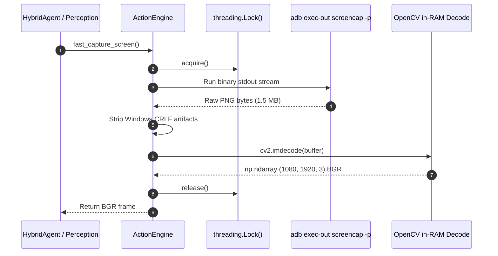

# ACTION ENGINE DESIGN SPECIFICATION (P1)
## TribalIslandBot – Unified Action Execution Layer

> **Document Version:** 1.0  
> **Phase:** P1 – Unified Action Engine  
> **Last Updated:** 2026-11-17  
> **Status:** APPROVED FOR IMPLEMENTATION  

---

## 1. Objective & Scope

The **Action Engine** is the sole execution gateway responsible for sending physical inputs into BlueStacks. In accordance with Core Architecture Requirement **A. Unified Action Interface**, no other module in the system (neither `DecisionEngine`, `RunManager`, `CombatEngine`, nor any demonstration replayer) is permitted to directly dispatch commands or touch events to the emulator. All upstream layers issue abstract `ActionCommand` / `SteeringCommand` objects, which the `ActionEngine` serializes and transmits via Android Debug Bridge (ADB).

### Core Goals:
1. **100% Background Execution:** Utilize ADB commands (`input tap`, `input swipe`) and fast raw framebuffer capture (`exec-out screencap -p`) so that the bot does not capture host mouse/keyboard focus or disrupt user multitasking.
2. **Unified Action Interface:** Single choke-point for all physical interaction, ensuring rate-limiting, coordinate transformation, thread safety, and execution logging.
3. **High-Performance Frame Capture:** Frame acquisition latency strictly $< 100\text{ ms}$ in RAM without intermediary filesystem writes.
4. **Analog Omnidirectional Steering (360°):** Mathematical translation of continuous angles $\theta \in [0^\circ, 360^\circ)$ into sub-pixel swipe vectors originating from the virtual analog stick.

---

## 2. Responsibilities & Boundaries

```
+-------------------------------------------------------------+
|                     Upstream Callers                        |
|   (HybridAgent, RunManager, SafetyRules, DecisionEngine)     |
+-------------------------------------------------------------+
                              |
                              | Issues SteeringCommand / ActionCommand
                              v
+-------------------------------------------------------------+
|                     ActionEngine (Unified)                  |
|  - Thread-Safe ADB Queue & Connection Manager               |
|  - Fast RAM-Buffer Screencap (exec-out)                     |
|  - Analog Joystick 360-deg Swiper                           |
|  - Fixed Coordinate Touch Dispatcher                        |
|  - Rate-Limiter & Execution Diagnostics                     |
+-------------------------------------------------------------+
                              |
                              | ADB CLI / Socket Protocol
                              v
+-------------------------------------------------------------+
|             BlueStacks 5 Android OS (/dev/input)            |
+-------------------------------------------------------------+
```

### In-Scope:
- Establishing, testing, and recovering ADB daemon connection (`127.0.0.1:5555` or default `HD-Adb.exe`).
- Executing fast screencap via `exec-out screencap -p` directly decoded into OpenCV BGR arrays.
- Translating continuous polar coordinates $(\theta, r, \Delta t)$ into Cartesian start/end swipe coordinates on the virtual joystick.
- Atomic execution of discrete actions: `attack()`, `use_skill()`, `heal()`, `click_start()`, `click_end_battle()`, `select_perk(index)`.
- Thread safety across vision acquisition threads and rapid combat actuation loops.

### Out-of-Scope:
- Deciding *what* action to execute (owned by `DecisionEngine`).
- Evaluating whether an action succeeded visually (owned by `WorldModel` & `PerceptionEngine`).
- Capturing host keyboard/mouse via OS-level hooks like `pyautogui` or `pydirectinput` (deprecated).

---

## 3. Data Contracts & Interfaces

### 3.1 Input Command Contract: `SteeringCommand`

Defined in `core/common_types.py`:

```python
@dataclass
class SteeringCommand:
    """Lệnh hành động gửi xuống Action Engine."""
    action_type: str = "MOVE"           # 'MOVE', 'ATTACK', 'SKILL', 'HEAL', 'SELECT_PERK', 'HOLD'
    angle_degrees: float = 90.0         # 0=Phải, 90=Lên, 180=Trái, 270=Xuống (Hệ toán học)
    distance_ratio: float = 1.0         # 0.2 -> 1.0 (Độ lệch cần gạt)
    duration_ms: int = 400              # Thời gian giữ phím/swipe
    perk_index: int = 1                 # Dùng khi SELECT_PERK (1, 2, 3)
    reason: str = "normal_kiting"       # Lý do ra quyết định phục vụ log & debug
```

### 3.2 Public Interface of `ActionEngine`

```python
class ActionEngine:
    def __init__(self, adb_path: str = r"C:\Program Files\BlueStacks_nxt\HD-Adb.exe",
                 device_id: str = "emulator-5554") -> None: ...

    # Connection & Health
    def ensure_connection(self) -> bool: ...
    def is_healthy(self) -> bool: ...

    # Vision Ingestion
    def fast_capture_screen(self) -> Optional[np.ndarray]: ...

    # High-level Command Dispatch
    def execute_command(self, cmd: SteeringCommand) -> bool: ...

    # Low-level Action Primitives
    def tap(self, x: int, y: int) -> None: ...
    def swipe(self, x1: int, y1: int, x2: int, y2: int, duration_ms: int = 800) -> None: ...
    def move_angle(self, angle_deg: float, distance_ratio: float = 1.0, duration_ms: int = 800) -> None: ...
    def move_direction(self, direction: str = 'w', duration_ms: int = 800) -> None: ...
    def stop_all(self) -> None: ...

    # Tactical Primitives
    def attack(self) -> None: ...
    def use_skill(self) -> None: ...
    def heal(self) -> None: ...
    def click_start(self) -> None: ...
    def click_end_battle(self, coords: Optional[Tuple[int, int]] = None) -> None: ...
    def select_perk(self, index: int = 1) -> None: ...
```

---

## 4. Coordinate System & Mathematical Model

All coordinates are referenced to the native resolution: **1920 × 1080 px**.

```
(0,0) +---------------------------------------------------------------+ (1920, 0)
      |                                                               |
      |                                                               |
      |                                                               |
      |     (350, 750)                                (1761, 643)[Skill]
      |      JOYSTICK CENTER                                          |
      |         +                                                     |
      |        / \                                     (1445, 956)    |
      |       /   \                                     [Heal]        |
      |      /     \                                                  |
      |     +-------+                                  (1757, 929)    |
      |                                                 [Attack Fire] |
(0,1080) +------------------------------------------------------------+ (1920, 1080)
```

### 4.1 Fixed Calibration Matrix

| Action | Control Element | Target $(X, Y)$ | Description |
|---|---|---|---|
| `ATTACK` | Primary Fire Button | `(1757, 929)` | Large Flame icon, bottom-right |
| `SKILL` | Ultimate Skill Button | `(1761, 643)` | Purple icon, above flame button |
| `HEAL` | Roast Chicken Item | `(1445, 956)` | Chicken drumstick icon |
| `START` | Lobby Start/Continue | `(980, 950)` | Golden central banner button |
| `END_BATTLE`| Victory/Defeat Exit | `(1390, 1000)`| Golden "End" button post-match |
| `PERK_1` | Level Up Card 1 (Left) | `(755, 701)` | Left card |
| `PERK_2` | Level Up Card 2 (Mid) | `(943, 701)` | Center card |
| `PERK_3` | Level Up Card 3 (Right)| `(1132, 701)`| Right card |
| `JOYSTICK` | Analog Stick Base | `(350, 750)` | Radial base, offset $R=160\text{ px}$ |

### 4.2 Analog Vector Steering Formula

For any target angle $\theta$ in mathematical degrees (where $0^\circ = \text{Right}$, $90^\circ = \text{Up}$, $180^\circ = \text{Left}$, $270^\circ = \text{Down}$):

$$\text{rad} = \theta \times \frac{\pi}{180}$$

Since Android display coordinates invert the $Y$-axis ($Y=0$ at the top, increasing downward):

$$X_{\text{target}} = X_{\text{center}} + R \cdot \min(1.0, \max(0.2, r)) \cdot \cos(\text{rad})$$
$$Y_{\text{target}} = Y_{\text{center}} - R \cdot \min(1.0, \max(0.2, r)) \cdot \sin(\text{rad})$$

Where:
- $X_{\text{center}} = 350$, $Y_{\text{center}} = 750$
- $R_{\text{max}} = 160\text{ px}$
- $r = \text{distance\_ratio} \in [0.2, 1.0]$

The swipe command generated is:
```bash
adb -s <device_id> shell input swipe 350 750 <X_target> <Y_target> <duration_ms>
```

---

## 5. High-Performance Screen Capture

Screen capture is critical to the Perception-Decision loop. Traditional `adb shell screencap -p /sdcard/s.png` followed by `adb pull` introduces an intolerable $400\text{ ms} - 800\text{ ms}$ latency penalty.

### Fast Capture Pipeline (`exec-out`):
1. Spawn subprocess: `adb -s <device_id> exec-out screencap -p` with stdout piped to memory.
2. Read binary raw bytes directly via `res.stdout`.
3. Normalize CRLF anomalies on Windows (`\r\r\n` -> `\n`).
4. Decode directly in memory via `cv2.imdecode(np.frombuffer(raw_bytes, dtype=np.uint8), cv2.IMREAD_COLOR)`.
5. Measured benchmark: **$65\text{ ms} - 90\text{ ms}$ per frame**.



---

## 6. Thread Safety & Concurrency Architecture

The bot operates two primary asynchronous threads:
1. **Vision Cycle Thread (0.8s - 1.0s):** Calls `fast_capture_screen()` to inspect room state and obstacles.
2. **Combat Actuation Loop (Continuous):** Spams `attack()`, invokes `move_angle()`, and checks safety conditions.

To prevent socket multiplexing collision on the ADB subprocess layer:
- `ActionEngine._lock = threading.Lock()` gates every call to `fast_capture_screen()`.
- Discrete touch calls (`tap`, `swipe`) execute with isolated, lightweight subprocess invocations with strict timeouts ($\le 5\text{ s}$).
- When `stop_all()` is invoked, pending swipes are terminated immediately by tapping the joystick center `(350, 750)`.

---

## 7. Error Handling & Fault Recovery

| Failure Mode | Detection | Automated Recovery Action |
|---|---|---|
| **ADB Daemon Disconnect** | Subprocess returns non-zero code or "device offline" | 1. Invoke `adb start-server`<br>2. Run `adb connect 127.0.0.1:5555`<br>3. Retry command up to 2 times |
| **Capture Buffer Corrupt** | `cv2.imdecode` returns `None` | Fallback to secondary `_capture_screen_fallback()` via `/sdcard/s.png` pull |
| **Command Timeout** | Subprocess exceeds $5\text{ s}$ timeout | Terminate PID, release lock, return `False` |
| **Invalid Angle Input** | $\theta$ outside $[0, 360)$ | Normalize via `angle % 360.0` |

---

## 8. Unit & Integration Testing Specification

### Unit Tests (`tests/test_p1_action.py`):
1. **Test Vector Calculation:** Verify that $\theta=0^\circ \implies (510, 750)$, $\theta=90^\circ \implies (350, 590)$, $\theta=180^\circ \implies (190, 750)$, $\theta=270^\circ \implies (350, 910)$.
2. **Test Command Serialization:** Verify `execute_command(SteeringCommand(action_type="HEAL"))` invokes `heal()` on `(1445, 956)`.
3. **Test Screen Capture Benchmark:** Run 20 sequential calls of `fast_capture_screen()`. Assert mean latency $< 110\text{ ms}$, 0 frame decoding errors.

### Integration Tests:
1. **Host Isolation Test:** Bot moves joystick and attacks for 30 seconds while user clicks around host desktop. Assert zero mouse hijacking or host key focus loss.
2. **Re-connection Resilience Test:** Disconnect BlueStacks ADB network port while running. Verify `ensure_connection()` successfully re-establishes link within 5 seconds.

---

## 9. Acceptance Criteria (Pass/Fail)

- [ ] **AC-1.1:** `fast_capture_screen()` delivers valid `np.ndarray` of shape `(1080, 1920, 3)` with mean latency $\le 100\text{ ms}$.
- [ ] **AC-1.2:** Analog joystick moves character in all 8 directional quadrants without cursor drift.
- [ ] **AC-1.3:** 100% background operation: host desktop remains fully usable without keystroke leakage.
- [ ] **AC-1.4:** Zero usage of `pydirectinput` or `pyautogui` in the active hybrid agent path.
- [ ] **AC-1.5:** Complete execution of all `SteeringCommand` action types with zero unhandled exceptions.

