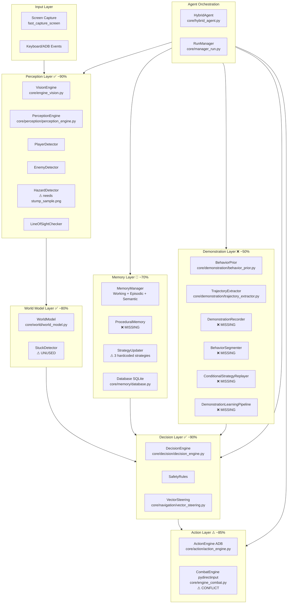
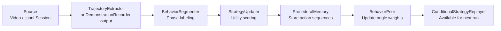
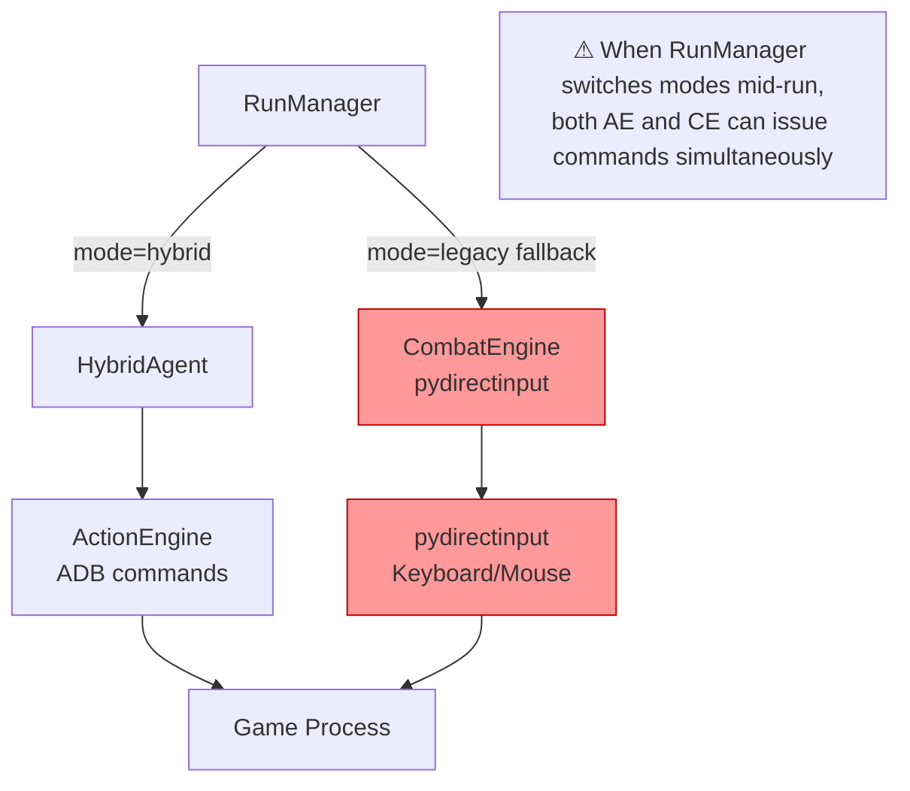
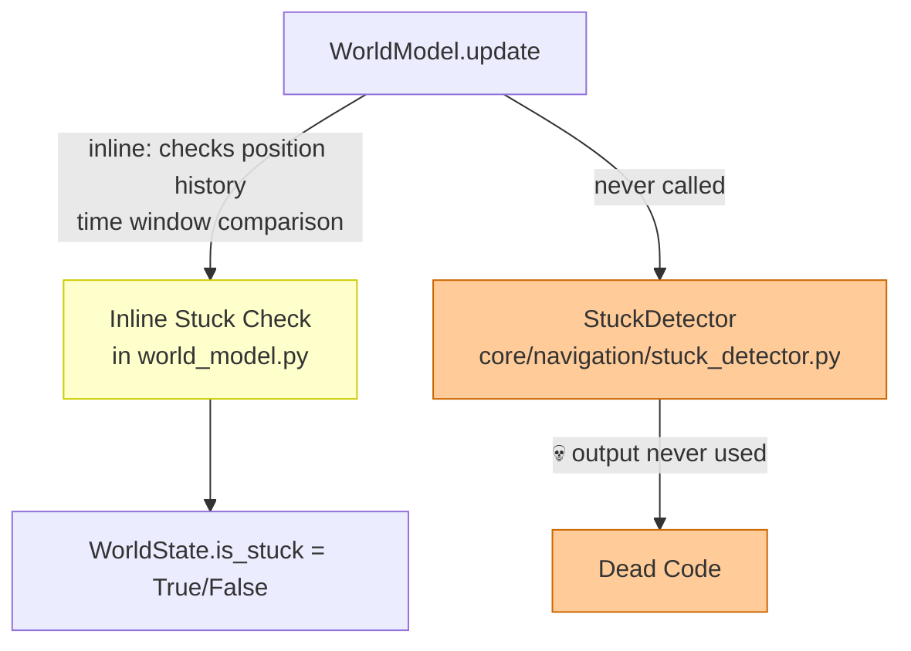
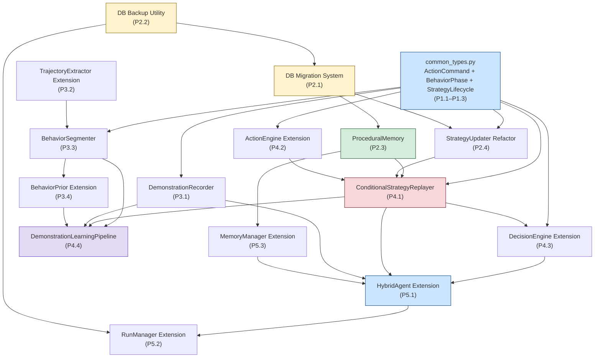
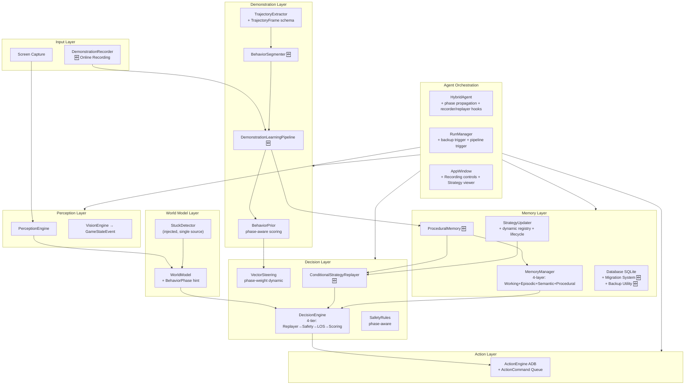

# ARCHITECTURE GAP ANALYSIS
## TribalIslandBot – Hybrid Demonstration Learning Bot

> **Document Version:** 1.0  
> **Date:** 2026-11-17  
> **Author:** Architecture Agent (auto-generated via reverse engineering)  
> **Status:** DRAFT – Pending review by coordinator

---

## Table of Contents

1. [Executive Summary](#1-executive-summary)
2. [System Overview Diagram](#2-system-overview-diagram)
3. [Full Gap Analysis Table](#3-full-gap-analysis-table)
4. [Missing Modules – Detailed Descriptions](#4-missing-modules--detailed-descriptions)
5. [Critical Conflicts & Duplications](#5-critical-conflicts--duplications)
6. [Priority Ordering of Gaps to Resolve](#6-priority-ordering-of-gaps-to-resolve)
7. [Dependency Constraints](#7-dependency-constraints)
8. [Target Architecture – After Gaps Resolved](#8-target-architecture--after-gaps-resolved)
9. [Risk Register](#9-risk-register)
10. [Glossary](#10-glossary)

---

## 1. Executive Summary

TribalIslandBot is a **Hybrid Demonstration Learning** agent designed to play the game *Tribal Island* autonomously. It combines:

- **Reactive control** (rule-based safety rules, vector-steering navigation)
- **Memory-driven strategy** (SQLite-backed episodic + semantic memory)
- **Demonstration learning** (imitation from human-recorded trajectories)

### Current State (as-built)

The codebase is **approximately 65% complete** relative to the full target architecture. The five primary layers are present in skeleton form:

| Layer | Completeness | Key Gap |
|---|---|---|
| **Perception** | ~90% | Missing `stump_sample.png` asset |
| **Action** | ~85% | Dual control-path conflict (ADB vs pydirectinput) |
| **World Model** | ~80% | `stuck_start_time` dead code; `StuckDetector` unused |
| **Decision** | ~90% | Fully functional, minor extension needed |
| **Memory** | ~70% | Missing Procedural Memory layer |
| **Demonstration** | ~50% | Missing Recorder, Segmenter, Replayer, Pipeline |
| **Infrastructure** | ~40% | Missing DB migrations, backup, strategy lifecycle |

<!-- 
  Tóm tắt: Bot đang ở khoảng 65% so với kiến trúc mục tiêu.
  Phần Demonstration Learning là phần thiếu nhiều nhất.
-->

### Critical Findings

1. **Two competing control paths** (`ActionEngine` ADB vs `CombatEngine` pydirectinput) create an unresolved conflict when `RunManager` runs in `hybrid` mode while `CombatEngine` is also referenced.
2. **`StuckDetector`** is a fully implemented class that is **never called** – stuck detection is duplicated inline inside `WorldModel`.
3. **`WorldModel.stuck_start_time`** is assigned but **never read** – dead code that could cause confusion.
4. The **Demonstration Learning pipeline** is the largest gap: `DemonstrationRecorder`, `BehaviorSegmenter`, `ConditionalStrategyReplayer`, and the unifying `DemonstrationLearningPipeline` are all absent.
5. **ProceduralMemory** is architecturally required (the fourth memory tier) but entirely unimplemented.
6. **Strategy versioning** (Observed → Candidate → Validated → Deprecated lifecycle) does not exist; `StrategyUpdater` works with 3 hardcoded strategy names only.
7. **No database migration system** – schema changes require manual SQL edits.

---

## 2. System Overview Diagram



<!-- 
  Biểu đồ tổng quan hệ thống. 
  ✅ = hoàn chỉnh, ⚠ = có vấn đề, ❌ = thiếu, 🔶 = một phần.
-->

---

## 3. Full Gap Analysis Table

> **Classification Legend:**
> - `EXISTING_AND_REUSABLE` – Works as-is, no changes needed
> - `EXISTING_NEEDS_EXTENSION` – Core logic good, needs new features added
> - `EXISTING_NEEDS_REFACTOR` – Logic present but structurally problematic; must be restructured
> - `MISSING` – Does not exist; must be created from scratch
> - `DUPLICATED` – Logic exists in two places simultaneously; one must be removed
> - `DEPRECATED` – Superseded by a newer module; schedule for removal

| # | Module | File Path | Current State | Classification | Required State (Target) | Gap Description | Proposed Action |
|---|---|---|---|---|---|---|---|
| 1 | `CommonTypes` | `core/common_types.py` | Dataclasses: Entity, PerceptionResult, WorldState, SteeringCommand. Fully typed. | `EXISTING_AND_REUSABLE` | Add `ActionCommand` dataclass; add `BehaviorPhase` enum; add `StrategyLifecycle` enum | Missing `ActionCommand` queue type; missing `BehaviorPhase` enum for segmenter; missing `StrategyLifecycle` enum | Add new dataclasses/enums in-place. No breaking changes to existing types. |
| 2 | `ActionEngine` | `core/action/action_engine.py` | ADB-based. Implements: `move_angle`, `tap`, `swipe`, `attack`, `heal`, `select_perk`, `execute_command`. Unified. | `EXISTING_NEEDS_EXTENSION` | Accept `ActionCommand` queue; expose `is_busy()` and `cancel_current()` for replayer; add action logging hook | No `ActionCommand` queue pattern; no cancellation mechanism; no replay-safe interface | Wrap `execute_command` to accept `ActionCommand`; add `ActionQueue` consumer; expose cancellation API. |
| 3 | `PerceptionEngine` | `core/perception/perception_engine.py` | Orchestrates Player/Enemy/Hazard detectors via VisionEngine. Fully integrated. | `EXISTING_AND_REUSABLE` | Same; minor: expose `last_perception_ms` latency metric | No latency telemetry | Add timing wrapper; no structural change. |
| 4 | `PlayerDetector` | `core/perception/detector_player.py` | HSV green bar detection. Complete. | `EXISTING_AND_REUSABLE` | Same | None | No action required. |
| 5 | `EnemyDetector` | `core/perception/detector_enemy.py` | HSV red bar detection. Complete. | `EXISTING_AND_REUSABLE` | Same | None | No action required. |
| 6 | `HazardDetector` | `core/perception/detector_hazard.py` | Template + HSV wood color detection. Logic complete. | `EXISTING_NEEDS_EXTENSION` | Same logic + `stump_sample.png` asset present in `assets/` | Missing `stump_sample.png` template image; will raise FileNotFoundError at runtime | Create/capture `stump_sample.png` from game footage and place in `assets/`. |
| 7 | `LineOfSightChecker` | `core/perception/line_of_sight.py` | Segment-circle intersection algorithm. Complete. | `EXISTING_AND_REUSABLE` | Same | None | No action required. |
| 8 | `WorldModel` | `core/world/world_model.py` | Stuck detection (inline), LOS, escape angle. `stuck_start_time` assigned but never read. | `EXISTING_NEEDS_REFACTOR` | Delegate stuck detection to `StuckDetector`; remove dead `stuck_start_time` field; expose `BehaviorPhase` hint for segmenter | Inline stuck detection duplicates `StuckDetector`; `stuck_start_time` is dead code | Refactor: remove inline stuck logic, inject `StuckDetector`; delete `stuck_start_time`; add phase hint property. |
| 9 | `VectorSteering` | `core/navigation/vector_steering.py` | 8-direction scoring with weights `w_s, w_d, w_l, w_m, w_demo`. Has `BehaviorPrior` hook. | `EXISTING_NEEDS_EXTENSION` | Accept `ConditionalStrategyReplayer` override weight `w_replay`; support dynamic weight injection per `BehaviorPhase` | Only static weights; no phase-aware dynamic weighting; replayer not yet wired | Add `set_phase_weights(phase, weights_dict)` method; add `w_replay` weight slot. |
| 10 | `StuckDetector` | `core/navigation/stuck_detector.py` | Time-window position tracking. Complete but **never instantiated or called** in main loop. | `DUPLICATED` | Become the single source of truth for stuck detection; used by `WorldModel` via injection | `WorldModel` has its own stuck detection making this class dead code | **Inject** `StuckDetector` into `WorldModel.__init__`; remove `WorldModel`'s inline stuck logic. |
| 11 | `DecisionEngine` | `core/decision/decision_engine.py` | 3-tier: Safety → LOS → Scoring. Complete. | `EXISTING_NEEDS_EXTENSION` | Add 4th tier: `ReplayerOverride` (checked before Safety only for safe replays); accept `BehaviorPhase` context | No replayer override tier; no phase context propagation | Add optional `replayer_override(world_state)` tier; pass `phase` to `SafetyRules`. |
| 12 | `SafetyRules` | `core/decision/safety_rules.py` | HP critical, enemy close, stuck, low confidence checks. Complete. | `EXISTING_AND_REUSABLE` | Same; optionally receive `BehaviorPhase` to relax/tighten thresholds per phase | No phase-aware threshold modulation | Minor: accept optional `phase` param; default behavior unchanged. |
| 13 | `Database` | `core/memory/database.py` | SQLite, 4 tables: `runs`, `floor_records`, `battle_events`, `strategy_stats`. Complete schema. | `EXISTING_NEEDS_EXTENSION` | Add 2 new tables: `procedural_memory`, `demonstration_segments`; add migration runner; add backup utility | No migration system; no backup strategy; no tables for procedural/demo data | Add `migrate.py` runner; add `backup_db()` function; add new table DDL via migration files. |
| 14 | `MemoryManager` | `core/memory/memory_manager.py` | 3-layer: Working / Episodic / Semantic. Partial. | `EXISTING_NEEDS_EXTENSION` | 4-layer: Working / Episodic / Semantic / **Procedural** | Missing Procedural Memory layer entirely | Add `ProceduralMemory` class; wire into `MemoryManager` as 4th layer. |
| 15 | `ProceduralMemory` | `core/memory/procedural_memory.py` | **Does not exist.** | `MISSING` | Stores learned action sequences (macro-skills): how to escape corners, how to approach enemies, kiting patterns. Persistent in SQLite. | Entirely absent | **Create** `ProceduralMemory` class: store/retrieve `(context_hash → action_sequence)`; backed by `procedural_memory` DB table. |
| 16 | `StrategyUpdater` | `core/memory/strategy_updater.py` | Utility Score `U = 0.4C + 0.3S + 0.2E + 0.1T`. Limited to 3 hardcoded strategy names. | `EXISTING_NEEDS_REFACTOR` | Dynamic strategy registry; support strategy lifecycle: Observed → Candidate → Validated → Deprecated; unbounded strategy names | 3 hardcoded strategies is a hard ceiling; no lifecycle tracking; no version history | Refactor: replace hardcoded list with DB-backed registry; add `StrategyLifecycle` state machine; version strategies. |
| 17 | `BehaviorPrior` | `core/demonstration/behavior_prior.py` | Loads JSON trajectories, scores candidate angles. Basic implementation. | `EXISTING_NEEDS_EXTENSION` | Accept input from `BehaviorSegmenter` (phase-tagged segments); weight scores by segment phase and confidence | Loads raw trajectories with no phase awareness; no confidence weighting per segment type | Add `load_segments(segmented_data)` method; weight angle scores by `BehaviorPhase` and segment confidence. |
| 18 | `TrajectoryExtractor` | `core/demonstration/trajectory_extractor.py` | Video analysis. Extracts: `angle`, `speed`, `enemy_dist`. Complete. | `EXISTING_NEEDS_EXTENSION` | Also extract: `player_hp_pct`, `action_type` (move/attack/heal/retreat); feed into `BehaviorSegmenter` | Missing HP and action-type extraction; output format not yet compatible with `BehaviorSegmenter` input schema | Add HP% and action-type extraction; define output schema `TrajectoryFrame`; adapter for `BehaviorSegmenter`. |
| 19 | `DemonstrationRecorder` | `core/demonstration/demonstration_recorder.py` | **Does not exist.** | `MISSING` | Synchronized recording: `WorldState + Screenshot + ActionCommand + Timestamp` at each game tick during human play. Output: `.jsonl` session files. | Entirely absent; only offline video extraction exists | **Create** `DemonstrationRecorder` class: hook into `HybridAgent` tick loop; serialize `RecordedFrame` to `.jsonl`; support start/stop/pause. |
| 20 | `BehaviorSegmenter` | `core/demonstration/behavior_segmenter.py` | **Does not exist.** | `MISSING` | Segments recorded/extracted trajectories into labeled phases: `APPROACH / COMBAT / RETREAT / STUCK / IDLE`. Outputs `BehaviorSegment` list with phase, start_idx, end_idx, confidence. | Entirely absent; no phase labeling anywhere in pipeline | **Create** `BehaviorSegmenter`: rule-based segmentation using HP%, enemy proximity, speed, action_type thresholds; output typed `BehaviorSegment` dataclass list. |
| 21 | `ConditionalStrategyReplayer` | `core/demonstration/conditional_strategy_replayer.py` | **Does not exist.** | `MISSING` | Looks up stored strategies by `(BehaviorPhase, context_hash)`; checks preconditions; replays `ActionCommand` sequence if conditions met; reports outcome. | Entirely absent; `BehaviorPrior` only injects a score hint, never replays concrete action sequences | **Create** `ConditionalStrategyReplayer`: query `ProceduralMemory`; evaluate preconditions; execute via `ActionEngine`; record outcome to `StrategyUpdater`. |
| 22 | `DemonstrationLearningPipeline` | `core/demonstration/demonstration_pipeline.py` | **Does not exist.** | `MISSING` | Orchestrates the full offline learning flow: `TrajectoryExtractor / DemonstrationRecorder → BehaviorSegmenter → StrategyUpdater → ProceduralMemory`. CLI-runnable or GUI-triggerable. | No unified pipeline; steps are disconnected modules with incompatible I/O schemas | **Create** `DemonstrationLearningPipeline`: define canonical I/O contracts between stages; run sequentially or in stages; expose `run_pipeline(source)` API. |
| 23 | `ActionCommand` | `core/common_types.py` (new dataclass) | **Does not exist as a type.** `SteeringCommand` exists but is angle-only. | `MISSING` | Formal `ActionCommand(type, params, priority, ttl_ms)` dataclass; used by `ActionEngine` queue and `ConditionalStrategyReplayer` | No formal command abstraction; no priority or TTL; no queue pattern | Add `ActionCommand` dataclass to `common_types.py`; add `ActionQueue` to `action_engine.py`. |
| 24 | `StrategyLifecycle` | `core/memory/strategy_updater.py` | **Does not exist as a type.** | `MISSING` | Enum: `Observed → Candidate → Validated → Deprecated`; stored in `strategy_stats` table as a column | No lifecycle tracking; strategies have no promotion/demotion logic | Add `StrategyLifecycle` enum to `common_types.py`; add `lifecycle` column to `strategy_stats` via migration; add promotion logic to `StrategyUpdater`. |
| 25 | `DB Migration System` | `core/memory/migrations/` | **Does not exist.** | `MISSING` | Versioned migration files (`001_initial.sql`, `002_add_procedural.sql`, …); `MigrationRunner` applies unapplied migrations on startup | Schema changes require manual SQL; no version tracking | **Create** `migrations/` folder; `MigrationRunner` class; `schema_version` table; migration files for all existing + new tables. |
| 26 | `DB Backup Utility` | `core/memory/db_backup.py` | **Does not exist.** | `MISSING` | `backup_db(src, dest_dir)`: copies SQLite WAL-safe; scheduled on `RunManager` lifecycle events (end of run, before schema migration) | No backup; a corrupt DB loses all learned strategies permanently | **Create** `db_backup.py`: use `sqlite3` online backup API; call from `RunManager.on_run_end()` and before migrations. |
| 27 | `HybridAgent` | `core/hybrid_agent.py` | Main agent loop. Integrates all 5 layers. Complete for current architecture. | `EXISTING_NEEDS_EXTENSION` | Wire in: `DemonstrationRecorder` (tick hook), `ConditionalStrategyReplayer` (decision tier), `ProceduralMemory` (memory layer), `BehaviorPhase` propagation | Missing hooks for recorder, replayer; no phase propagation through tick loop | Add `_phase: BehaviorPhase` field updated each tick; inject `DemonstrationRecorder`; add replayer check in tick. |
| 28 | `RunManager` | `core/manager_run.py` | Lifecycle management. Dual mode: `hybrid + legacy`. Complete. | `EXISTING_NEEDS_EXTENSION` | Add: `on_run_end()` triggers DB backup; `run_pipeline(source)` triggers `DemonstrationLearningPipeline`; remove legacy mode if `CombatEngine` conflict resolved | No DB backup trigger; no pipeline trigger; legacy mode conflict with hybrid | Add backup call; add pipeline trigger; guard legacy mode behind explicit flag. |
| 29 | `CombatEngine` | `core/engine_combat.py` | Legacy pydirectinput-based. Kiting pattern. | `DEPRECATED` | Replaced by `ActionEngine` (ADB) + `ConditionalStrategyReplayer` (kiting strategy from demonstration). Keep as fallback only under explicit `--legacy` flag. | Conflict with `ActionEngine` when both are active; pydirectinput and ADB cannot both control the game safely | **Deprecate**: gate behind `--legacy` CLI flag; add `DeprecationWarning`; plan removal in v2.0 when replayer covers kiting. |
| 30 | `VisionEngine` | `core/engine_vision.py` | HP%, floor OCR, lobby/levelup/end detection. | `EXISTING_AND_REUSABLE` | Same; expose structured `GameStateEvent` output for `HybridAgent` to consume | Currently returns raw values; `HybridAgent` does ad-hoc checks | Minor: wrap return values in typed `GameStateEvent` dataclass for cleaner consumption. |
| 31 | `GUI (AppWindow)` | `gui/app_window.py` | Exists. | `EXISTING_NEEDS_EXTENSION` | Add: recording start/stop button; pipeline trigger button; strategy viewer panel | No recording controls; no pipeline UI | Add controls for `DemonstrationRecorder`; add pipeline status panel; add strategy lifecycle viewer. |

---

## 4. Missing Modules – Detailed Descriptions

<!-- Mô tả chi tiết các module còn thiếu và hợp đồng API của chúng -->

### 4.1 `DemonstrationRecorder`
**File:** `core/demonstration/demonstration_recorder.py`

Records synchronized observations during human gameplay for offline learning.

```python
# Mỗi tick trong vòng lặp game sẽ ghi lại một RecordedFrame
@dataclass
class RecordedFrame:
    timestamp_ms: int           # Wall-clock ms since session start
    world_state: WorldState     # Full perception snapshot
    screenshot_path: str        # Path to saved PNG (optional, by config)
    action_command: ActionCommand | None  # What action was issued this tick
    phase_hint: BehaviorPhase   # Optionally auto-labelled

class DemonstrationRecorder:
    def start_session(self, session_id: str) -> None: ...
    def record_tick(self, frame: RecordedFrame) -> None: ...
    def stop_session(self) -> Path:  # Returns path to .jsonl output
        ...
    def pause(self) -> None: ...
    def resume(self) -> None: ...
```

**Output format:** `.jsonl` file, one `RecordedFrame` JSON per line.

---

### 4.2 `BehaviorSegmenter`
**File:** `core/demonstration/behavior_segmenter.py`

Segments a trajectory (from `TrajectoryExtractor` or `DemonstrationRecorder`) into labeled behavioral phases.

```python
class BehaviorPhase(Enum):
    APPROACH = "approach"   # Moving toward enemy, HP safe
    COMBAT   = "combat"     # Attacking, close range
    RETREAT  = "retreat"    # Moving away, HP low or enemy close
    STUCK    = "stuck"      # Minimal movement, repeated positions
    IDLE     = "idle"       # No enemies, low activity

@dataclass
class BehaviorSegment:
    phase: BehaviorPhase
    start_idx: int
    end_idx: int
    confidence: float       # 0.0–1.0 based on signal strength
    metadata: dict          # avg_speed, avg_hp, avg_enemy_dist, etc.

class BehaviorSegmenter:
    def segment(self, frames: list[TrajectoryFrame]) -> list[BehaviorSegment]: ...
```

**Segmentation rules (rule-based, v1):**

| Phase | Condition |
|---|---|
| `RETREAT` | `hp_pct < 0.35` OR (`enemy_dist < 80px` AND `action == HEAL`) |
| `COMBAT` | `enemy_dist < 120px` AND `action == ATTACK` AND `hp_pct >= 0.35` |
| `APPROACH` | `enemy_dist > 120px` AND `speed > 0.3` AND `hp_pct >= 0.35` |
| `STUCK` | `speed < 0.05` for `> 2.0s` |
| `IDLE` | No enemies visible, `speed < 0.1` |

---

### 4.3 `ConditionalStrategyReplayer`
**File:** `core/demonstration/conditional_strategy_replayer.py`

Checks preconditions and replays stored action sequences from `ProceduralMemory`.

```python
class ConditionalStrategyReplayer:
    def __init__(self, procedural_memory: ProceduralMemory,
                 action_engine: ActionEngine,
                 strategy_updater: StrategyUpdater): ...

    def should_replay(self, world_state: WorldState,
                      phase: BehaviorPhase) -> bool: ...

    def replay(self, world_state: WorldState,
               phase: BehaviorPhase) -> ReplayOutcome: ...
```

**Precondition checks before replay:**

1. `world_state.player_hp_pct > SAFETY_THRESHOLD` (don't replay during critical HP)
2. `world_state.enemy_count <= MAX_ENEMIES_FOR_REPLAY`
3. Strategy in `Candidate` or `Validated` lifecycle state
4. No safety rule override active

---

### 4.4 `ProceduralMemory`
**File:** `core/memory/procedural_memory.py`

Stores learned macro-skills as reusable action sequences.

```python
class ProceduralMemory:
    def store(self, context_hash: str, 
              phase: BehaviorPhase,
              action_sequence: list[ActionCommand],
              source: str = "demonstration") -> None: ...

    def retrieve(self, context_hash: str,
                 phase: BehaviorPhase) -> list[ActionCommand] | None: ...

    def list_all(self) -> list[ProceduralEntry]: ...
    def invalidate(self, entry_id: int) -> None: ...
```

**DB backing:** `procedural_memory` table (added via migration `002`):

```sql
-- Thêm vào migration 002_add_procedural.sql
CREATE TABLE IF NOT EXISTS procedural_memory (
    id              INTEGER PRIMARY KEY AUTOINCREMENT,
    context_hash    TEXT NOT NULL,
    phase           TEXT NOT NULL,
    action_sequence TEXT NOT NULL,  -- JSON array of ActionCommand
    source          TEXT DEFAULT 'demonstration',
    use_count       INTEGER DEFAULT 0,
    success_rate    REAL DEFAULT 0.0,
    lifecycle       TEXT DEFAULT 'Observed',
    created_at      REAL NOT NULL,
    updated_at      REAL NOT NULL
);
```

---

### 4.5 `DemonstrationLearningPipeline`
**File:** `core/demonstration/demonstration_pipeline.py`

Orchestrates the full offline learning loop.



```python
class DemonstrationLearningPipeline:
    def run_pipeline(self, source: Path | str,
                     source_type: Literal["video", "session"]) -> PipelineReport: ...

    def run_extraction_stage(self, source: Path) -> list[TrajectoryFrame]: ...
    def run_segmentation_stage(self, frames: list) -> list[BehaviorSegment]: ...
    def run_strategy_stage(self, segments: list) -> list[ProceduralEntry]: ...
    def run_prior_update_stage(self, entries: list) -> None: ...
```

---

### 4.6 `DB Migration System`
**Directory:** `core/memory/migrations/`

```
core/memory/migrations/
├── __init__.py
├── migration_runner.py      # Applies unapplied migrations in order
├── 001_initial_schema.sql   # Existing 4 tables
├── 002_add_procedural.sql   # procedural_memory table
├── 003_add_demo_segments.sql# demonstration_segments table
└── 004_add_lifecycle_col.sql# lifecycle column to strategy_stats
```

```python
class MigrationRunner:
    def __init__(self, db_path: str): ...
    def run_pending(self) -> list[str]:  # Returns applied migration names
        ...
    def current_version(self) -> int: ...
```

---

## 5. Critical Conflicts & Duplications

<!-- Phần này mô tả các xung đột nghiêm trọng cần giải quyết ngay -->

### 5.1 CONFLICT: Dual Control Paths

**Severity:** 🔴 HIGH – Can cause simultaneous ADB + keyboard input, game state corruption.



**Root Cause:** `RunManager` supports `dual mode: hybrid + legacy`. If `hybrid` mode's `HybridAgent` encounters an error and falls through to `CombatEngine`, both control paths may be active concurrently.

**Resolution Plan:**
1. Add `--legacy` CLI flag; `CombatEngine` only instantiated under this flag.
2. Add mutex lock `_control_lock` in `RunManager`; only one engine holds it at a time.
3. Long-term: implement kiting as a `ProceduralMemory` strategy in `ConditionalStrategyReplayer`; deprecate `CombatEngine` entirely.

---

### 5.2 DUPLICATION: StuckDetector vs WorldModel Inline Stuck Detection

**Severity:** 🟡 MEDIUM – Logic inconsistency, maintenance burden, potential divergence.



**Details:**
- `WorldModel` maintains its own position-history list and checks distance thresholds inline.
- `StuckDetector` in `core/navigation/stuck_detector.py` implements the same logic with time-windowed tracking — but is **never instantiated** in `hybrid_agent.py` or anywhere in the main loop.
- `WorldModel.stuck_start_time` is set to `None` in `__init__` and assigned in one place but **never read anywhere** — pure dead code.

**Resolution Plan:**
1. Inject `StuckDetector` into `WorldModel.__init__(self, stuck_detector: StuckDetector)`.
2. Replace `WorldModel`'s inline stuck check with `self.stuck_detector.update(position)` call.
3. Delete `WorldModel.stuck_start_time` field entirely.
4. Update `HybridAgent` to construct `StuckDetector` and pass to `WorldModel`.

---

### 5.3 DEAD CODE: `WorldModel.stuck_start_time`

**Severity:** 🟢 LOW – Cosmetic but confusing.

| Location | Issue |
|---|---|
| `world_model.py __init__` | `self.stuck_start_time = None` |
| `world_model.py update()` | `self.stuck_start_time = time.time()` (assigned but never read) |
| Everywhere else | No reads of `stuck_start_time` |

**Resolution:** Delete field. It was likely intended to track when a stuck state began, but `stuck_duration` from `blocked_los` path is used instead.

---

## 6. Priority Ordering of Gaps to Resolve

<!-- Thứ tự ưu tiên giải quyết các khoảng thiếu hụt -->

Priorities are assigned based on: **blocking impact** (how many other modules depend on it), **risk** (what breaks without it), and **effort** (relative development cost).

### Phase 0 – Immediate Fixes (No new modules required)

| Priority | Item | Effort | Reason |
|---|---|---|---|
| P0.1 | Resolve `StuckDetector` duplication | XS (1–2h) | Removes confusion; no behavior change |
| P0.2 | Delete `WorldModel.stuck_start_time` dead code | XS (30m) | Prevents future confusion |
| P0.3 | Add `stump_sample.png` asset | XS (1h) | Prevents `FileNotFoundError` crash |
| P0.4 | Gate `CombatEngine` behind `--legacy` flag | S (2–4h) | Prevents dual-control conflict |

### Phase 1 – Type System Foundation

| Priority | Item | Effort | Reason |
|---|---|---|---|
| P1.1 | Add `ActionCommand` dataclass to `common_types.py` | S (2h) | Required by ActionEngine, Replayer, Recorder |
| P1.2 | Add `BehaviorPhase` enum to `common_types.py` | XS (1h) | Required by Segmenter, Steering, Decision |
| P1.3 | Add `StrategyLifecycle` enum to `common_types.py` | XS (1h) | Required by StrategyUpdater refactor |
| P1.4 | Wrap `VisionEngine` returns in `GameStateEvent` | S (2–3h) | Cleaner `HybridAgent` tick loop |

### Phase 2 – Infrastructure

| Priority | Item | Effort | Reason |
|---|---|---|---|
| P2.1 | DB Migration System (`MigrationRunner` + migration files) | M (4–6h) | Required before any new DB tables |
| P2.2 | DB Backup Utility | S (2h) | Required before data loss risk from migrations |
| P2.3 | `ProceduralMemory` class + DB table (migration 002) | M (4–6h) | Required by Replayer and Pipeline |
| P2.4 | Refactor `StrategyUpdater` with dynamic registry + lifecycle | M (6–8h) | Required for strategy versioning |

### Phase 3 – Demonstration Recording

| Priority | Item | Effort | Reason |
|---|---|---|---|
| P3.1 | `DemonstrationRecorder` | M (6–8h) | Enables online synchronized recording |
| P3.2 | Extend `TrajectoryExtractor` output schema (`TrajectoryFrame`) | S (3–4h) | Required by `BehaviorSegmenter` |
| P3.3 | `BehaviorSegmenter` | M (6–8h) | Required by Pipeline and BehaviorPrior extension |
| P3.4 | Extend `BehaviorPrior` with phase-aware scoring | S (3–4h) | Required by VectorSteering phase-weight injection |

### Phase 4 – Replay & Integration

| Priority | Item | Effort | Reason |
|---|---|---|---|
| P4.1 | `ConditionalStrategyReplayer` | L (8–12h) | Core demonstration-to-action bridge |
| P4.2 | Extend `ActionEngine` with `ActionCommand` queue + cancellation | M (4–6h) | Required by Replayer |
| P4.3 | Extend `DecisionEngine` with replayer override tier | S (3–4h) | Wires replayer into decision flow |
| P4.4 | `DemonstrationLearningPipeline` | M (6–8h) | Ties all demonstration modules together |

### Phase 5 – Agent & GUI Integration

| Priority | Item | Effort | Reason |
|---|---|---|---|
| P5.1 | Extend `HybridAgent` with phase propagation + recorder/replayer hooks | M (4–6h) | End-to-end integration |
| P5.2 | Extend `RunManager` with backup trigger + pipeline trigger | S (2–3h) | Lifecycle completeness |
| P5.3 | Extend `MemoryManager` with `ProceduralMemory` as 4th layer | S (2–3h) | Memory architecture completeness |
| P5.4 | Extend `GUI` with recording controls + strategy viewer | L (8–16h) | Operator usability |

---

## 7. Dependency Constraints

<!-- Ràng buộc phụ thuộc: module nào phải tồn tại trước module nào -->



### Constraint Summary Table

| Module | Must come AFTER | Must come BEFORE |
|---|---|---|
| `ActionCommand` type | — | `ActionEngine ext`, `DemonstrationRecorder`, `ConditionalStrategyReplayer` |
| `BehaviorPhase` type | — | `BehaviorSegmenter`, `BehaviorPrior ext`, `VectorSteering ext`, `DecisionEngine ext` |
| `StrategyLifecycle` type | — | `StrategyUpdater refactor` |
| `DB Backup Utility` | — | `DB Migration System` (must backup before migrating) |
| `DB Migration System` | `DB Backup Utility` | `ProceduralMemory`, `StrategyUpdater refactor` |
| `ProceduralMemory` | `DB Migration System`, `ActionCommand` | `ConditionalStrategyReplayer`, `MemoryManager ext` |
| `StrategyUpdater refactor` | `DB Migration System`, `StrategyLifecycle` | `ConditionalStrategyReplayer` |
| `TrajectoryExtractor ext` | `BehaviorPhase` | `BehaviorSegmenter` |
| `BehaviorSegmenter` | `BehaviorPhase`, `TrajectoryExtractor ext` | `BehaviorPrior ext`, `DemonstrationLearningPipeline` |
| `DemonstrationRecorder` | `ActionCommand`, `BehaviorPhase` | `HybridAgent ext`, `DemonstrationLearningPipeline` |
| `BehaviorPrior ext` | `BehaviorSegmenter` | `DemonstrationLearningPipeline` |
| `ActionEngine ext` | `ActionCommand` | `ConditionalStrategyReplayer` |
| `ConditionalStrategyReplayer` | `ProceduralMemory`, `StrategyUpdater refactor`, `ActionEngine ext`, `BehaviorPhase` | `DecisionEngine ext`, `DemonstrationLearningPipeline`, `HybridAgent ext` |
| `DecisionEngine ext` | `ConditionalStrategyReplayer`, `BehaviorPhase` | `HybridAgent ext` |
| `DemonstrationLearningPipeline` | `DemonstrationRecorder`, `BehaviorSegmenter`, `BehaviorPrior ext`, `ConditionalStrategyReplayer` | — (terminal) |
| `MemoryManager ext` | `ProceduralMemory` | `HybridAgent ext` |
| `HybridAgent ext` | `DecisionEngine ext`, `ConditionalStrategyReplayer`, `DemonstrationRecorder`, `MemoryManager ext` | `RunManager ext` |
| `RunManager ext` | `HybridAgent ext`, `DB Backup Utility` | — (terminal) |

---

## 8. Target Architecture – After Gaps Resolved



<!-- 
  Kiến trúc mục tiêu sau khi lấp đầy tất cả khoảng thiếu.
  🆕 = module mới cần tạo.
-->

---

## 9. Risk Register

| Risk | Probability | Impact | Mitigation |
|---|---|---|---|
| `CombatEngine` + `ActionEngine` both issue simultaneous inputs | Medium | 🔴 High – game state corruption | P0.4: Gate CombatEngine behind `--legacy` flag immediately |
| DB schema migration fails mid-run, corrupts SQLite file | Low | 🔴 High – all learned strategies lost | P2.2: Implement backup utility; backup before every migration |
| `stump_sample.png` missing causes crash on floor with stumps | High | 🟡 Medium – crash, run lost | P0.3: Capture asset from footage immediately |
| `BehaviorSegmenter` rule thresholds misaligned with actual gameplay | Medium | 🟡 Medium – poor learning quality | Tune thresholds against 10+ recorded sessions before prod use |
| `ConditionalStrategyReplayer` replays stale strategy in unsafe state | Low | 🔴 High – safety rules bypassed | Safety-rule check inside `should_replay()`; never replay at critical HP |
| `DemonstrationLearningPipeline` processes corrupt `.jsonl` | Medium | 🟢 Low – silent bad data | Add schema validation step at pipeline entry; log and skip bad frames |
| `StrategyUpdater` refactor breaks existing 3 hardcoded strategies | Medium | 🟡 Medium – regressions | Write unit tests for existing strategies before refactoring |

---

## 10. Glossary

| Term | Definition |
|---|---|
| **ActionCommand** | Formal dataclass representing a discrete agent action with type, params, priority, TTL |
| **BehaviorPhase** | Enum describing current behavioral context: APPROACH, COMBAT, RETREAT, STUCK, IDLE |
| **BehaviorPrior** | Module that injects demonstration-derived angle biases into VectorSteering scoring |
| **BehaviorSegmenter** | Module that labels trajectory frames with BehaviorPhase tags |
| **ConditionalStrategyReplayer** | Module that checks preconditions and replays stored action sequences |
| **DemonstrationLearningPipeline** | Orchestrator connecting all demonstration modules into a single runnable flow |
| **DemonstrationRecorder** | Module that records synchronized WorldState+Action+Timestamp during human play |
| **ProceduralMemory** | 4th memory tier storing learned macro-skill action sequences keyed by context |
| **StrategyLifecycle** | Enum: Observed → Candidate → Validated → Deprecated; tracks strategy maturity |
| **SteeringCommand** | Existing dataclass: angle + speed for navigation output |
| **TrajectoryFrame** | Extended output of TrajectoryExtractor: angle + speed + enemy_dist + hp_pct + action_type |
| **WorldModel** | Module maintaining world state including stuck detection, LOS, escape angle |
| **w_demo** | VectorSteering weight for demonstration prior influence |
| **w_replay** | (New) VectorSteering weight for ConditionalStrategyReplayer override influence |
| **U score** | StrategyUpdater utility score: U = 0.4·Completion + 0.3·Survival + 0.2·Efficiency + 0.1·Time |

---

*End of ARCHITECTURE_GAP_ANALYSIS.md*  
*— Generated by architecture analysis agent, TribalIslandBot v1.x gap analysis pass —*

<!-- 
  Tài liệu này được tạo tự động từ kỹ thuật đảo ngược codebase.
  Cập nhật tài liệu này khi các module được tạo hoặc thay đổi.
  Vietnamese comments included throughout for local team clarity.
-->
