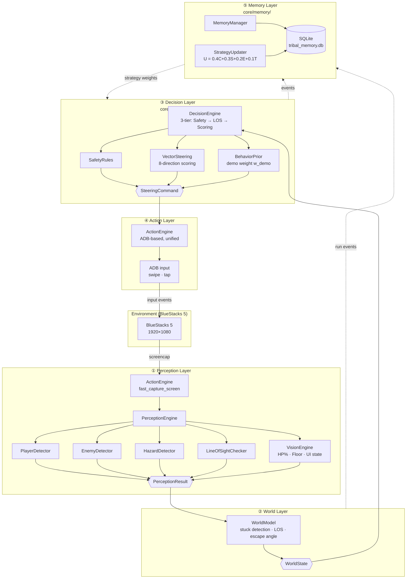
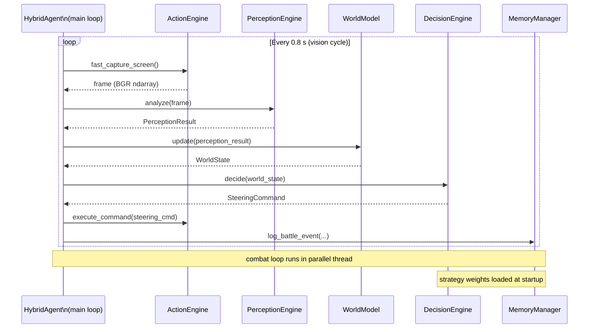
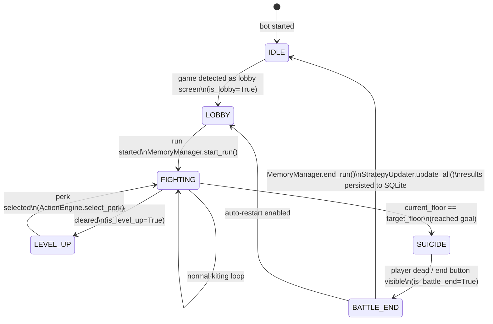
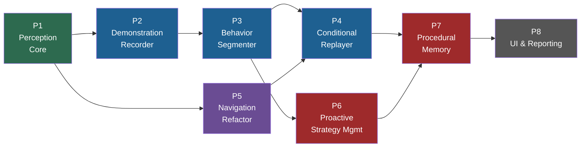

# TribalIslandBot — Architecture Overview

> **Document type:** Technical Design Specification (TDS)
> **Version:** 1.0 (current architecture P1 + planned extensions P2–P8)
> **Last updated:** 2026-11-17
> **Status:** Living document — update on every architectural change

---

## 1. System Purpose & Scope

**TribalIslandBot** is a fully autonomous game-playing agent for the mobile
game *Tribal Island* (Android), running inside **BlueStacks 5** on a Windows
host. The bot perceives the game through real-time screen capture, reasons
about world state, and issues control inputs via ADB without any game-side
modification.

### 1.1 Goals

| Goal | Description |
|------|-------------|
| **Autonomous floor climbing** | Navigate and fight floors 1 → `target_floor` without human intervention |
| **Adaptive strategy** | Learn from past runs and human demonstrations to improve survival |
| **Safety-first** | Never execute an action that violates the safety invariants (critical HP, imminent death) |
| **Auditability** | Every decision is logged with its reason; every run is stored in SQLite |

### 1.2 Out of Scope

- Game-side code modification or memory hacking
- Multiplayer / PvP modes
- Any platform other than BlueStacks 5 on Windows 11

---

## 2. Environment

| Property | Value |
|---|---|
| **Operating System** | Windows 11 (64-bit) |
| **Emulator** | BlueStacks 5 |
| **Screen Resolution** | 1920 × 1080 px (emulator window) |
| **ADB** | Android Debug Bridge (BlueStacks built-in, port 5555) |
| **Python** | 3.11 |
| **Primary Libraries** | OpenCV 4.x, PySide6, SQLite 3, pydirectinput, adbutils |
| **Persistence** | `data/tribal_memory.db` (SQLite) |

---

## 3. Technology Stack

| Layer | Technology | Purpose |
|---|---|---|
| **Screen Capture** | ADB screencap → OpenCV | Pixel-level game state acquisition |
| **Computer Vision** | OpenCV (HSV color, template matching, Tesseract OCR) | Entity detection, HP reading, UI parsing |
| **Decision / AI** | Pure Python + NumPy vector math | Steering, safety logic, strategy scoring |
| **Input Emulation** | ADB `input swipe / tap` | Touch-event injection into BlueStacks |
| **Persistent Memory** | SQLite 3 (`data/tribal_memory.db`) | Run history, strategy statistics |
| **Demonstration Learning** | JSON trajectory files + OpenCV video analysis | Human-guided behavior priors |
| **GUI** | PySide6 (Qt6) | Control panel, live log view |
| **Concurrency** | Python `threading` | Vision cycle (0.8 s) + combat loop (parallel) |

---

## 4. Five-Layer Architecture

The bot is organised as a strict **unidirectional pipeline**. Data flows
downward from perception to action; memory is a read/write side-channel
available to every layer.



### 4.1 Layer Responsibilities

| Layer | Module(s) | Input | Output | State |
|---|---|---|---|---|
| **Perception** | `PerceptionEngine`, `*Detector`, `VisionEngine`, `LineOfSightChecker` | Raw screenshot (BGR) | `PerceptionResult` | Stateless |
| **World** | `WorldModel` | `PerceptionResult` (stream) | `WorldState` | Stateful (stuck timer, position history) |
| **Decision** | `DecisionEngine`, `SafetyRules`, `VectorSteering`, `BehaviorPrior` | `WorldState` | `SteeringCommand` | Mostly stateless; weights loaded from Memory |
| **Action** | `ActionEngine` | `SteeringCommand` | ADB input events | Stateful (ADB connection) |
| **Memory** | `MemoryManager`, `Database`, `StrategyUpdater` | Events from all layers | Persisted run/strategy data | Stateful (SQLite) |

---

## 5. Component Interaction Diagram



---

## 6. Demonstration Learning Pipeline

```mermaid
flowchart LR
    subgraph RECORD["P2 — Record"]
        HU[Human plays\nor bot plays]
        DR[DemonstrationRecorder\nsynced: WorldState+Screenshot+Action]
        DF{{DemonstrationFrame}}
        HU --> DR --> DF
    end

    subgraph SEGMENT["P3 — Segment"]
        BS_SG[BehaviorSegmenter\nphase detection]
        SEG{{BehaviorSegment\nAPPROACH·COMBAT·RETREAT·STUCK}}
        DF --> BS_SG --> SEG
    end

    subgraph STRATEGY["P7 — Strategy"]
        SC2[StrategyCandidate\nOBSERVED→CANDIDATE]
        SU2[StrategyUpdater\nvalidation & scoring]
        STR{{StrategyCandidate\nVALIDATED/DEPRECATED}}
        SEG --> SC2 --> SU2 --> STR
    end

    subgraph REPLAY["P4 — Replay"]
        CSR[ConditionalStrategyReplayer\nprecondition check]
        RC[ReplayCondition\nmatcher + abort_conditions]
        STR --> CSR
        RC --> CSR
    end

    subgraph DECISION["Decision Layer"]
        BP2[BehaviorPrior\nw_demo weight]
    end

    CSR -->|score influence| BP2
    BP2 -->|weighted angle| VS2[VectorSteering]
```



---

## 7. Run Lifecycle State Machine



**State transition table:**

| From | To | Trigger | Action |
|---|---|---|---|
| `IDLE` | `LOBBY` | `is_lobby=True` in PerceptionResult | Wait for run start |
| `LOBBY` | `FIGHTING` | Run started | `memory.start_run()` |
| `FIGHTING` | `LEVEL_UP` | `is_level_up=True` | `action.select_perk(1)` |
| `FIGHTING` | `SUICIDE` | `current_floor == target_floor` | Enter suicide kiting mode |
| `LEVEL_UP` | `FIGHTING` | Perk confirmed selected | Resume combat loop |
| `SUICIDE` | `BATTLE_END` | `is_battle_end=True` | Tap end button |
| `BATTLE_END` | `IDLE` | Cleanup complete | `memory.end_run()`, `strategy_updater.update_all()` |

---

## 8. Orchestration

### 8.1 HybridAgent (main orchestrator)

```
HybridAgent.__init__()
  ├── ActionEngine()          — ADB connection
  ├── PerceptionEngine()      — vision pipeline
  ├── WorldModel()            — state synthesis
  ├── DecisionEngine()        — 3-tier steering
  ├── MemoryManager()         — run + strategy persistence
  ├── StrategyUpdater(db)     — post-run learning
  └── BehaviorPrior()         — demo-guided steering
```

- **Vision cycle:** every 0.8 s, runs in its own `threading.Thread`
- **Combat loop:** parallel thread executing `SteeringCommand` output
- **Safety invariant:** `SafetyRules` are evaluated first in every `decide()` call; their output pre-empts all other decisions

### 8.2 RunManager (lifecycle wrapper)

Provides dual-mode operation:

| Mode | Orchestrator | Input method |
|---|---|---|
| **Hybrid** (primary) | `HybridAgent` | ADB swipe/tap via `ActionEngine` |
| **Legacy** (fallback) | `CombatEngine` | `pydirectinput` keyboard/mouse |

---

## 9. P1–P8 Dependency Graph



| Phase | Deliverable | Depends on |
|---|---|---|
| **P1** | Current 5-layer architecture (DONE) | — |
| **P2** | `DemonstrationRecorder` + `DemonstrationFrame` | P1 |
| **P3** | `BehaviorSegmenter` + `BehaviorSegment` | P2 |
| **P4** | `ConditionalStrategyReplayer` + `ReplayCondition` | P3, P5 |
| **P5** | Navigation refactor (remove `StuckDetector` duplication) | P1 |
| **P6** | Strategy lifecycle (OBSERVED→VALIDATED→DEPRECATED) | P3 |
| **P7** | `ProceduralMemory` in `MemoryManager` + versioned `StrategyCandidate` | P4, P6 |
| **P8** | GUI dashboards + telemetry export | P7 |

---

## 10. Architecture Invariants

> [!IMPORTANT]
> These rules **MUST NOT** be violated by any new module or refactor.

| # | Invariant | Rationale |
|---|---|---|
| **I-1** | Only **one `ActionEngine`** instance exists; all modules issue `SteeringCommand` and never call ADB directly | Prevents race conditions on the ADB connection |
| **I-2** | **`SafetyRules` have the highest priority** in `DecisionEngine.decide()` and cannot be overridden by learned strategies | Prevents catastrophic unsafe behaviour |
| **I-3** | Persistent storage is **always `data/tribal_memory.db`** (SQLite) — no replacement, no parallel DB | Single source of truth for all run data |
| **I-4** | The **Learning Engine never modifies Python source code** at runtime | Prevents self-modification exploits and undefined behaviour |
| **I-5** | **Combat pattern is kiting**; at `target_floor` the bot enters **suicide mode**; skill slot is always **slot 1** | Game design constraint |
| **I-6** | `PerceptionResult` → `WorldState` → `SteeringCommand` data flow is **unidirectional** | Maintains architectural clarity and testability |

---

## 11. File Tree (current state)

```
TribalIslandBot/
├── core/
│   ├── common_types.py          # Shared dataclasses: Entity, PerceptionResult, WorldState, SteeringCommand
│   ├── hybrid_agent.py          # Main orchestration loop
│   ├── manager_run.py           # Run lifecycle + dual-mode management
│   ├── engine_combat.py         # Legacy CombatEngine (pydirectinput, fallback)
│   ├── engine_vision.py         # Legacy VisionEngine (reusable)
│   ├── engine_adb.py            # Low-level ADB utilities
│   ├── action/
│   │   └── action_engine.py     # Unified ADB action layer
│   ├── perception/
│   │   ├── perception_engine.py
│   │   ├── detector_player.py
│   │   ├── detector_enemy.py
│   │   ├── detector_hazard.py
│   │   ├── line_of_sight.py
│   │   └── (vision_engine used via engine_vision.py)
│   ├── world/
│   │   └── world_model.py
│   ├── decision/
│   │   ├── decision_engine.py
│   │   └── safety_rules.py
│   ├── navigation/
│   │   ├── vector_steering.py
│   │   └── stuck_detector.py    # EXISTS but duplicated by WorldModel — to be resolved P5
│   ├── memory/
│   │   ├── memory_manager.py
│   │   ├── database.py
│   │   └── strategy_updater.py
│   └── demonstration/
│       ├── behavior_prior.py
│       └── trajectory_extractor.py
├── data/
│   └── tribal_memory.db         # SQLite persistence (NEVER move or rename)
├── gui/
│   └── app_window.py
└── docs/
    └── architecture/            # ← this file lives here
```

---

*End of ARCHITECTURE_OVERVIEW.md*
