# TribalIslandBot — Core Data Contracts

> **Document type:** Technical Design Specification (TDS) — Data Contracts
> **Version:** 1.0 (P1 existing + P2–P7 planned)
> **Last updated:** 2026-11-17
> **Source of truth file:** `core/common_types.py`

---

## Table of Contents

1. [Design Principles](#1-design-principles)
2. [Existing Dataclasses (P1 — VERIFIED)](#2-existing-dataclasses-p1--verified)
   - 2.1 Entity
   - 2.2 PerceptionResult
   - 2.3 WorldState
   - 2.4 SteeringCommand
3. [New Dataclasses (P2–P7 — TO BE ADDED)](#3-new-dataclasses-p2p7--to-be-added)
   - 3.1 DemonstrationFrame (P2)
   - 3.2 BehaviorSegment (P3)
   - 3.3 StrategyCandidate (P7)
   - 3.4 ReplayCondition (P4)
4. [Module Interface Contracts](#4-module-interface-contracts)
5. [ActionCommand Queue Pattern](#5-actioncommand-queue-pattern)
6. [SQLite Schema Contract](#6-sqlite-schema-contract)
7. [Error Types & Exception Hierarchy](#7-error-types--exception-hierarchy)
8. [Strategy Lifecycle States](#8-strategy-lifecycle-states)
9. [Contract Evolution Rules](#9-contract-evolution-rules)

---

## 1. Design Principles

| Principle | Description |
|---|---|
| **Immutability at boundaries** | Dataclasses crossing layer boundaries are treated as read-only by the receiving layer |
| **Loose coupling** | No layer imports from a layer above it in the stack |
| **Single source of truth** | All shared types live in `core/common_types.py` |
| **Backward compatibility** | New fields added with defaults; no field may be removed without a migration version bump |
| **Fail-safe defaults** | Every field that influences safety decisions defaults to the most conservative safe value |

---

## 2. Existing Dataclasses (P1 — VERIFIED)

All four types are verified present in `core/common_types.py`.

---

### 2.1 `Entity`

Represents a single detected on-screen entity (player, enemy, obstacle, portal).

```python
@dataclass
class Entity:
    id: int
    category: str
    center_x: int
    center_y: int
    radius: int = 40
    confidence: float = 1.0
    hp_percent: float = 100.0
    velocity: Tuple[float, float] = (0.0, 0.0)

    @property
    def pos(self) -> Tuple[int, int]: ...
```

| Field | Type | Description | Valid Values |
|---|---|---|---|
| `id` | `int` | Unique frame-scoped ID assigned by the detector | ≥ 0 |
| `category` | `str` | Entity class | `'player'`, `'enemy'`, `'boss'`, `'obstacle_stump'`, `'obstacle_wall'`, `'portal'` |
| `center_x` | `int` | X pixel coordinate of entity centre (screen space) | 0 – 1920 |
| `center_y` | `int` | Y pixel coordinate of entity centre (screen space) | 0 – 1080 |
| `radius` | `int` | Approximate collision radius in pixels | > 0, default 40 |
| `confidence` | `float` | Detection confidence from detector | 0.0 – 1.0 |
| `hp_percent` | `float` | Current HP as percentage (read from HP bar) | 0.0 – 100.0 |
| `velocity` | `Tuple[float, float]` | Estimated `(vx, vy)` in px/s, derived from positional delta | Unconstrained |

**Computed property:**

| Property | Returns | Description |
|---|---|---|
| `pos` | `Tuple[int, int]` | `(center_x, center_y)` shorthand |

**Usage notes:**
- `id` is reassigned every frame by the detector — do **not** use as a persistent entity key across frames.
- `velocity` defaults to `(0.0, 0.0)`; it is populated by `PerceptionEngine` when two consecutive frames are compared.
- `confidence < 0.5` entities should be treated as noise by downstream layers.

---

### 2.2 `PerceptionResult`

The complete output of one `PerceptionEngine.analyze()` call. Represents a single frame's worth of parsed game state.

```python
@dataclass
class PerceptionResult:
    timestamp: float = field(default_factory=time.time)
    frame_id: int = 0
    player: Optional[Entity] = None
    enemies: List[Entity] = field(default_factory=list)
    obstacles: List[Entity] = field(default_factory=list)
    portal: Optional[Entity] = None

    # UI state
    hp_percent: float = 100.0
    current_floor: int = 1
    is_level_up: bool = False
    is_lobby: bool = False
    is_battle_end: bool = False
    end_btn_coords: Optional[Tuple[int, int]] = None
    overall_confidence: float = 1.0
```

| Field | Type | Description | Fail-safe Default |
|---|---|---|---|
| `timestamp` | `float` | Unix epoch seconds at frame capture | `time.time()` |
| `frame_id` | `int` | Monotonically increasing frame counter | 0 |
| `player` | `Optional[Entity]` | Player entity; `None` if not detected | `None` |
| `enemies` | `List[Entity]` | All detected enemy entities | `[]` |
| `obstacles` | `List[Entity]` | All detected obstacle entities (stumps, walls) | `[]` |
| `portal` | `Optional[Entity]` | Portal entity if visible | `None` |
| `hp_percent` | `float` | Player HP from green HP bar OCR | `100.0` (assume full if undetected) |
| `current_floor` | `int` | Current dungeon floor from OCR | `1` |
| `is_level_up` | `bool` | Level-up overlay detected | `False` |
| `is_lobby` | `bool` | Lobby screen detected | `False` |
| `is_battle_end` | `bool` | Battle-end overlay detected | `False` |
| `end_btn_coords` | `Optional[Tuple[int, int]]` | Pixel coords of the end/confirm button | `None` |
| `overall_confidence` | `float` | Composite confidence across all detectors | `1.0` |

**Mutual exclusivity contract:**
- At most one of `is_lobby`, `is_level_up`, `is_battle_end` may be `True` at a time.
- If `overall_confidence < 0.3`, downstream layers should treat the result as unreliable and issue a `HOLD` command.

---

### 2.3 `WorldState`

A synthesised, decision-ready representation of the game world, produced by `WorldModel.update()`.

```python
@dataclass
class WorldState:
    timestamp: float = field(default_factory=time.time)
    player_pos: Tuple[int, int] = (960, 540)
    player_hp: float = 100.0
    current_floor: int = 1
    game_state: str = "FIGHTING"

    nearest_enemy: Optional[Entity] = None
    nearest_enemy_dist: float = 9999.0
    enemies_count: int = 0

    has_clear_shot: bool = True
    blocking_obstacle: Optional[Entity] = None

    is_stuck: bool = False
    stuck_duration: float = 0.0
    suggested_escape_angle: Optional[float] = None

    confidence: float = 1.0
```

| Field | Type | Description | Valid Values |
|---|---|---|---|
| `timestamp` | `float` | Unix epoch of this state snapshot | — |
| `player_pos` | `Tuple[int, int]` | Player pixel position `(x, y)` | 0–1920, 0–1080 |
| `player_hp` | `float` | Player HP % forwarded from `PerceptionResult` | 0.0 – 100.0 |
| `current_floor` | `int` | Current floor number | ≥ 1 |
| `game_state` | `str` | High-level game state | `'LOBBY'`, `'FIGHTING'`, `'LEVEL_UP'`, `'FLOOR_EXIT'`, `'DEAD'` |
| `nearest_enemy` | `Optional[Entity]` | Closest enemy entity | — |
| `nearest_enemy_dist` | `float` | Euclidean pixel distance to nearest enemy | ≥ 0.0; `9999.0` if no enemy |
| `enemies_count` | `int` | Total enemies visible | ≥ 0 |
| `has_clear_shot` | `bool` | Line-of-sight to nearest enemy is unobstructed | `True` if no enemy present |
| `blocking_obstacle` | `Optional[Entity]` | The obstacle blocking LOS | `None` if `has_clear_shot` |
| `is_stuck` | `bool` | Player position hasn't changed for ≥ 2 s | `False` |
| `stuck_duration` | `float` | Seconds player has been stuck | 0.0 |
| `suggested_escape_angle` | `Optional[float]` | Best escape angle in degrees, computed by `WorldModel` | 0–360 or `None` |
| `confidence` | `float` | Inherited from `PerceptionResult.overall_confidence` | 0.0 – 1.0 |

---

### 2.4 `SteeringCommand`

The action directive produced by `DecisionEngine.decide()` and consumed by `ActionEngine.execute_command()`.

```python
@dataclass
class SteeringCommand:
    action_type: str = "MOVE"
    angle_degrees: float = 90.0
    distance_ratio: float = 1.0
    duration_ms: int = 400
    perk_index: int = 1
    reason: str = "normal_kiting"
```

| Field | Type | Description | Valid Values |
|---|---|---|---|
| `action_type` | `str` | Action to perform | `'MOVE'`, `'ATTACK'`, `'SKILL'`, `'HEAL'`, `'SELECT_PERK'`, `'HOLD'` |
| `angle_degrees` | `float` | Direction of movement (screen space) | 0 = Right, 90 = Up, 180 = Left, 270 = Down |
| `distance_ratio` | `float` | Joystick deflection ratio | 0.2 – 1.0 |
| `duration_ms` | `int` | How long to hold the input (swipe/keypress) | 50 – 2000 ms |
| `perk_index` | `int` | Which perk to select (only for `SELECT_PERK`) | 1, 2, 3 |
| `reason` | `str` | Human-readable decision reason for logs | Free text |

**`action_type` semantics:**

| `action_type` | `ActionEngine` behaviour | Fields used |
|---|---|---|
| `MOVE` | ADB swipe on joystick from centre | `angle_degrees`, `distance_ratio`, `duration_ms` |
| `ATTACK` | ADB tap on attack button | `duration_ms` |
| `SKILL` | ADB tap on skill slot 1 | `duration_ms` |
| `HEAL` | ADB tap on heal button | `duration_ms` |
| `SELECT_PERK` | ADB tap on perk `perk_index` | `perk_index` |
| `HOLD` | No input emitted; decision deferred | — |

> [!IMPORTANT]
> `HOLD` must never be omitted from `DecisionEngine` logic. It is the safe no-op when confidence is too low to act.

---

## 3. New Dataclasses (P2–P7 — TO BE ADDED)

These types are **planned** for phases P2–P7. They do not yet exist in the codebase. When implemented, they must be added to `core/common_types.py` (or a versioned `core/common_types_v2.py` with re-export from `common_types.py`).

---

### 3.1 `DemonstrationFrame` (P2)

A single timestamped snapshot recorded during a human or bot demonstration session.

```python
from enum import Enum

class FrameSource(str, Enum):
    HUMAN = "HUMAN"
    BOT   = "BOT"

@dataclass
class DemonstrationFrame:
    timestamp: float
    world_state: WorldState
    screenshot_path: str
    action_taken: Optional[SteeringCommand]
    source: FrameSource = FrameSource.BOT
    game_event: Optional[str] = None
```

| Field | Type | Description |
|---|---|---|
| `timestamp` | `float` | Unix epoch of capture |
| `world_state` | `WorldState` | Full world snapshot at this instant |
| `screenshot_path` | `str` | Relative path to saved PNG screenshot (e.g., `data/demos/session_001/frame_0042.png`) |
| `action_taken` | `Optional[SteeringCommand]` | The command issued at this frame; `None` if no action |
| `source` | `FrameSource` | Whether the action came from a human or the bot |
| `game_event` | `Optional[str]` | Named game event at this instant (e.g., `'ENEMY_DIED'`, `'HP_CRITICAL'`, `'FLOOR_CLEARED'`) |

**Storage contract:**
- Frames are serialised to newline-delimited JSON (`.jsonl`) under `data/demos/<session_id>/frames.jsonl`.
- Screenshots are saved as PNG at the path in `screenshot_path`.
- `DemonstrationRecorder` owns writing; `BehaviorSegmenter` owns reading.

---

### 3.2 `BehaviorSegment` (P3)

A contiguous sequence of `DemonstrationFrame`s grouped by detected behavior phase.

```python
class PhaseType(str, Enum):
    APPROACH       = "APPROACH"
    COMBAT         = "COMBAT"
    RETREAT        = "RETREAT"
    STUCK_RECOVERY = "STUCK_RECOVERY"

@dataclass
class BehaviorSegment:
    segment_id: str
    phase_type: PhaseType
    frames: List[DemonstrationFrame]
    start_time: float
    end_time: float
    outcome: Optional[str] = None      # e.g. 'SURVIVED', 'DIED', 'ENEMY_CLEARED'
```

| Field | Type | Description |
|---|---|---|
| `segment_id` | `str` | UUID, unique across all sessions |
| `phase_type` | `PhaseType` | Detected behavior phase |
| `frames` | `List[DemonstrationFrame]` | Ordered frame sequence (non-empty) |
| `start_time` | `float` | Unix epoch of first frame |
| `end_time` | `float` | Unix epoch of last frame |
| `outcome` | `Optional[str]` | What happened at the end of this segment |

**Phase detection heuristics (BehaviorSegmenter responsibility):**

| Phase | Detection Rule |
|---|---|
| `APPROACH` | `nearest_enemy_dist > 300` and player moving toward nearest enemy |
| `COMBAT` | `nearest_enemy_dist ≤ 300` and `has_clear_shot=True` |
| `RETREAT` | `player_hp < 40%` or `enemies_count ≥ 3` |
| `STUCK_RECOVERY` | `is_stuck=True` |

---

### 3.3 `StrategyCandidate` (P7)

A named, versioned strategy extracted from `BehaviorSegment`s and subject to a formal lifecycle.

```python
class LifecycleState(str, Enum):
    OBSERVED   = "OBSERVED"
    CANDIDATE  = "CANDIDATE"
    VALIDATED  = "VALIDATED"
    DEPRECATED = "DEPRECATED"

@dataclass
class StrategyCandidate:
    id: str                            # UUID
    name: str                          # Human-readable, e.g. 'aggressive_kite_v2'
    source_segments: List[str]         # List of segment_id values this was derived from
    preconditions: Dict[str, Any]      # WorldState field matchers (see ReplayCondition)
    expected_outcome: str              # e.g. 'ENEMY_CLEARED'
    confidence: float                  # 0.0–1.0, updated by StrategyUpdater
    lifecycle_state: LifecycleState = LifecycleState.OBSERVED
    version: int = 1                   # Incremented on each validated update
    utility_score: float = 0.0         # U = 0.4C + 0.3S + 0.2E + 0.1T
    total_uses: int = 0
    success_count: int = 0
    last_updated: Optional[float] = None
```

| Field | Type | Description |
|---|---|---|
| `id` | `str` | UUID, permanent identifier |
| `name` | `str` | Descriptive name; versioned in human form |
| `source_segments` | `List[str]` | `segment_id`s that informed this strategy |
| `preconditions` | `Dict[str, Any]` | Subset of `WorldState` fields with their required values / ranges |
| `expected_outcome` | `str` | The intended result of executing this strategy |
| `confidence` | `float` | Running confidence estimate, 0–1 |
| `lifecycle_state` | `LifecycleState` | Current lifecycle position |
| `version` | `int` | Bumped each time the strategy is promoted to `VALIDATED` after updates |
| `utility_score` | `float` | Composite utility U (see `StrategyUpdater`) |
| `total_uses` | `int` | Lifetime execution count |
| `success_count` | `int` | Lifetime success count |
| `last_updated` | `Optional[float]` | Unix epoch of last `StrategyUpdater` pass |

**Utility formula:**
```
U = 0.4 × (success_count / total_uses)        # C: completion rate
  + 0.3 × avg_hp_remaining / 100              # S: survival quality
  + 0.2 × (1 - avg_duration / max_duration)  # E: efficiency
  + 0.1 × recency_bonus                       # T: temporal bonus
```

---

### 3.4 `ReplayCondition` (P4)

Specifies when a `StrategyCandidate` should be activated and when it should be aborted.

```python
@dataclass
class ReplayCondition:
    world_state_matcher: Dict[str, Any]
    confidence_threshold: float = 0.6
    abort_conditions: List[Dict[str, Any]] = field(default_factory=list)
```

| Field | Type | Description | Example |
|---|---|---|---|
| `world_state_matcher` | `Dict[str, Any]` | Field name → value or `{"min": x, "max": y}` range | `{"nearest_enemy_dist": {"min": 100, "max": 300}, "player_hp": {"min": 50}}` |
| `confidence_threshold` | `float` | Minimum `WorldState.confidence` to activate | `0.6` |
| `abort_conditions` | `List[Dict[str, Any]]` | List of matcher dicts; if any match, replay is aborted | `[{"player_hp": {"max": 20}}]` |

**Matching semantics:**
- Scalar value: exact equality
- `{"min": x}`: field ≥ x
- `{"max": x}`: field ≤ x
- `{"min": x, "max": y}`: x ≤ field ≤ y
- If matcher is empty `{}`, condition always matches

> [!CAUTION]
> `abort_conditions` are evaluated every frame during replay. Missing abort conditions for HP-critical states is a safety defect.

---

## 4. Module Interface Contracts

### 4.1 `PerceptionEngine`

```python
class PerceptionEngine:
    def analyze(self, frame: np.ndarray) -> PerceptionResult:
        """
        Analyze a BGR screenshot and return a full PerceptionResult.

        Args:
            frame: BGR image (height=1080, width=1920, dtype=uint8)

        Returns:
            PerceptionResult populated by all sub-detectors.

        Raises:
            PerceptionError: if frame dimensions don't match expected resolution.

        Contract:
            - Must complete in < 200 ms on target hardware.
            - Thread-safe: may be called from vision thread only.
            - Never modifies `frame` in-place.
        """
```

Sub-detector interface (shared signature):

```python
class BaseDetector:
    def detect(self, frame: np.ndarray) -> List[Entity]:
        """Return list of detected entities; empty list on failure (never raises)."""
```

---

### 4.2 `WorldModel`

```python
class WorldModel:
    def update(self, perception: PerceptionResult) -> WorldState:
        """
        Synthesise a WorldState from the latest PerceptionResult.

        Args:
            perception: Output of PerceptionEngine.analyze()

        Returns:
            WorldState with stuck detection, LOS check, and escape angle computed.

        Contract:
            - Stateful: maintains position history for stuck detection.
            - Must be called in-order (monotonically increasing timestamps).
            - Stuck detection window: 2 seconds of < 5 px movement.
        """

    def compute_escape_angle(self, world_state: WorldState) -> Optional[float]:
        """Return best escape direction (degrees) or None if not stuck."""
```

---

### 4.3 `DecisionEngine`

```python
class DecisionEngine:
    def decide(self, world_state: WorldState) -> SteeringCommand:
        """
        Produce a SteeringCommand using 3-tier evaluation:
            Tier 1: SafetyRules (highest priority, pre-empts all)
            Tier 2: LOS-based routing (obstacles present)
            Tier 3: VectorSteering scoring (8 candidate angles)

        Args:
            world_state: Current WorldState.

        Returns:
            SteeringCommand — never raises; returns HOLD on internal error.

        Invariant:
            SafetyRules output is ALWAYS returned unchanged if triggered.
            Tier 2 and Tier 3 results may not override Tier 1.
        """

    def set_scoring_weights(
        self,
        w_s: float,   # safety weight
        w_d: float,   # distance weight
        w_l: float,   # LOS weight
        w_m: float    # memory weight
    ) -> None:
        """Update VectorSteering weights from MemoryManager."""
```

---

### 4.4 `ActionEngine`

```python
class ActionEngine:
    def fast_capture_screen(self) -> np.ndarray:
        """
        Capture a screenshot from BlueStacks via ADB.

        Returns:
            BGR ndarray (1080, 1920, 3), dtype=uint8.

        Raises:
            ADBConnectionError: if ADB connection is lost.
        """

    def execute_command(self, cmd: SteeringCommand) -> bool:
        """
        Execute a SteeringCommand via ADB input events.

        Args:
            cmd: SteeringCommand produced by DecisionEngine.

        Returns:
            True if executed successfully, False on ADB error.

        Contract:
            - This is the ONLY code path allowed to send ADB input.
            - Non-blocking: queues the input and returns immediately.
            - Thread-safe.
        """

    def ensure_connection(self) -> bool:
        """Check and restore ADB connection. Returns True if connected."""

    def stop_all(self) -> None:
        """Cancel all pending inputs and release controls."""
```

---

### 4.5 `MemoryManager`

```python
class MemoryManager:
    def start_run(self, target_floor: int = 71) -> int:
        """
        Begin a new run record in SQLite.
        Returns: run_id (int primary key).
        """

    def end_run(
        self,
        reached_floor: int,
        result: str = "SUCCESS",
        total_stuck: int = 0,
        total_heals: int = 0,
        final_hp: float = 100.0
    ) -> None:
        """Finalise the active run record."""

    def log_battle_event(
        self,
        event_type: str,
        player_x: int,
        player_y: int,
        details: str = ""
    ) -> None:
        """Append a battle event to the active run."""

    def get_strategy_weights(self) -> Tuple[float, float, float, float]:
        """
        Return (w_s, w_d, w_l, w_m) from semantic memory.
        Falls back to BASELINE_WEIGHTS = (0.35, 0.25, 0.25, 0.15) if no data.
        """
```

---

### 4.6 `DemonstrationRecorder` (P2 — planned)

```python
class DemonstrationRecorder:
    def __init__(self, session_id: str, output_dir: str = "data/demos"): ...

    def record_frame(
        self,
        world_state: WorldState,
        frame: np.ndarray,
        action: Optional[SteeringCommand],
        source: FrameSource,
        game_event: Optional[str] = None
    ) -> DemonstrationFrame:
        """
        Save screenshot + metadata and return a DemonstrationFrame.

        Contract:
            - Called synchronously from the vision thread.
            - Must complete in < 50 ms (non-blocking disk write via queue).
            - Each PNG is saved to: {output_dir}/{session_id}/frame_{n:06d}.png
        """

    def stop(self) -> List[DemonstrationFrame]:
        """Flush queue, close session, return all recorded frames."""
```

---

### 4.7 `BehaviorSegmenter` (P3 — planned)

```python
class BehaviorSegmenter:
    def segment(self, frames: List[DemonstrationFrame]) -> List[BehaviorSegment]:
        """
        Partition frames into contiguous BehaviorSegments by phase.

        Args:
            frames: Ordered list of DemonstrationFrames from one session.

        Returns:
            Ordered list of non-overlapping BehaviorSegments.

        Contract:
            - Total frame coverage: every frame belongs to exactly one segment.
            - Minimum segment length: 3 frames.
        """
```

---

### 4.8 `ConditionalStrategyReplayer` (P4 — planned)

```python
class ConditionalStrategyReplayer:
    def should_activate(
        self,
        strategy: StrategyCandidate,
        world_state: WorldState
    ) -> bool:
        """Return True if strategy preconditions match current world state."""

    def get_steering_influence(
        self,
        strategy: StrategyCandidate,
        world_state: WorldState
    ) -> Optional[float]:
        """
        Return an angle (degrees) suggestion for BehaviorPrior injection,
        or None if no applicable action in this strategy for current state.

        Contract:
            - NEVER returns a command directly — only an angle suggestion.
            - SafetyRules evaluation is NOT bypassed.
        """

    def should_abort(
        self,
        strategy: StrategyCandidate,
        world_state: WorldState
    ) -> bool:
        """Return True if any abort_condition in strategy.replay_condition matches."""
```

---

## 5. ActionCommand Queue Pattern

> [!NOTE]
> This pattern is planned for P2+ to allow asynchronous, ordered action execution without blocking the vision cycle.

```
Decision Thread                 ActionEngine Thread
     |                                |
     | SteeringCommand (enqueue)      |
     |─────────────────────────────► queue
     |                                |
     |                       dequeue & execute
     |                                |
     |◄──────────────────────── result callback (optional)
```

**Rules:**
1. The queue is a `collections.deque` with `maxlen=4` (oldest dropped on overflow).
2. Only `ActionEngine` dequeues and executes.
3. `HOLD` commands are discarded at enqueue time (no-op).
4. Queue is cleared on `stop_all()`.
5. The vision thread only enqueues; it never waits for execution completion.

**Interface (planned):**

```python
class ActionCommandQueue:
    def enqueue(self, cmd: SteeringCommand) -> None: ...
    def dequeue(self) -> Optional[SteeringCommand]: ...
    def clear(self) -> None: ...
    def __len__(self) -> int: ...
```

---

## 6. SQLite Schema Contract

**Database:** `data/tribal_memory.db`

> [!CAUTION]
> This file must never be renamed, moved, or replaced with another database engine. All schema changes require a migration.

### Table: `runs`

```sql
CREATE TABLE runs (
    run_id          INTEGER PRIMARY KEY AUTOINCREMENT,
    start_time      TIMESTAMP DEFAULT CURRENT_TIMESTAMP,
    end_time        TIMESTAMP,
    target_floor    INTEGER NOT NULL,
    reached_floor   INTEGER,
    duration_seconds REAL,
    result          TEXT DEFAULT 'RUNNING',  -- 'RUNNING', 'SUCCESS', 'FAILED', 'ABORTED'
    total_stuck_count INTEGER DEFAULT 0,
    total_heals_used  INTEGER DEFAULT 0,
    final_hp_percent  REAL
);
```

### Table: `floor_records`

```sql
CREATE TABLE floor_records (
    record_id       INTEGER PRIMARY KEY AUTOINCREMENT,
    run_id          INTEGER NOT NULL REFERENCES runs(run_id),
    floor_number    INTEGER NOT NULL,
    start_hp_percent REAL,
    end_hp_percent  REAL,
    duration_seconds REAL,
    stuck_count     INTEGER DEFAULT 0,
    primary_strategy TEXT,
    result          TEXT    -- 'CLEARED', 'DIED', 'TIMEOUT'
);
```

### Table: `battle_events`

```sql
CREATE TABLE battle_events (
    event_id    INTEGER PRIMARY KEY AUTOINCREMENT,
    run_id      INTEGER NOT NULL REFERENCES runs(run_id),
    floor_number INTEGER NOT NULL,
    event_type  TEXT NOT NULL,  -- 'STUCK', 'HEAL', 'ENEMY_KILLED', 'SKILL_USED', etc.
    player_x    INTEGER,
    player_y    INTEGER,
    details     TEXT,
    timestamp   TIMESTAMP DEFAULT CURRENT_TIMESTAMP
);
```

### Table: `strategy_stats`

```sql
CREATE TABLE strategy_stats (
    strategy_name   TEXT PRIMARY KEY,
    total_uses      INTEGER DEFAULT 0,
    success_count   INTEGER DEFAULT 0,
    avg_hp_remaining REAL DEFAULT 0.0,
    avg_duration_sec REAL DEFAULT 0.0,
    utility_score   REAL DEFAULT 0.0,
    last_updated    TIMESTAMP DEFAULT CURRENT_TIMESTAMP
);
```

**Migration policy:**
- Schema version is tracked in `PRAGMA user_version`.
- Migrations are forward-only SQL scripts in `data/migrations/`.
- `Database.__init__()` checks `user_version` and applies pending migrations automatically.

---

## 7. Error Types & Exception Hierarchy

```python
# core/exceptions.py  (to be created)

class TribalBotError(Exception):
    """Base exception for all TribalIslandBot errors."""

class PerceptionError(TribalBotError):
    """Raised when PerceptionEngine cannot process a frame."""
    # Sub-types:
    class FrameDimensionError(PerceptionError): ...
    class DetectorError(PerceptionError): ...

class ADBConnectionError(TribalBotError):
    """Raised when ADB connection to BlueStacks is lost or unavailable."""

class WorldModelError(TribalBotError):
    """Raised on invalid WorldModel state (e.g., non-monotonic timestamps)."""

class DecisionError(TribalBotError):
    """Raised when DecisionEngine encounters an irrecoverable state.
    Should be caught by HybridAgent and translated into a HOLD command."""

class MemoryError(TribalBotError):
    """Raised on SQLite access failure."""

class DemonstrationError(TribalBotError):
    """Raised during recording or segmentation."""
    class RecordingError(DemonstrationError): ...
    class SegmentationError(DemonstrationError): ...

class StrategyError(TribalBotError):
    """Raised on invalid strategy lifecycle transition."""
```

**Error handling contract:**
- `PerceptionEngine.analyze()` → never raises; returns default `PerceptionResult` with `overall_confidence=0.0` on failure.
- `DecisionEngine.decide()` → never raises; returns `SteeringCommand(action_type='HOLD', reason='error_fallback')` on exception.
- `ActionEngine.execute_command()` → returns `False` on failure; raises `ADBConnectionError` only on total connection loss.
- `MemoryManager` methods → log and silently fail; never crash the main loop.

---

## 8. Strategy Lifecycle States

```mermaid
stateDiagram-v2
    [*] --> OBSERVED : BehaviorSegmenter creates StrategyCandidate\nfrom extracted segments

    OBSERVED --> CANDIDATE : Manual or automated review\nconfidence > 0.4\ntotal_uses >= 1

    CANDIDATE --> VALIDATED : utility_score > 0.6\nsuccess_count / total_uses > 0.5\nversion bumped

    CANDIDATE --> DEPRECATED : success_count / total_uses < 0.2\nor manually flagged

    VALIDATED --> CANDIDATE : Performance degrades\nutility_score drops < 0.4\nversion retained

    VALIDATED --> DEPRECATED : Explicitly retired\nor superseded by newer version

    DEPRECATED --> [*] : Archived; no longer injected into BehaviorPrior
```



**Transition rules:**

| Transition | Condition | Action |
|---|---|---|
| `OBSERVED → CANDIDATE` | `confidence > 0.4` after first use | `StrategyUpdater` promotes automatically |
| `CANDIDATE → VALIDATED` | `utility_score > 0.6` and win rate > 50% over ≥ 5 runs | `StrategyUpdater.validate()` bumps `version` |
| `CANDIDATE → DEPRECATED` | Win rate < 20% over ≥ 5 runs | `StrategyUpdater.deprecate()` |
| `VALIDATED → CANDIDATE` | `utility_score` drops below 0.4 | Automatic regression detection |
| `VALIDATED → DEPRECATED` | Superseded or manually retired | Manual or automated |
| `DEPRECATED → *` | ❌ **NOT ALLOWED** | Deprecated strategies are archived, not revived; create a new `StrategyCandidate` instead |

> [!WARNING]
> A `DEPRECATED` strategy must never be injected into `BehaviorPrior`. `ConditionalStrategyReplayer` must filter by `lifecycle_state == VALIDATED` before calling `get_steering_influence()`.

---

## 9. Contract Evolution Rules

These rules govern all future changes to types in `core/common_types.py`.

### 9.1 Additive Changes (safe)

| Change | Rule |
|---|---|
| **Add a field** | Must have a default value; existing code continues to work |
| **Add an enum value** | Allowed; all `match`/`if` chains must handle `default` / `else` case |
| **Add a method** | Allowed anywhere |

### 9.2 Breaking Changes (require migration)

| Change | Required Action |
|---|---|
| **Remove a field** | Bump schema migration version; update all usages; add deprecation warning for 1 phase |
| **Rename a field** | Treat as remove + add; provide alias property for 1 phase |
| **Change a field type** | Full migration; update all serialisation/deserialisation code |
| **Change an enum value string** | Update SQLite `strategy_stats.strategy_name` via migration |

### 9.3 Versioning

- `core/common_types.py` carries a module-level `SCHEMA_VERSION: int = 1` constant.
- Each breaking change increments `SCHEMA_VERSION`.
- `Database.__init__()` asserts `PRAGMA user_version == SCHEMA_VERSION`; mismatch triggers migration.

### 9.4 Serialisation Contract

- All dataclasses must remain serialisable via `dataclasses.asdict()` → JSON.
- `np.ndarray` fields (screenshots) are **never** stored in dataclasses; use `screenshot_path: str` instead.
- `Optional` fields serialise as `null` in JSON; deserialise `null` back to `None`.

---

*End of CORE_DATA_CONTRACTS.md*
