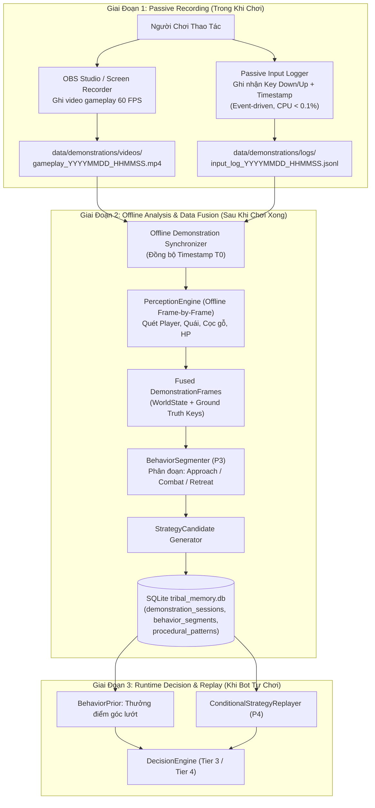
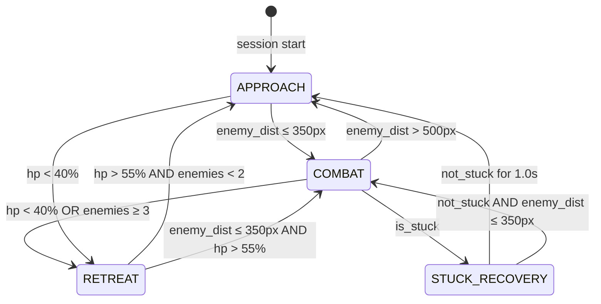
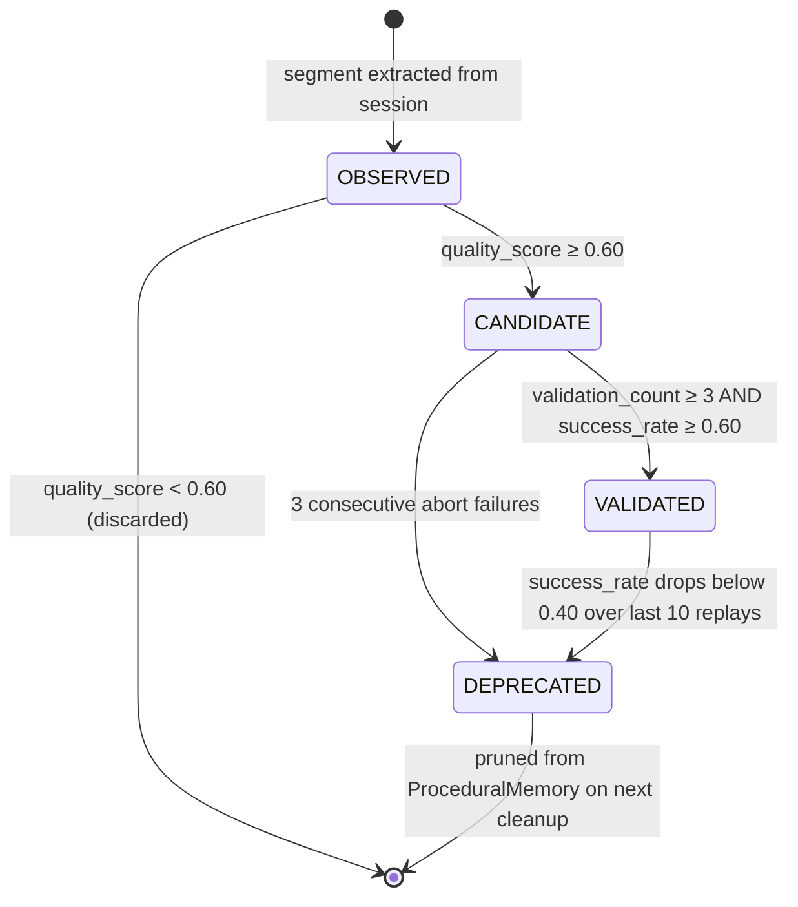

# Demonstration Learning Design
## TribalIslandBot – Technical Design Specification

**Version:** 1.0  
**Status:** Design Phase  
**Scope:** P2 (DemonstrationRecorder) · P3 (BehaviorSegmenter) · P4 (ConditionalStrategyReplayer)

---

## 1. Overview & Architectural Selection

The Demonstration Learning subsystem enables the bot to learn tactical patterns and reflexes from human gameplay.

### 1.1 So Sánh 3 Phương Án Thu Thập Dữ Liệu Thị Phạm

| Tiêu chí | Cách 1: Video Đơn Thuần | Cách 2: Live Hook Trong Trận | Cách 3: Hybrid Passive Recording (Khuyến nghị chuẩn) |
|---|---|---|---|
| **Ghi hình gameplay** | Có (OBS / Screen Recorder) | Tùy triển khai | **Có (OBS 60 FPS mượt mà)** |
| **Ghi chính xác phím bấm** | Không (Chỉ thấy kết quả pixel) | Có | **Có (Chính xác từng phím W/A/S/D/J/L/Space)** |
| **Ghi thời điểm nhấn/thả (Down/Up)** | Không | Có | **Có (Độ trễ mili-giây qua Event Hook)** |
| **Phân tích nặng trong lúc chơi** | Không | Có (Làm tụt FPS, lag game) | **KHÔNG (Chuyển 100% sang Offline sau trận)** |
| **Nguy cơ ảnh hưởng gameplay** | Thấp | Cao (Xung đột phím, gián đoạn) | **CỰC THẤP (Logger thuần thụ động < 0.1% CPU)** |
| **Khả năng tái tạo hành vi** | Hạn chế (Ước lượng vận tốc) | Tốt | **RẤT CAO (Có cả hình ảnh lẫn Ground Truth Input)** |
| **Phân tích sau khi chơi (Offline)**| Có | Có | **CÓ (Perception + Fusion + Segmentation)** |

### 1.2 Quyết Định Kiến Trúc: Hybrid Passive Recording

Hệ thống TribalIslandBot chính thức chuẩn hóa theo **Phương án 3: Hybrid Passive Recording**:
1. **OBS / Screen Recorder:** Ghi hình toàn bộ gameplay ở 60 FPS mà không chịu bất kỳ can thiệp nào từ bot.
2. **Passive Input Logger:** Script chạy ngầm siêu nhẹ, bắt sự kiện phím nhấn/thả và timestamp theo hướng sự kiện (Event-driven).
   - **Nguyên tắc bất biến:** Input Logger chỉ là một hệ thống quan sát thụ động, **tuyệt đối không gửi lệnh điều khiển, không chặn phím, không chạy nhận diện hình ảnh và không làm thay đổi hành vi gameplay**.
3. **Offline Analysis & Data Fusion:** Sau khi người chơi kết thúc ván và tắt OBS:
   - Bot mở video và file log phím lên phân tích offline từng frame.
   - Đồng bộ hóa hình ảnh WorldState với sự kiện phím thật để tạo `DemonstrationFrame` hoàn chỉnh.
   - Trích xuất chiến thuật, phân đoạn phase và lưu vào SQLite `tribal_memory.db`.

---

## 2. Demonstration Learning Pipeline



---

## 3. P2 – DemonstrationRecorder Design

### 3.1 Purpose

Capture a synchronized stream of `(WorldState, screenshot, action_taken, timestamp, source)` tuples during a human-played session so that the resulting data can be used for offline segmentation and strategy extraction.

> [!IMPORTANT]
> Recording **never starts automatically**. The user must explicitly opt-in via GUI toggle or CLI flag before any data is written to disk.

### 3.2 RecordedFrame Data Model

```python
@dataclass
class RecordedFrame:
    session_id: str           # UUID4 assigned at session start
    frame_idx: int            # monotonic counter within session
    timestamp_ms: int         # epoch ms
    source: Literal["HUMAN", "BOT"]   # labeling
    world_state: WorldState   # full snapshot from PerceptionEngine
    screenshot_path: str      # relative path: sessions/<id>/frames/NNNNNN.jpg
    action: Optional[SteeringCommand]  # None if no action this frame
    game_event: Optional[str] # e.g. "LEVEL_UP", "BATTLE_END", None
    notes: str                # free-text; empty string by default
```

### 3.3 Session Management

```
data/demonstrations/sessions/
└── <session_id>/                    # e.g. 2026-11-17T06-30-00_human
    ├── session_meta.json            # see §3.4
    ├── frames/
    │   ├── 000000.jpg               # JPEG q=85, downsampled to 640×360
    │   ├── 000001.jpg
    │   └── …
    └── trajectory.jsonl             # one RecordedFrame JSON per line
```

**Session lifecycle:**

| Event | Action |
|-------|--------|
| User enables recording | Generate `session_id`, write `session_meta.json`, begin capture loop |
| Each perception tick | Append one `RecordedFrame` to `trajectory.jsonl`, save screenshot |
| User disables recording | Flush buffer, write `session_end` to metadata, close file handles |
| Crash / unexpected exit | `session_meta.json` marked `status: INCOMPLETE`; partial data retained |

### 3.4 Session Metadata Format (`session_meta.json`)

```json
{
  "session_id": "2026-11-17T06-30-00_abc123",
  "source": "HUMAN",
  "created_at": "2026-11-17T06:30:00Z",
  "ended_at": "2026-11-17T06:45:12Z",
  "status": "COMPLETE",
  "frame_count": 4532,
  "consent_acknowledged": true,
  "consent_timestamp": "2026-11-17T06:29:58Z",
  "game_version": "unknown",
  "notes": ""
}
```

### 3.5 Source Labeling (HUMAN vs BOT)

- `source` is determined by who controls the input **at the time of the frame**.
- When the GUI recording toggle is active and human keypresses are detected → `"HUMAN"`.
- When the bot's `DecisionEngine` issues a command while recording is active → `"BOT"`.
- Frames without a clear signal default to `"BOT"` (conservative labeling).
- Mixed sessions (human takes over partway) are valid; each frame carries its own label.

> [!NOTE]
> Only `"HUMAN"` frames are used for strategy extraction in P3/P4. `"BOT"` frames in a session are retained for reference and can be used for supervised comparison.

### 3.6 Privacy & Safety Rules

1. **Explicit opt-in required**: no recording starts without `consent_acknowledged: true`.
2. **No network upload**: session data never leaves the local machine automatically.
3. **User can delete sessions** via GUI; recorder provides a `purge_session(session_id)` method.
4. **Screenshot privacy**: screenshots are stored locally, JPEG-compressed; no cloud sync.
5. **Recording indicator**: the GUI must display a visible "REC" indicator while recording is active.

### 3.7 Module Interface

```python
class DemonstrationRecorder:
    def __init__(self, session_root: str = "data/demonstrations/sessions"):
        ...

    def start_session(self, source: str = "HUMAN", notes: str = "") -> str:
        """Returns session_id. Requires prior consent acknowledgement."""
        ...

    def record_frame(
        self,
        world_state: WorldState,
        screenshot: np.ndarray,
        action: Optional[SteeringCommand],
        game_event: Optional[str] = None,
    ) -> None:
        """Append one RecordedFrame to the active session."""
        ...

    def stop_session(self) -> dict:
        """Flush, close, return session_meta dict."""
        ...

    def purge_session(self, session_id: str) -> None:
        """Hard-delete session directory and all frames."""
        ...
```

---

## 4. P3 – BehaviorSegmenter Design

### 4.1 Purpose

Partition a session's `RecordedFrame` stream into semantically meaningful **BehaviorSegments** (phase-labelled contiguous frame windows) that can be turned into reusable strategy candidates.

### 4.2 Phase Taxonomy

| Phase | Trigger Condition | Termination Condition |
|-------|------------------|-----------------------|
| `APPROACH` | `nearest_enemy_dist > 500px` and `enemies_count ≥ 1` | Enemy enters `< 350px` or combat detected |
| `COMBAT` | `nearest_enemy_dist ≤ 350px` and `speed > 0` | Enemy leaves `> 500px`, HP critical, or stuck |
| `RETREAT` | `hp_percent < 40%` OR `enemies_count ≥ 3` | HP restored `> 55%` or enemy count drops `< 2` |
| `STUCK_RECOVERY` | `is_stuck == True` (WorldState flag) | `is_stuck == False` for ≥ 1.0s |

Transitions use a **state machine** with hysteresis to prevent rapid phase flipping.

### 4.3 Segmentation State Machine



### 4.4 BehaviorSegment Data Model

```python
@dataclass
class BehaviorSegment:
    segment_id: str              # UUID4
    session_id: str
    phase: Literal["APPROACH", "COMBAT", "RETREAT", "STUCK_RECOVERY"]
    start_frame_idx: int
    end_frame_idx: int
    duration_sec: float
    source: Literal["HUMAN", "BOT"]   # dominant label in segment
    quality_score: float         # [0.0, 1.0] – see §4.5
    summary: dict                # aggregated stats (mean speed, min hp, etc.)
    frames: List[RecordedFrame]  # references, not embedded in segment file
```

### 4.5 Segment Quality Metrics

A segment's `quality_score` is computed as a weighted combination:

| Metric | Weight | Description |
|--------|--------|-------------|
| **Coverage** | 0.30 | `min(1.0, duration_sec / 5.0)` – penalise very short segments |
| **Source purity** | 0.25 | Fraction of frames with `source == "HUMAN"` |
| **Confidence** | 0.25 | Mean `world_state.confidence` across frames (from PerceptionEngine) |
| **Outcome** | 0.20 | `1.0` if HP increased or enemy eliminated at segment end, else `0.0` |

`quality_score = 0.30·coverage + 0.25·source_purity + 0.25·confidence + 0.20·outcome`

Segments with `quality_score < 0.50` are retained but flagged `CANDIDATE_REJECTED` and not promoted to ProceduralMemory.

### 4.6 Integration with Existing TrajectoryExtractor

`TrajectoryExtractor` processes **video files** offline (confidence threshold 0.60) and outputs JSON with the same fields that `RecordedFrame` carries. The `BehaviorSegmenter` accepts **both** data sources:

```
Input to BehaviorSegmenter:
  ① trajectory.jsonl  (live session, from DemonstrationRecorder)
  ② <name>.json       (offline, from TrajectoryExtractor)

Both are normalised into a List[RecordedFrame] before segmentation.
TrajectoryExtractor frames carry source="HUMAN" (assumed) and game_event=None.
```

This allows existing video trajectories to be retroactively segmented and promoted to strategy candidates.

### 4.7 Module Interface

```python
class BehaviorSegmenter:
    def __init__(self, min_segment_frames: int = 15, hysteresis_frames: int = 5):
        ...

    def segment_session(self, frames: List[RecordedFrame]) -> List[BehaviorSegment]:
        """Run state-machine segmentation over a full session."""
        ...

    def segment_trajectory_file(self, json_path: str) -> List[BehaviorSegment]:
        """Load a TrajectoryExtractor JSON and segment it."""
        ...

    def compute_quality(self, segment: BehaviorSegment) -> float:
        """Return quality_score for a segment."""
        ...
```

---

## 5. P4 – ConditionalStrategyReplayer Design

### 5.1 Purpose

Given the current `WorldState`, check whether a validated strategy from `ProceduralMemory` has matching preconditions, then replay its action sequence, monitoring for abort conditions throughout.

> [!NOTE]
> The existing `BehaviorPrior` **is not replaced**. It continues to inject a `w_demo=0.15` score into `VectorSteering`. `ConditionalStrategyReplayer` operates at a higher tier (Tier 3) and **overrides** VectorSteering entirely while active.

### 5.2 StrategyCandidate Data Model

```python
@dataclass
class StrategyCandidate:
    strategy_id: str
    phase: str                       # APPROACH | COMBAT | RETREAT | STUCK_RECOVERY
    lifecycle: Literal[
        "OBSERVED", "CANDIDATE", "VALIDATED", "DEPRECATED"
    ]
    preconditions: StrategyPreconditions
    action_sequence: List[SteeringCommand]   # ordered replay steps
    expected_outcome: ExpectedOutcome
    quality_score: float
    validation_count: int            # times this strategy was replayed
    success_count: int
    created_at: str
    last_used_at: Optional[str]
```

### 5.3 Precondition Matching

```python
@dataclass
class StrategyPreconditions:
    phase: str                            # must match current phase
    hp_range: Tuple[float, float]         # e.g. (30.0, 80.0) percent
    enemy_dist_range: Tuple[float, float] # e.g. (100.0, 500.0) px
    enemies_count_range: Tuple[int, int]  # e.g. (1, 3)
    is_stuck: Optional[bool]             # None = don't care
    min_confidence: float                 # world_state confidence floor (default 0.50)
```

**Matching algorithm:**

```
match(world_state, preconditions) → bool:
  1. current_phase matches preconditions.phase
  2. preconditions.hp_range[0] ≤ world_state.hp_percent ≤ preconditions.hp_range[1]
  3. preconditions.enemy_dist_range[0] ≤ nearest_enemy_dist ≤ preconditions.enemy_dist_range[1]
  4. preconditions.enemies_count_range[0] ≤ enemies_count ≤ preconditions.enemies_count_range[1]
  5. (is_stuck is None) OR (is_stuck == world_state.is_stuck)
  6. world_state.confidence ≥ preconditions.min_confidence
  All 6 must be True → match = True
```

**Candidate selection:** when multiple strategies match, select by `success_count / max(1, validation_count)` (success rate), breaking ties by `quality_score`.

### 5.4 Confidence Threshold

A strategy is eligible for replay only when:
- `strategy.lifecycle == "VALIDATED"`
- `strategy.success_count / max(1, strategy.validation_count) ≥ 0.60`
- `strategy.validation_count ≥ 3` (minimum evidence)

### 5.5 Abort Conditions

The replayer monitors abort conditions **every tick** during replay:

| # | Condition | Threshold | Action |
|---|-----------|-----------|--------|
| 1 | **Timeout** | Replay exceeds `max(5.0s, len(action_sequence) × 0.5s)` | Abort, return control to Tier 4 |
| 2 | **HP Drop** | `hp_percent` drops `> 15%` during replay | Abort, trigger SafetyRules re-evaluation |
| 3 | **Stuck** | `is_stuck == True` for `> 1.2s` during replay | Abort, return control to Tier 4 |

On abort, the current replay attempt is logged as a **failure** (decrements success rate). Three consecutive aborts of the same strategy trigger a lifecycle transition to `DEPRECATED`.

### 5.6 Expected Outcome Validation

```python
@dataclass
class ExpectedOutcome:
    hp_delta_min: float       # minimum acceptable HP change (can be negative)
    enemy_dist_delta: float   # expected distance change (positive = further)
    is_stuck_cleared: bool    # True if strategy should resolve stuck state
    timeout_sec: float        # time window for outcome check after replay ends
```

Outcome is evaluated `timeout_sec` after the last replay command executes. If `expected_outcome` is satisfied, `success_count += 1`; otherwise the replay is a failure.

### 5.7 Strategy Lifecycle



### 5.8 Relationship to Existing BehaviorPrior

| Aspect | BehaviorPrior (existing) | ConditionalStrategyReplayer (new P4) |
|--------|--------------------------|--------------------------------------|
| Data source | JSON trajectory files | ProceduralMemory (validated segments) |
| Output | Score bonus `[0,100]` → fed into VectorSteering `w_demo=0.15` | Direct `List[SteeringCommand]` replay |
| Activation | Always active (passive influence) | Active only when preconditions match |
| Override level | Tier 4 weight modifier | Tier 3 decision override |
| Abort mechanism | None | 3 abort types (see §5.5) |

Both coexist: BehaviorPrior continues to operate as a soft influence when CSR is idle.

### 5.9 Module Interface

```python
class ConditionalStrategyReplayer:
    def __init__(self, procedural_memory: ProceduralMemory):
        ...

    def try_match(self, world_state: WorldState, current_phase: str) -> Optional[StrategyCandidate]:
        """Return best matching VALIDATED strategy, or None."""
        ...

    def begin_replay(self, strategy: StrategyCandidate) -> None:
        """Start replaying action_sequence; sets internal state to REPLAYING."""
        ...

    def tick(self, world_state: WorldState) -> Optional[SteeringCommand]:
        """Call each decision tick. Returns next command or None if done/aborted."""
        ...

    def is_replaying(self) -> bool:
        """True while a replay is in progress."""
        ...
```

---

## 6. Data Flow Summary

### 6.1 Offline Path (Existing)

```
MP4 video
  → TrajectoryExtractor.extract_from_video()
      (confidence threshold: 0.60)
  → JSON: {frame_idx, time_sec, player_x, player_y, angle_deg,
           speed_px_per_sec, nearest_enemy_dist, enemies_count}
  → BehaviorPrior.load_demonstrations()
  → BehaviorPrior.get_demonstration_score(angle) → [0, 100]
  → VectorSteering (w_demo=0.15 hook)
```

### 6.2 Live Path (New)

```
Human player (opt-in)
  → DemonstrationRecorder.record_frame(WorldState, screenshot, action)
  → trajectory.jsonl in session directory
  → BehaviorSegmenter.segment_session(frames)
  → List[BehaviorSegment] with quality_score
  → quality_score ≥ 0.60 → StrategyCandidate(OBSERVED → CANDIDATE)
  → ConditionalStrategyReplayer validation replays
  → validation_count ≥ 3 AND success_rate ≥ 0.60 → VALIDATED
  → ProceduralMemory store
  → ConditionalStrategyReplayer.try_match(world_state) in Tier 3
```

---

## 7. File Storage Layout

```
data/demonstrations/
├── videos/                              # Raw MP4 recordings (input to offline path)
│   ├── 2026-11-16 21-29-10.mp4         (22 MB)
│   ├── 2026-11-16 22-41-18.mp4         (12 MB)
│   ├── 2026-11-16 23-11-29.mp4         (47 MB)
│   └── 2026-11-17 01-16-20.mp4         (73 MB)
├── trajectories/                        # JSON outputs from TrajectoryExtractor
│   └── <video_name>.json
└── sessions/                            # Live session data from DemonstrationRecorder
    └── <session_id>/
        ├── session_meta.json
        ├── frames/
        │   └── NNNNNN.jpg
        └── trajectory.jsonl
```

---

## 8. Implementation Priority

| Priority | Component | Dependency | Estimated Effort |
|----------|-----------|------------|-----------------|
| P2 | DemonstrationRecorder | PerceptionEngine, ActionEngine | Medium |
| P3 | BehaviorSegmenter | DemonstrationRecorder OR TrajectoryExtractor | Medium |
| P4a | ProceduralMemory layer | MemoryManager extension | Small |
| P4b | ConditionalStrategyReplayer | P3 segments + ProceduralMemory | Large |
| P4c | Lifecycle management | ConditionalStrategyReplayer | Small |

> [!TIP]
> P3 can be prototyped immediately using the existing 4 MP4 recordings via `TrajectoryExtractor` → `BehaviorSegmenter`, without waiting for P2 DemonstrationRecorder to be built.
