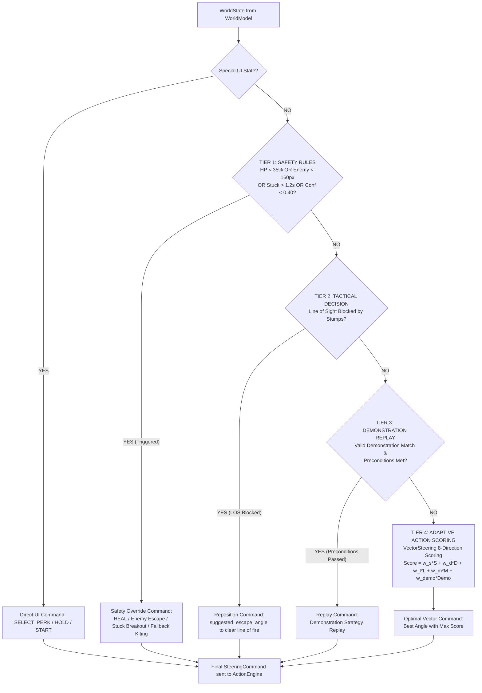
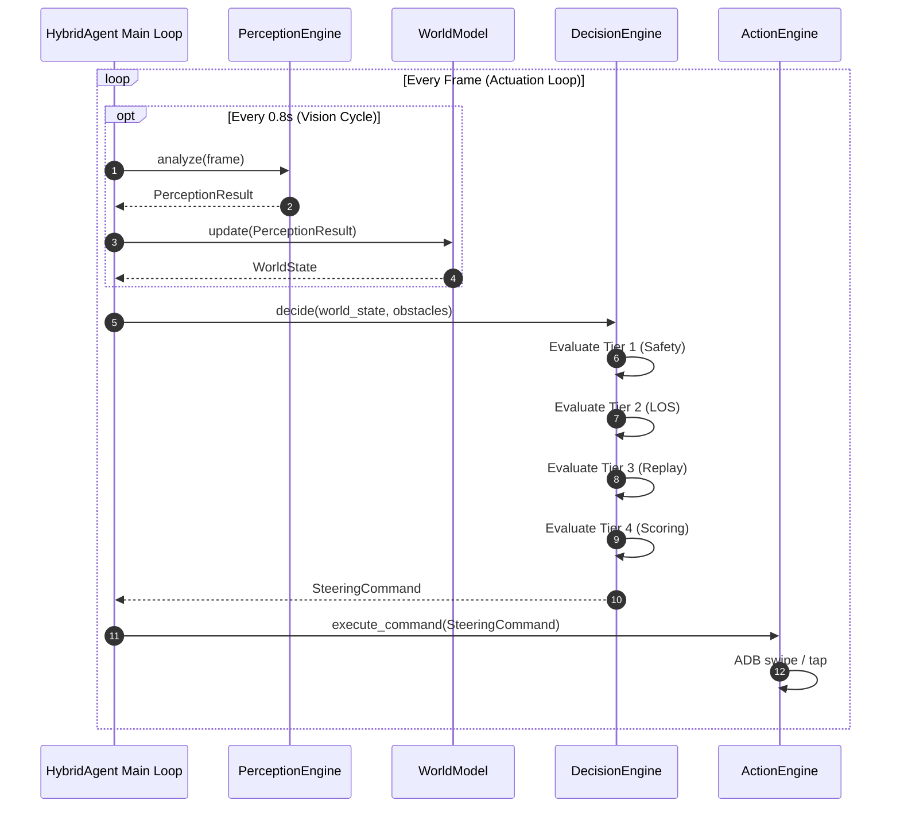

# HYBRID DECISION ENGINE DESIGN SPECIFICATION (P5 & P6)
## TribalIslandBot – Multi-Tier Hierarchical Decision Architecture

> **Document Version:** 1.0  
> **Phases:** P5 (Decision & Perception Integration) & P6 (Hybrid Decision Engine)  
> **Last Updated:** 2026-11-17  
> **Status:** APPROVED FOR IMPLEMENTATION  

---

## 1. Objective & Decision Invariants

The **Decision Engine** serves as the cognitive control center of TribalIslandBot. It receives the high-level spatial understanding encapsulated in `WorldState` from the `WorldModel` and produces a single, optimal `SteeringCommand` to be executed by the `ActionEngine`.

### Core Architectural Invariants:
1. **Strict 4-Tier Hierarchy:** The decision arbitration must follow a fixed evaluation pipeline:
   $$\text{Safety Layer} \longrightarrow \text{Tactical Decision} \longrightarrow \text{Demonstration Strategy} \longrightarrow \text{Fallback Policy}$$
2. **Single Ownership Rule:** Exactly **one** decision tier is permitted to possess execution ownership at any given frame. Upstream tiers unconditionally override downstream tiers.
3. **No Self-Modifying Code:** The Decision Engine adapts solely through numerical weight tuning and persistent state scoring stored in SQLite; it is strictly prohibited from altering its own executable logic or safety thresholds.
4. **Guaranteed Fallback (Graceful Degradation):** When perception confidence drops or demonstration models fail, the bot gracefully falls back to deterministic vector steering and circular kiting routines.

---

## 2. Decision Engine Architecture



---

## 3. Detailed Specification of Decision Tiers

### 3.1 Tier 0: Special UI State Handler
Before initiating tactical calculations, the system intercepts non-combat modal screens:
- **`LEVEL_UP`:** Returns `SteeringCommand(action_type="SELECT_PERK", perk_index=1, reason="level_up_perk")`. Automatically picks the left perk card without delay.
- **`LOBBY`:** Returns `SteeringCommand(action_type="HOLD", reason="lobby_idle")` while `RunManager` taps the Start button.
- **`BATTLE_END`:** Returns `SteeringCommand(action_type="HOLD", reason="battle_end_idle")` while results are logged.

---

### 3.2 Tier 1: Safety Layer (`SafetyRules`)
The Safety Layer possesses absolute sovereignty over character navigation. It mitigates mortal risks through 4 deterministic rules evaluated in order:

```python
class SafetyRules:
    def __init__(self, hp_critical_percent: float = 35.0, 
                 danger_enemy_dist: float = 160.0,
                 heal_cooldown: float = 3.0):
        self.hp_critical_percent = hp_critical_percent  # Fixed threshold: 35%
        self.danger_enemy_dist = danger_enemy_dist      # Fixed threshold: 160 pixels
        self.heal_cooldown = heal_cooldown              # 3.0s minimum cooldown
        self.last_heal_time = 0.0
```

#### Rule 1.1: Critical Health Recovery (Heal)
- **Precondition:** $0.0 < \text{player\_hp} < 35.0\%$ and $(t_{\text{now}} - t_{\text{last\_heal}}) \ge 3.0\text{ s}$.
- **Output:** `SteeringCommand(action_type="HEAL", reason="critical_hp_<val>%")`.
- **Side Effect:** Updates `self.last_heal_time = t_now`.

#### Rule 1.2: Proximity Hazard Repulsion (Enemy Escape)
- **Precondition:** Nearest enemy distance $< 160.0\text{ px}$.
- **Output:** Immediate radial repulsion away from the enemy's center:
  $$\Delta x = X_{\text{player}} - X_{\text{enemy}}, \quad \Delta y = Y_{\text{player}} - Y_{\text{enemy}}$$
  $$\theta_{\text{escape}} = \left(\text{atan2}(-\Delta y, \Delta x) \times \frac{180}{\pi} + 360^\circ\right) \pmod{360^\circ}$$
  Command: `SteeringCommand(action_type="MOVE", angle_degrees=theta_escape, distance_ratio=1.0, duration_ms=450, reason="enemy_too_close_<dist>px")`.

#### Rule 1.3: Stuck Angle Breakout
- **Precondition:** `world.is_stuck == True` and `world.suggested_escape_angle is not None`.
- **Output:** `SteeringCommand(action_type="MOVE", angle_degrees=suggested_escape_angle, distance_ratio=1.0, duration_ms=600, reason="stuck_recovery_breakout")`.

#### Rule 1.4: Low Confidence Sensor Fallback
- **Precondition:** Overall perception confidence $< 40\%$.
- **Output:** Predictable cyclic elliptical kiting:
  $$\theta_{\text{fallback}} \in [45.0^\circ, 140.0^\circ, 225.0^\circ, 320.0^\circ]$$
  Cycling every 1.5 seconds to keep the character in motion without risking collision.

---

### 3.3 Tier 2: Tactical Decision (Line of Sight Repositioning)
In *Tribal Island*, wooden stumps (`obstacle_stump`) absorb all projectile hits. When a stump is positioned directly between the player and the primary target, firing is futile.

- **Precondition:** `world.has_clear_shot == False` and `world.suggested_escape_angle is not None`.
- **Computation:** `WorldModel` identifies the blocking obstacle $(X_{\text{obs}}, Y_{\text{obs}})$ and computes an escape angle tangential or orthogonal to the obstacle-player vector:
  $$\Delta x = X_{\text{player}} - X_{\text{obs}}, \quad \Delta y = Y_{\text{player}} - Y_{\text{obs}}$$
  $$\theta_{\text{tangent}} = \left(\text{atan2}(-\Delta y, \Delta x) \times \frac{180}{\pi} + 360^\circ\right) \pmod{360^\circ}$$
- **Output:** `SteeringCommand(action_type="MOVE", angle_degrees=suggested_escape_angle, distance_ratio=0.9, duration_ms=450, reason="blocked_los_reposition")`.

---

### 3.4 Tier 3: Demonstration Strategy Replay (Conditional Replay)
When the game state is stable and safe, the bot checks whether a validated human demonstration pattern fits current conditions.

- **Precondition Checks:**
  1. Room phase matches demonstration segment (e.g., `COMBAT` phase).
  2. Character HP $\ge 50\%$.
  3. No imminent obstacle collisions within 100 px.
  4. Matching confidence score $\ge 0.75$.
- **Abort Conditions (Immediate Exit to Tier 4 or Tier 1):**
  - Player HP drops by $> 15\%$ during replay.
  - Character position remains unchanged for $> 1.0\text{ s}$ (stuck).
  - Target enemy dies or despawns.
- **Output:** Replayed steering trajectory with sequence tag `reason="demonstration_replay_<strat_id>"`.

---

### 3.5 Tier 4: Fallback Policy & Adaptive Action Scoring (`VectorSteering`)
If no demonstration strategy applies, the bot relies on 8-directional vector evaluation:
$$\theta \in \{0^\circ, 45^\circ, 90^\circ, 135^\circ, 180^\circ, 225^\circ, 270^\circ, 315^\circ\}$$

#### Mathematical Scoring Function:
$$\text{Score}(\theta) = w_s \cdot S(\theta) + w_d \cdot D(\theta) + w_l \cdot L(\theta) + w_m \cdot M(\theta) + w_{\text{demo}} \cdot \text{Demo}(\theta)$$

Where all component scores are normalized to $[0, 100]$:

| Term | Metric | Weight | Scoring Formulation |
|---|---|---|---|
| $S(\theta)$ | **Safety Score** | $w_s = 0.30$ | Deducts 60 if near walls ($X \notin [200, 1720]$ or $Y \notin [160, 900]$); Deducts 50 if near obstacle radius $+ 50\text{px}$; Deducts 70 if enemy dist $< 160\text{px}$. |
| $D(\theta)$ | **Distance Score** | $w_d = 0.20$ | Measures distance to nearest enemy relative to ideal kiting radius $R_{\text{ideal}} = 450\text{px}$:<br>$D(\theta) = \max(0, 100 - \frac{|\text{dist} - 450|}{4})$. |
| $L(\theta)$ | **Line of Sight** | $w_l = 0.25$ | 100 if projected position $(X', Y')$ has unobstructed line to target; 15 if blocked by stump. |
| $M(\theta)$ | **Memory Score** | $w_m = 0.10$ | Learned bias from `memory_bias` dictionary for current floor. Default 50.0. |
| $\text{Demo}(\theta)$ | **Human Prior** | $w_{\text{demo}} = 0.15$ | Smooth curvature bonus: $+30$ if angle delta with previous step is $25^\circ - 75^\circ$; $-35$ if reversing $> 135^\circ$. |

---

## 4. Online Weight Adaptation & Rollback Engine

### 4.1 Utility Score Formulation
After every completed run or floor, `StrategyUpdater` computes the overall utility $U$ for each active strategy profile:

$$U = 0.4 \cdot C + 0.3 \cdot S + 0.2 \cdot E + 0.1 \cdot T$$

- $C = \frac{\text{success\_count}}{\max(1, \text{total\_uses})} \in [0.0, 1.0]$: Completion rate.
- $S = \min\left(1.0, \frac{\text{avg\_hp}}{100.0}\right) \in [0.0, 1.0]$: Health preservation.
- $E = 1.0 - \min\left(1.0, \frac{\text{heals\_used}}{5}\right) \in [0.0, 1.0]$: Healing item conservation.
- $T = \max\left(0.0, 1.0 - \frac{\text{avg\_duration}}{120.0}\right) \in [0.0, 1.0]$: Clearing efficiency.

### 4.2 Safe Weight Adaptation Bounds
Weights may only adjust within verified safety intervals:
$$w_s \in [0.20, 0.60], \quad w_d \in [0.15, 0.40], \quad w_l \in [0.15, 0.40], \quad w_m \in [0.05, 0.30]$$

### 4.3 Automatic Rollback Protocol
If the rolling average survival rate drops by $> 25\%$ across 3 consecutive runs:
1. `MemoryManager.rollback_to_baseline()` is immediately executed.
2. Triggers baseline restoration:
   $$(w_s, w_d, w_l, w_m) = (0.35, 0.25, 0.25, 0.15)$$
3. Invalidated candidate weights are flagged as `DEPRECATED` in SQLite.
4. An alert event `CRITICAL_ROLLBACK_ACTIVATED` is logged in `battle_events`.

---

## 5. Decision-to-Action Pipeline Timing



---

## 6. Acceptance Criteria (Pass/Fail)

- [ ] **AC-5.1:** Tier 1 Safety Rules unconditionally override Tier 2, 3, and 4 in 100% of test scenarios.
- [ ] **AC-5.2:** Emergency heal command issued within $\le 50\text{ ms}$ of $HP < 35\%$ detection.
- [ ] **AC-5.3:** Character never attempts to shoot directly through a wooden stump for $> 1.2\text{ s}$ without repositioning.
- [ ] **AC-5.4:** `VectorSteering` produces a valid directional candidate with $Score > 0$ under all room configurations.
- [ ] **AC-5.5:** Rollback to baseline weights executes in $< 10\text{ ms}$ upon simulated failure trigger.

