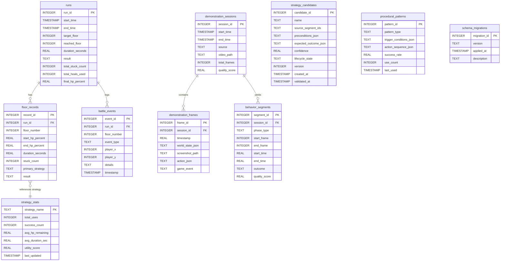

# TribalIslandBot — Memory & Database Schema

> Technical reference for the 4-layer memory architecture and SQLite schema
> (`data/tribal_memory.db`). Covers both the **current** (v1) tables and the
> **target** (v2) tables required by the Hybrid Demonstration Learning roadmap.

---

## Table of Contents

1. [4-Layer Memory Architecture](#1-4-layer-memory-architecture)
2. [Entity-Relationship Diagram](#2-entity-relationship-diagram)
3. [SQL DDL — Existing Tables (v1)](#3-sql-ddl--existing-tables-v1)
4. [SQL DDL — New Tables (v2 Target)](#4-sql-ddl--new-tables-v2-target)
5. [Index Specifications](#5-index-specifications)
6. [Foreign Key Relationships](#6-foreign-key-relationships)
7. [Migration Strategy](#7-migration-strategy)
8. [Backup Strategy](#8-backup-strategy)
9. [Utility Score Formula](#9-utility-score-formula)
10. [Weight Management Rules](#10-weight-management-rules)
11. [Thread Safety](#11-thread-safety)
12. [Common Query Patterns](#12-common-query-patterns)
13. [Data Retention Policy](#13-data-retention-policy)

---

## 1. 4-Layer Memory Architecture

The bot uses a cognitive memory model inspired by human memory research. Each
layer has a distinct lifetime, storage medium, and access pattern.

| Layer | Type | Storage | Lifetime | Python Location |
|-------|------|---------|----------|----------------|
| **Working Memory** | Volatile in-process state | RAM (Python attrs) | Single run | `MemoryManager` instance fields |
| **Episodic Memory** | Per-event records | SQLite tables | Persistent | `runs`, `floor_records`, `battle_events` |
| **Semantic Memory** | Aggregated knowledge | SQLite + RAM | Persistent | `strategy_stats`, weight tuple |
| **Procedural Memory** | Reusable action programs | SQLite | Persistent | `procedural_patterns` (**MISSING – v2**) |

### 1.1 Working Memory

Stored entirely in `MemoryManager` attributes; lost on process exit.

| Field | Type | Description |
|-------|------|-------------|
| `active_run_id` | `int \| None` | FK into `runs` for the current session |
| `run_start_time` | `float \| None` | `time.time()` snapshot at run start |
| `current_weights` | `tuple[float,float,float,float]` | Live steering weights `(w_s, w_d, w_l, w_m)` |

### 1.2 Episodic Memory

Structured log of every run, floor, and notable in-game event. Provides the
raw observations that feed semantic learning.

- **`runs`** – one row per game session (start→end).
- **`floor_records`** – one row per floor within a run.
- **`battle_events`** – one row per notable event (stuck, critical HP, death).
- **`demonstration_sessions`** *(v2)* – one row per human/bot recording session.
- **`demonstration_frames`** *(v2)* – per-frame state+action snapshots.
- **`behavior_segments`** *(v2)* – labelled phases carved from frame sequences.

### 1.3 Semantic Memory

Abstracted knowledge extracted from many episodes.

- **`strategy_stats`** – utility scores per named strategy.
- **`strategy_candidates`** *(v2)* – machine-discovered strategies under review.
- In-RAM: `current_weights` tuple updated via `MemoryManager.update_weights()`.

### 1.4 Procedural Memory *(v2 – not yet implemented)*

Reusable action programs triggered by conditions. Analogous to motor programs
in human cognition.

- **`procedural_patterns`** – trigger → action-sequence mappings with live
  success rates.
- Will be loaded by `ProceduralMemory` module (to be created in P5).

---

## 2. Entity-Relationship Diagram



---

## 3. SQL DDL — Existing Tables (v1)

> These are verbatim from `core/memory/database.py`. Do **not** modify the
> column definitions without a corresponding migration.

```sql
-- ─────────────────────────────────────────────
-- Table 1: runs
-- One row per game session (bot run).
-- ─────────────────────────────────────────────
CREATE TABLE IF NOT EXISTS runs (
    run_id INTEGER PRIMARY KEY AUTOINCREMENT,
    start_time TIMESTAMP DEFAULT CURRENT_TIMESTAMP,
    end_time TIMESTAMP,
    target_floor INTEGER DEFAULT 71,
    reached_floor INTEGER DEFAULT 1,
    duration_seconds REAL DEFAULT 0.0,
    result TEXT,  -- 'RUNNING', 'SUCCESS', 'DIED', 'MANUAL_STOP'
    total_stuck_count INTEGER DEFAULT 0,
    total_heals_used INTEGER DEFAULT 0,
    final_hp_percent REAL DEFAULT 0.0
);

-- ─────────────────────────────────────────────
-- Table 2: floor_records
-- One row per floor within a run.
-- ─────────────────────────────────────────────
CREATE TABLE IF NOT EXISTS floor_records (
    record_id INTEGER PRIMARY KEY AUTOINCREMENT,
    run_id INTEGER,
    floor_number INTEGER,
    start_hp_percent REAL,
    end_hp_percent REAL,
    duration_seconds REAL,
    stuck_count INTEGER DEFAULT 0,
    primary_strategy TEXT,  -- 'circular_kiting', 'adaptive_kiting', 'safe_distance'
    result TEXT,
    FOREIGN KEY(run_id) REFERENCES runs(run_id)
);

-- ─────────────────────────────────────────────
-- Table 3: battle_events
-- One row per notable in-game event.
-- ─────────────────────────────────────────────
CREATE TABLE IF NOT EXISTS battle_events (
    event_id INTEGER PRIMARY KEY AUTOINCREMENT,
    run_id INTEGER,
    floor_number INTEGER,
    event_type TEXT,  -- 'BLOCKED_LOS_BREAKOUT', 'STUCK_CORNER', 'CRITICAL_HP', 'DEATH'
    player_x INTEGER,
    player_y INTEGER,
    details TEXT,
    timestamp TIMESTAMP DEFAULT CURRENT_TIMESTAMP,
    FOREIGN KEY(run_id) REFERENCES runs(run_id)
);

-- ─────────────────────────────────────────────
-- Table 4: strategy_stats
-- Aggregated performance per named strategy.
-- Pre-seeded at DB init:
--   ('circular_kiting', 0, 0, 0.0, 0.0, 0.50, ...)
--   ('adaptive_kiting', 0, 0, 0.0, 0.0, 0.60, ...)
--   ('safe_distance',   0, 0, 0.0, 0.0, 0.55, ...)
-- ─────────────────────────────────────────────
CREATE TABLE IF NOT EXISTS strategy_stats (
    strategy_name TEXT PRIMARY KEY,
    total_uses INTEGER DEFAULT 0,
    success_count INTEGER DEFAULT 0,
    avg_hp_remaining REAL DEFAULT 0.0,
    avg_duration_sec REAL DEFAULT 0.0,
    utility_score REAL DEFAULT 0.0,
    last_updated TIMESTAMP DEFAULT CURRENT_TIMESTAMP
);
```

---

## 4. SQL DDL — New Tables (v2 Target)

> These tables do not exist in the current codebase. They must be added via
> the migration system (see §7). The `schema_migrations` table should be
> created first to record the migration itself.

```sql
-- ─────────────────────────────────────────────
-- Table 5: schema_migrations
-- Audit log of applied schema migrations.
-- Must be the FIRST new table created.
-- ─────────────────────────────────────────────
CREATE TABLE IF NOT EXISTS schema_migrations (
    migration_id INTEGER PRIMARY KEY AUTOINCREMENT,
    version TEXT NOT NULL UNIQUE,         -- e.g. '002_add_demonstration_tables'
    applied_at TIMESTAMP DEFAULT CURRENT_TIMESTAMP,
    description TEXT
);

-- ─────────────────────────────────────────────
-- Table 6: demonstration_sessions
-- One row per recording session (human or bot).
-- source: 'HUMAN' | 'BOT'
-- ─────────────────────────────────────────────
CREATE TABLE IF NOT EXISTS demonstration_sessions (
    session_id INTEGER PRIMARY KEY AUTOINCREMENT,
    start_time TIMESTAMP DEFAULT CURRENT_TIMESTAMP,
    end_time TIMESTAMP,
    source TEXT NOT NULL CHECK(source IN ('HUMAN', 'BOT')),
    video_path TEXT,                      -- absolute path to screen recording
    total_frames INTEGER DEFAULT 0,
    quality_score REAL DEFAULT 0.0        -- 0.0–1.0, set by BehaviorSegmenter
);

-- ─────────────────────────────────────────────
-- Table 7: demonstration_frames
-- Per-frame snapshot: state + action taken.
-- world_state_json: serialised WorldState dataclass.
-- action_json:      serialised SteeringCommand / ActionCommand.
-- game_event:       optional label ('LEVEL_UP', 'HEAL', 'DEATH', NULL).
-- ─────────────────────────────────────────────
CREATE TABLE IF NOT EXISTS demonstration_frames (
    frame_id INTEGER PRIMARY KEY AUTOINCREMENT,
    session_id INTEGER NOT NULL,
    timestamp REAL NOT NULL,              -- seconds since session start_time
    world_state_json TEXT,                -- JSON blob
    screenshot_path TEXT,                 -- relative path under data/screenshots/
    action_json TEXT,                     -- JSON blob
    game_event TEXT,
    FOREIGN KEY(session_id) REFERENCES demonstration_sessions(session_id)
        ON DELETE CASCADE
);

-- ─────────────────────────────────────────────
-- Table 8: behavior_segments
-- Labelled phase carved from a frame sequence.
-- phase_type: 'approach' | 'combat' | 'retreat' | 'stuck' | 'perk_select'
-- outcome:    'success' | 'failure' | 'unknown'
-- ─────────────────────────────────────────────
CREATE TABLE IF NOT EXISTS behavior_segments (
    segment_id INTEGER PRIMARY KEY AUTOINCREMENT,
    session_id INTEGER NOT NULL,
    phase_type TEXT NOT NULL,
    start_frame INTEGER NOT NULL,         -- frame_id of first frame in segment
    end_frame INTEGER NOT NULL,           -- frame_id of last frame in segment
    start_time REAL NOT NULL,             -- seconds since session start
    end_time REAL NOT NULL,
    outcome TEXT DEFAULT 'unknown',
    quality_score REAL DEFAULT 0.0,       -- 0.0–1.0
    FOREIGN KEY(session_id) REFERENCES demonstration_sessions(session_id)
        ON DELETE CASCADE
);

-- ─────────────────────────────────────────────
-- Table 9: strategy_candidates
-- Machine-discovered strategies under validation.
-- lifecycle_state: 'OBSERVED' | 'CANDIDATE' | 'VALIDATED' | 'DEPRECATED'
-- source_segment_ids: JSON array of segment_id integers.
-- preconditions_json / expected_outcome_json: JSON objects.
-- ─────────────────────────────────────────────
CREATE TABLE IF NOT EXISTS strategy_candidates (
    candidate_id INTEGER PRIMARY KEY AUTOINCREMENT,
    name TEXT NOT NULL,
    source_segment_ids TEXT DEFAULT '[]', -- JSON array
    preconditions_json TEXT DEFAULT '{}', -- JSON object
    expected_outcome_json TEXT DEFAULT '{}',
    confidence REAL DEFAULT 0.0,          -- 0.0–1.0
    lifecycle_state TEXT DEFAULT 'OBSERVED'
        CHECK(lifecycle_state IN ('OBSERVED','CANDIDATE','VALIDATED','DEPRECATED')),
    version INTEGER DEFAULT 1,
    created_at TIMESTAMP DEFAULT CURRENT_TIMESTAMP,
    validated_at TIMESTAMP
);

-- ─────────────────────────────────────────────
-- Table 10: procedural_patterns
-- Reusable trigger→action programs (Procedural Memory).
-- pattern_type: 'kiting' | 'escape' | 'approach' | 'custom'
-- trigger_conditions_json: JSON object with field matchers.
-- action_sequence_json:    JSON array of SteeringCommand dicts.
-- ─────────────────────────────────────────────
CREATE TABLE IF NOT EXISTS procedural_patterns (
    pattern_id INTEGER PRIMARY KEY AUTOINCREMENT,
    pattern_type TEXT NOT NULL,
    trigger_conditions_json TEXT DEFAULT '{}',
    action_sequence_json TEXT DEFAULT '[]',
    success_rate REAL DEFAULT 0.0,        -- updated after each replay
    use_count INTEGER DEFAULT 0,
    last_used TIMESTAMP
);
```

---

## 5. Index Specifications

Performance indexes should be created after their parent tables. All are
non-unique unless stated otherwise.

```sql
-- ── Episodic Memory ──────────────────────────────────────────────────────────

-- Most frequent query pattern: "all floors for this run"
CREATE INDEX IF NOT EXISTS idx_floor_records_run_id
    ON floor_records(run_id);

-- Time-range queries on run history
CREATE INDEX IF NOT EXISTS idx_runs_start_time
    ON runs(start_time);

-- Event lookup by run + type (dashboard, diagnostics)
CREATE INDEX IF NOT EXISTS idx_battle_events_run_floor
    ON battle_events(run_id, floor_number);

-- ── Demonstration / v2 ───────────────────────────────────────────────────────

-- Frame retrieval by session (sequential scan)
CREATE INDEX IF NOT EXISTS idx_demo_frames_session_time
    ON demonstration_frames(session_id, timestamp);

-- Segment retrieval by session and phase
CREATE INDEX IF NOT EXISTS idx_behavior_segments_session_phase
    ON behavior_segments(session_id, phase_type);

-- Strategy candidate lookup by lifecycle state
CREATE INDEX IF NOT EXISTS idx_strategy_candidates_lifecycle
    ON strategy_candidates(lifecycle_state);

-- Procedural pattern lookup by type (hot path during combat)
CREATE INDEX IF NOT EXISTS idx_procedural_patterns_type
    ON procedural_patterns(pattern_type);
```

---

## 6. Foreign Key Relationships

> SQLite foreign key enforcement is **off by default**. The `Database` class
> must issue `PRAGMA foreign_keys = ON;` after every connection open.

| Child Table | FK Column | Parent Table | Parent PK | On Delete |
|-------------|-----------|--------------|-----------|-----------|
| `floor_records` | `run_id` | `runs` | `run_id` | *no action* (preserve orphans for analysis) |
| `battle_events` | `run_id` | `runs` | `run_id` | *no action* |
| `demonstration_frames` | `session_id` | `demonstration_sessions` | `session_id` | CASCADE |
| `behavior_segments` | `session_id` | `demonstration_sessions` | `session_id` | CASCADE |

**Rationale for mixed cascade policy:**

- Demonstration data (frames, segments) is derived from sessions; deleting a
  session should clean up its frames automatically.
- Run data (floor_records, battle_events) is analytical; orphan rows from
  incomplete runs are acceptable and must not auto-delete.

---

## 7. Migration Strategy

### 7.1 Migration Numbering

Each migration file is a Python module named `NNN_description.py` stored in
`core/memory/migrations/`. The `version` column in `schema_migrations` stores
the filename stem (e.g. `001_initial_schema`).

```
core/memory/migrations/
  001_initial_schema.py        ← creates 4 v1 tables + pre-seeds strategy_stats
  002_add_demonstration.py     ← creates demonstration_sessions, frames, segments
  003_add_strategy_candidates.py
  004_add_procedural_patterns.py
```

### 7.2 Migration Runner (pseudocode)

```python
def run_migrations(db: Database) -> None:
    """Apply any unapplied migrations in version order."""
    applied = {row[0] for row in db.execute(
        "SELECT version FROM schema_migrations")}
    for migration in sorted(discover_migrations()):
        if migration.version not in applied:
            with db.transaction():
                migration.up(db)
                db.execute(
                    "INSERT INTO schema_migrations(version, description) "
                    "VALUES (?, ?)",
                    (migration.version, migration.description)
                )
```

### 7.3 schema_migrations Table Seed

```sql
-- Applied by migration 001 to record itself
INSERT OR IGNORE INTO schema_migrations(version, description)
VALUES ('001_initial_schema', 'Create v1 tables: runs, floor_records, battle_events, strategy_stats');
```

### 7.4 Rollback

Each migration module must implement a `down(db)` function that reverses its
`up()`. Rollback is invoked manually:

```python
migration.down(db)
db.execute("DELETE FROM schema_migrations WHERE version = ?", (version,))
```

> [!WARNING]
> SQLite does not support `DROP COLUMN` before version 3.35. Confirm the
> runtime SQLite version with `SELECT sqlite_version();` before writing
> destructive `down()` functions.

---

## 8. Backup Strategy

### 8.1 WAL Mode (Write-Ahead Logging)

Enable WAL mode at database init for better concurrency and crash recovery:

```sql
PRAGMA journal_mode=WAL;
PRAGMA synchronous=NORMAL;   -- balance safety vs speed; use FULL for critical data
```

WAL files (`tribal_memory.db-wal`, `tribal_memory.db-shm`) must be included
in any backup.

### 8.2 Online Backup API

Use SQLite's built-in backup API (via Python `sqlite3`) for a hot copy:

```python
import sqlite3, shutil, time

def backup_database(src_path: str, dst_path: str) -> None:
    """Non-blocking online backup using SQLite backup API."""
    src = sqlite3.connect(src_path)
    dst = sqlite3.connect(dst_path)
    with dst:
        src.backup(dst, pages=100, progress=None)
    dst.close()
    src.close()
```

### 8.3 Backup Schedule

| Trigger | Action | Destination |
|---------|--------|-------------|
| Bot run ends (`result != 'RUNNING'`) | Online backup | `data/backups/tribal_memory_<ISO8601>.db` |
| Daily at midnight | Rotate, keep last 7 | `data/backups/` |
| Before any migration | Snapshot | `data/backups/pre_migration_<version>.db` |

### 8.4 File Copy Fallback

If the backup API fails (e.g., locked WAL), fall back to `shutil.copy2` after
the bot process exits cleanly. Never copy a live WAL file without a checkpoint:

```sql
PRAGMA wal_checkpoint(TRUNCATE);
```

---

## 9. Utility Score Formula

Defined in `core/memory/strategy_updater.py` → `StrategyUpdater`.

### 9.1 Formula

```
U = 0.4·C + 0.3·S + 0.2·E + 0.1·T
```

| Component | Symbol | Formula | Range |
|-----------|--------|---------|-------|
| Completion Rate | C | `success_count / total_uses` | [0, 1] |
| Survival HP | S | `avg_hp_remaining / 100` | [0, 1] |
| Efficiency | E | ⚠️ **hardcoded `0.8`** | always 0.8 |
| Time Score | T | `1 - avg_duration_sec / 100` | (can be negative if >100 s) |

### 9.2 Weight Justification

| Weight | Rationale |
|--------|-----------|
| 0.4 × C | Primary objective: completing floors |
| 0.3 × S | HP preservation prevents cascading failures |
| 0.2 × E | Resource/move efficiency — **currently a placeholder** |
| 0.1 × T | Speed is a minor secondary concern |

### 9.3 Known Limitation

> [!CAUTION]
> **E is hardcoded to 0.8.** This means efficiency never adapts to actual
> move-count or resource-use data. It artificially inflates `utility_score`
> by a constant `0.2 × 0.8 = 0.16` for every strategy. All three pre-seeded
> strategies effectively share the same efficiency baseline.
>
> **Fix (P1 or P6):** Replace with
> `E = 1 - (actions_wasted / total_actions)` once action telemetry is recorded.

---

## 10. Weight Management Rules

Defined in `MemoryManager.update_weights()`.

### 10.1 Safety Bounds

| Weight | Symbol | Minimum | Maximum | Baseline |
|--------|--------|---------|---------|----------|
| Separation | `w_s` | 0.20 | 0.60 | 0.35 |
| Destination | `w_d` | 0.15 | 0.40 | 0.25 |
| LOS clearance | `w_l` | 0.15 | 0.40 | 0.25 |
| Memory (demo) | `w_m` | 0.05 | 0.30 | 0.15 |

### 10.2 Update Rules

1. Weights are **clamped** to their bounds after any delta is applied — never
   written raw.
2. Weights are **not** normalised to sum to 1.0. The vector-steering scorer
   uses them as independent scale factors.
3. After a failed run (`result == 'DIED'`), `w_s` is nudged upward; after a
   slow run, `w_d` is nudged upward.
4. `w_m` (demonstration weight) is nudged upward when a `BehaviorPrior` score
   contributed to a successful floor.
5. The baseline `(0.35, 0.25, 0.25, 0.15)` is restored if any weight goes
   out-of-bounds — a safety net against runaway learning.

### 10.3 Persistence

Working-memory weights are written to `strategy_stats` **only** at run-end or
on explicit checkpoint. Mid-run, `current_weights` lives in RAM and may differ
from the DB values.

---

## 11. Thread Safety

`core/memory/database.py` wraps all SQLite access with `threading.Lock`
stored as `Database._lock`.

```python
# Pattern used throughout Database class:
with self._lock:
    cursor = self._conn.execute(sql, params)
    return cursor.fetchall()
```

### 11.1 Known Risks

| Scenario | Risk | Mitigation |
|----------|------|------------|
| GUI thread reads DB while bot writes | Stale read | `_lock` serialises all access |
| `StrategyUpdater` aggregates while bot inserts `floor_records` | Partial aggregate | Run updater only at run-end, inside the lock |
| WAL checkpoint during backup | Corrupt backup file | Use SQLite backup API, not raw file copy |
| Migration runs while bot is active | Schema inconsistency | Migrations must only run at startup, before the bot loop begins |

### 11.2 SQLite Connection Model

The bot uses a **single shared connection** (`sqlite3.connect(..., check_same_thread=False)`) protected by `_lock`. This is acceptable for a single-process bot; for multi-process access, switch to WAL mode and open separate connections per thread.

---

## 12. Common Query Patterns

### 12.1 Start a New Run

```python
cursor = db.execute(
    "INSERT INTO runs(target_floor, result) VALUES (?, 'RUNNING')",
    (target_floor,)
)
run_id = cursor.lastrowid
```

### 12.2 Close a Run

```python
db.execute(
    """UPDATE runs SET end_time=CURRENT_TIMESTAMP,
       reached_floor=?, duration_seconds=?, result=?,
       total_stuck_count=?, total_heals_used=?, final_hp_percent=?
       WHERE run_id=?""",
    (reached, duration, result, stucks, heals, hp, run_id)
)
```

### 12.3 Recent Run Statistics (Last 20 Runs)

```python
db.execute("""
    SELECT result, AVG(reached_floor), AVG(final_hp_percent),
           AVG(duration_seconds)
    FROM runs
    WHERE result != 'RUNNING'
    ORDER BY run_id DESC
    LIMIT 20
""")
```

### 12.4 Strategy Performance Summary

```python
db.execute("""
    SELECT strategy_name, total_uses, success_count, utility_score
    FROM strategy_stats
    ORDER BY utility_score DESC
""")
```

### 12.5 Demonstration Frames for a Session (Paged)

```python
db.execute("""
    SELECT frame_id, timestamp, world_state_json, action_json
    FROM demonstration_frames
    WHERE session_id = ?
    ORDER BY timestamp
    LIMIT ? OFFSET ?
""", (session_id, page_size, page * page_size))
```

### 12.6 Segments by Phase Type

```python
db.execute("""
    SELECT bs.*, ds.source
    FROM behavior_segments bs
    JOIN demonstration_sessions ds USING(session_id)
    WHERE bs.phase_type = ? AND bs.quality_score >= ?
    ORDER BY bs.quality_score DESC
""", (phase, min_quality))
```

### 12.7 Strategy Candidates Ready for Validation

```python
db.execute("""
    SELECT * FROM strategy_candidates
    WHERE lifecycle_state = 'CANDIDATE'
      AND confidence >= 0.7
    ORDER BY confidence DESC
""")
```

---

## 13. Data Retention Policy

| Table | Retention Rule | Rationale |
|-------|----------------|-----------|
| `runs` | Keep all | Lightweight; complete history useful for analysis |
| `floor_records` | Keep all | Needed for strategy utility recalculation |
| `battle_events` | Keep last 500 per run | High-volume; older events have diminishing value |
| `strategy_stats` | Keep all (3 rows fixed) | Small; always needed |
| `demonstration_sessions` | Keep all | Sessions are sparse; each is valuable |
| `demonstration_frames` | Prune frames with `quality_score < 0.1` after segmentation | Storage can grow large (screenshots + JSON blobs) |
| `behavior_segments` | Keep all | Small count; needed for strategy candidate mining |
| `strategy_candidates` | Archive `DEPRECATED` after 30 days | Avoid table bloat as learning iterates |
| `procedural_patterns` | Keep all with `use_count > 0`; prune zero-use after 7 days | Unused patterns add noise to pattern matching |
| `schema_migrations` | Keep all | Permanent audit trail |

### 13.1 Pruning Query Examples

```sql
-- Prune low-quality demonstration frames older than current batch
DELETE FROM demonstration_frames
WHERE session_id NOT IN (
    SELECT session_id FROM demonstration_sessions
    WHERE start_time >= date('now', '-7 days')
)
AND world_state_json IS NULL;  -- never-recorded frames are useless

-- Archive deprecated candidates
DELETE FROM strategy_candidates
WHERE lifecycle_state = 'DEPRECATED'
  AND validated_at < date('now', '-30 days');
```

---

*Document version: v2.0 — matches target architecture for Hybrid Demonstration Learning.*
*Last updated: 2026-11-17*
