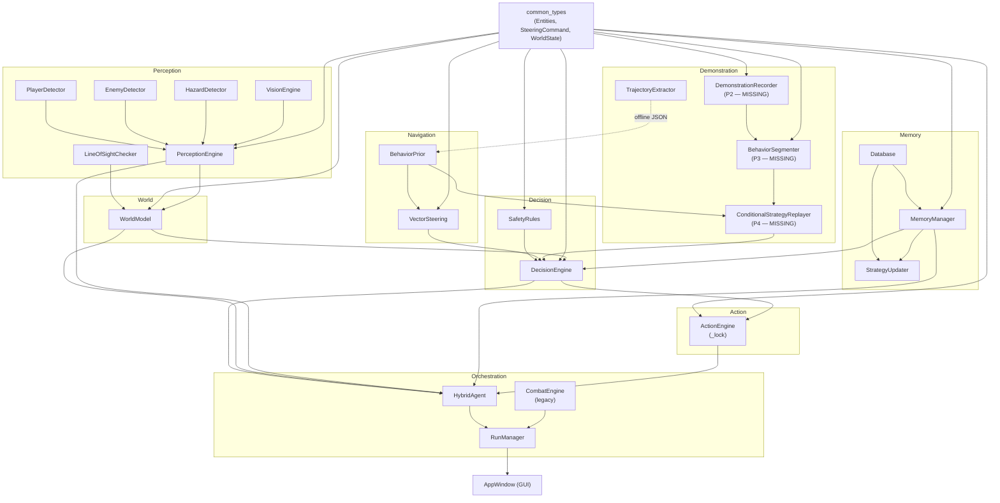

# TribalIslandBot – Module Interfaces Reference

> **Status:** Living document — updated as modules move from MISSING → COMPLETE.  
> **Last verified against codebase:** 2026-11-17  
> **Scope:** All 22 existing modules + 3 planned modules (P2–P7 roadmap)

---

## Table of Contents

1. [Architecture Invariants](#1-architecture-invariants)
2. [Data Contracts (Shared Types)](#2-data-contracts-shared-types)
3. [Module Catalogue](#3-module-catalogue)
   - [Perception Layer](#31-perception-layer)
   - [World Layer](#32-world-layer)
   - [Navigation Layer](#33-navigation-layer)
   - [Decision Layer](#34-decision-layer)
   - [Memory Layer](#35-memory-layer)
   - [Demonstration Layer](#36-demonstration-layer)
   - [Action Layer](#37-action-layer)
   - [Orchestration Layer](#38-orchestration-layer)
   - [Legacy / Reusable](#39-legacy--reusable)
   - [GUI](#310-gui)
4. [NEW Modules (P2–P7)](#4-new-modules-p2p7)
5. [Inter-Module Dependency Table](#5-inter-module-dependency-table)
6. [Module Dependency Diagram](#6-module-dependency-diagram)
7. [Interface Contracts](#7-interface-contracts)
8. [Thread Safety Notes](#8-thread-safety-notes)

---

## 1. Architecture Invariants

These rules are **absolute** and must never be violated by any module, present or future:

| # | Invariant |
|---|-----------|
| I-1 | **Only `ActionEngine` may send input to the game.** No other module calls ADB or pydirectinput directly. |
| I-2 | **All modules communicate action intent via `SteeringCommand`.** No module passes raw coordinates to another. |
| I-3 | **Execution priority: Safety → Tactical → Demonstration → Fallback.** SafetyRules output is never overridden. |
| I-4 | **No strategy (including demonstrations) can override Safety Rules.** |
| I-5 | **Thread-safe access:** `ActionEngine._lock` guards all ADB calls; `Database._lock` guards all SQLite writes. |

---

## 2. Data Contracts (Shared Types)

**File:** `core/common_types.py` — **COMPLETE**

All modules import these dataclasses. No module may define a parallel equivalent.

### 2.1 `Entity`

```python
@dataclass
class Entity:
    x: float                  # Normalized [0, 1] horizontal position
    y: float                  # Normalized [0, 1] vertical position
    entity_type: str          # "player" | "enemy" | "hazard"
    hp_ratio: float = 1.0     # 0.0 (dead) → 1.0 (full)
    confidence: float = 1.0   # Detection confidence [0, 1]
```

### 2.2 `PerceptionResult`

```python
@dataclass
class PerceptionResult:
    player: Optional[Entity]
    enemies: List[Entity]
    hazards: List[Entity]
    hp_ratio: float              # Player HP [0, 1]
    floor_number: int            # OCR-detected floor, 0 if unknown
    is_lobby: bool
    is_level_up: bool
    is_battle_end: bool
    confidence: float            # Overall perception confidence [0, 1]
    timestamp: float             # time.time() at capture
```

### 2.3 `WorldState`

```python
@dataclass
class WorldState:
    player: Optional[Entity]
    enemies: List[Entity]
    hazards: List[Entity]
    hp_ratio: float
    floor_number: int
    is_stuck: bool
    stuck_duration: float        # Seconds stuck
    los_blocked: bool            # Line-of-sight to nearest enemy blocked
    escape_angle: float          # Suggested escape angle (degrees)
    is_lobby: bool
    is_level_up: bool
    is_battle_end: bool
    timestamp: float
```

### 2.4 `SteeringCommand` — The ONLY Action Contract

```python
@dataclass
class SteeringCommand:
    action_type: str = "MOVE"       # "MOVE" | "ATTACK" | "SKILL" | "HEAL" |
                                    # "SELECT_PERK" | "HOLD"
    angle_degrees: float = 90.0     # Target direction (0=right, 90=up, 180=left, 270=down)
    distance_ratio: float = 1.0     # Joystick deflection [0.0, 1.0]
    duration_ms: int = 400          # How long to hold the action
    perk_index: int = 1             # 0–2, used only for SELECT_PERK
    reason: str = "normal_kiting"   # Logging / debugging label
```

---

## 3. Module Catalogue

---

### 3.1 Perception Layer

---

#### `PerceptionEngine`

| Attribute | Value |
|-----------|-------|
| **File** | `core/perception/perception_engine.py` |
| **Status** | ✅ COMPLETE |
| **Responsibility** | Orchestrates all sub-detectors to produce a `PerceptionResult` from a raw frame. |
| **Dependencies** | `PlayerDetector`, `EnemyDetector`, `HazardDetector`, `VisionEngine`, `common_types` |
| **Thread Safety** | Stateless per call; safe to call from any thread. |

**Public Interface:**

```python
class PerceptionEngine:
    def __init__(self, vision_engine: VisionEngine) -> None: ...

    def analyze(
        self,
        frame: np.ndarray,
        check_ocr_floor: bool = False
    ) -> PerceptionResult:
        """
        Analyze a raw BGR frame and return structured game state.

        Args:
            frame:          BGR image array (1920×1080 expected).
            check_ocr_floor: If True, run OCR to detect floor number (slower).

        Returns:
            PerceptionResult with all detections populated.

        Postcondition:
            result.timestamp == time.time() at call start.
            result.confidence in [0, 1].
        """
```

---

#### `PlayerDetector`

| Attribute | Value |
|-----------|-------|
| **File** | `core/perception/detector_player.py` |
| **Status** | ✅ COMPLETE |
| **Responsibility** | Detect player entity using HSV green HP bar. |
| **Thread Safety** | Stateless per call; safe. |

**Public Interface:**

```python
class PlayerDetector:
    def detect(self, frame: np.ndarray) -> Optional[Entity]: ...
```

---

#### `EnemyDetector`

| Attribute | Value |
|-----------|-------|
| **File** | `core/perception/detector_enemy.py` |
| **Status** | ✅ COMPLETE |
| **Responsibility** | Detect enemy entities using HSV red HP bar. |
| **Thread Safety** | Stateless per call; safe. |

**Public Interface:**

```python
class EnemyDetector:
    def detect(self, frame: np.ndarray) -> List[Entity]: ...
```

---

#### `HazardDetector`

| Attribute | Value |
|-----------|-------|
| **File** | `core/perception/detector_hazard.py` |
| **Status** | ✅ COMPLETE (requires `stump_sample.png`) |
| **Responsibility** | Detect environmental hazards via template matching + HSV wood color. |
| **Thread Safety** | Stateless per call; safe. |

**Public Interface:**

```python
class HazardDetector:
    def detect(self, frame: np.ndarray) -> List[Entity]: ...
```

> **⚠️ Dependency:** Requires `assets/stump_sample.png` at startup. Missing file causes hazard detection to silently return empty list.

---

#### `LineOfSightChecker`

| Attribute | Value |
|-----------|-------|
| **File** | `core/perception/line_of_sight.py` |
| **Status** | ✅ COMPLETE |
| **Responsibility** | Geometric segment-circle intersection test for LOS checks. |
| **Thread Safety** | Stateless; safe. |

**Public Interface:**

```python
class LineOfSightChecker:
    def check(
        self,
        origin: Tuple[float, float],
        target: Tuple[float, float],
        obstacles: List[Entity],
        obstacle_radius: float = 0.05
    ) -> bool:
        """Returns True if LOS is clear (no obstacle intersects the segment)."""
```

---

#### `VisionEngine`

| Attribute | Value |
|-----------|-------|
| **File** | `core/engine_vision.py` |
| **Status** | ✅ EXISTING_AND_REUSABLE |
| **Responsibility** | HP%, floor OCR, lobby/level-up/end-of-battle screen detection. |
| **Thread Safety** | Stateless; safe. |

**Public Interface:**

```python
class VisionEngine:
    def get_hp_ratio(self, frame: np.ndarray) -> float: ...
    def get_floor_number(self, frame: np.ndarray) -> int: ...
    def is_lobby(self, frame: np.ndarray) -> bool: ...
    def is_level_up(self, frame: np.ndarray) -> bool: ...
    def is_battle_end(self, frame: np.ndarray) -> bool: ...
```

---

### 3.2 World Layer

---

#### `WorldModel`

| Attribute | Value |
|-----------|-------|
| **File** | `core/world/world_model.py` |
| **Status** | ✅ COMPLETE |
| **Responsibility** | Converts `PerceptionResult` to `WorldState`, tracks stuck detection, computes LOS and escape angles. |
| **Dependencies** | `LineOfSightChecker`, `common_types` |
| **Thread Safety** | Stateful (position history). Call only from the main agent loop or protect with an external lock. |

**Public Interface:**

```python
class WorldModel:
    def __init__(self) -> None: ...

    def update(self, perception: PerceptionResult) -> WorldState:
        """
        Integrate new perception into the world model.

        Precondition:
            perception.timestamp > last processed timestamp.

        Postcondition:
            Returned WorldState reflects stuck detection, LOS status,
            and escape angle computed from current enemy/hazard positions.
        """
```

> **Known Issue:** `WorldModel.stuck_start_time` is tracked internally but `stuck_duration` in `WorldState` is sourced from `blocked_los` timing, not from `stuck_start_time`. See GAP-ANALYSIS §3.

---

### 3.3 Navigation Layer

---

#### `VectorSteering`

| Attribute | Value |
|-----------|-------|
| **File** | `core/navigation/vector_steering.py` |
| **Status** | ✅ COMPLETE — includes `BehaviorPrior` hook |
| **Responsibility** | Multi-objective directional scoring across 36 candidate angles (10° steps). Weights: w_s (safety), w_d (distance), w_l (LOS), w_m (momentum), w_demo (demonstration). |
| **Dependencies** | `BehaviorPrior`, `common_types` |
| **Thread Safety** | Stateless per call; safe. |

**Public Interface:**

```python
class VectorSteering:
    def __init__(self, behavior_prior: Optional[BehaviorPrior] = None) -> None: ...

    def find_best_angle(
        self,
        world: WorldState,
        obstacles: List[Entity],
        memory_bias: Optional[Any] = None
    ) -> Tuple[float, float]:
        """
        Find the best movement angle and distance ratio.

        Returns:
            (angle_degrees, distance_ratio) — the highest-scoring direction.

        Postcondition:
            angle_degrees in [0, 360).
            distance_ratio in [0.0, 1.0].
        """
```

---

#### `StuckDetector`

| Attribute | Value |
|-----------|-------|
| **File** | `core/navigation/stuck_detector.py` |
| **Status** | ✅ COMPLETE — **NOT USED** (WorldModel handles stuck detection inline) |
| **Responsibility** | Time-window position tracking to detect when the player is not moving. |
| **Thread Safety** | Stateful; not thread-safe without external lock. |

> **⚠️ Duplication:** `WorldModel` has its own stuck detection. `StuckDetector` is redundant. Resolution: either replace `WorldModel`'s inline logic with `StuckDetector`, or deprecate `StuckDetector`. See GAP-ANALYSIS.

**Public Interface:**

```python
class StuckDetector:
    def __init__(self, window_seconds: float = 2.0, threshold: float = 0.02) -> None: ...

    def update(self, x: float, y: float, timestamp: float) -> bool:
        """Returns True if player is considered stuck."""

    def reset(self) -> None: ...
```

---

### 3.4 Decision Layer

---

#### `DecisionEngine`

| Attribute | Value |
|-----------|-------|
| **File** | `core/decision/decision_engine.py` |
| **Status** | ✅ COMPLETE |
| **Responsibility** | 3-tier decision logic: Safety override → LOS-based routing → VectorSteering scoring. Produces a `SteeringCommand`. |
| **Dependencies** | `SafetyRules`, `VectorSteering`, `MemoryManager`, `common_types` |
| **Thread Safety** | Stateless per call; safe. |

**Public Interface:**

```python
class DecisionEngine:
    def __init__(
        self,
        safety_rules: SafetyRules,
        vector_steering: VectorSteering,
        memory_manager: Optional[MemoryManager] = None
    ) -> None: ...

    def decide(
        self,
        world: WorldState,
        obstacles: List[Entity],
        memory_bias: Optional[Any] = None
    ) -> SteeringCommand:
        """
        Produce the best SteeringCommand for the current world state.

        Decision order (Invariant I-3):
          1. SafetyRules.evaluate(world) — if not None, return immediately.
          2. LOS-based direction (escape_angle if los_blocked).
          3. VectorSteering.find_best_angle(world, obstacles, memory_bias).

        Postcondition:
            If SafetyRules returned a command, that command is returned verbatim.
            No other module may suppress or transform a Safety command.
        """
```

---

#### `SafetyRules`

| Attribute | Value |
|-----------|-------|
| **File** | `core/decision/safety_rules.py` |
| **Status** | ✅ COMPLETE |
| **Responsibility** | Hard-coded safety rules: HP critical → HEAL, enemy too close → flee, stuck → escape, low confidence → HOLD. |
| **Thread Safety** | Stateless per call; safe. |

**Public Interface:**

```python
class SafetyRules:
    def evaluate(self, world: WorldState) -> Optional[SteeringCommand]:
        """
        Evaluate safety conditions.

        Returns:
            SteeringCommand if any safety rule fires, None otherwise.

        Postcondition (Invariant I-3, I-4):
            A returned command MUST be executed without modification.
            No downstream module may filter or override it.
        """
```

---

### 3.5 Memory Layer

---

#### `Database`

| Attribute | Value |
|-----------|-------|
| **File** | `core/memory/database.py` |
| **Status** | ✅ COMPLETE |
| **Responsibility** | SQLite persistence layer. 4 tables: `runs`, `floor_records`, `battle_events`, `strategy_stats`. |
| **Thread Safety** | `_lock: threading.Lock` guards all write operations. Reads are unguarded (SQLite WAL mode). |

**Tables:**

| Table | Key Columns |
|-------|------------|
| `runs` | `run_id`, `start_time`, `target_floor`, `reached_floor`, `result` |
| `floor_records` | `run_id`, `floor_num`, `start_hp`, `end_hp`, `duration_s`, `strategy`, `result` |
| `battle_events` | `run_id`, `floor_num`, `event_type`, `player_x`, `player_y`, `details_json` |
| `strategy_stats` | `strategy_name`, `utility_score`, `win_rate`, `avg_floors` |

**Public Interface (abbreviated):**

```python
class Database:
    _lock: threading.Lock   # Protects all write operations

    def __init__(self, db_path: str = "data/bot_memory.db") -> None: ...
    def insert_run(self, ...) -> int: ...
    def update_run(self, run_id: int, ...) -> None: ...
    def insert_floor_record(self, ...) -> None: ...
    def insert_event(self, ...) -> None: ...
    def get_strategy_stats(self) -> List[Dict]: ...
    def upsert_strategy_stat(self, ...) -> None: ...
```

---

#### `MemoryManager`

| Attribute | Value |
|-----------|-------|
| **File** | `core/memory/memory_manager.py` |
| **Status** | ⚠️ PARTIAL — Procedural Memory layer missing |
| **Responsibility** | 3-layer memory: Working (session state), Episodic (run/floor history via DB), Semantic (strategy weights). |
| **Dependencies** | `Database` |
| **Thread Safety** | Delegates writes to `Database._lock`. Working memory is single-threaded (agent loop). |

**Public Interface:**

```python
class MemoryManager:
    def __init__(self, db: Database) -> None: ...

    # --- Run Lifecycle ---
    def start_run(self, target_floor: int) -> int:
        """Start a new run record. Returns run_id."""

    def end_run(
        self,
        reached_floor: int,
        result: str,
        total_stuck: int,
        total_heals: int,
        final_hp: float
    ) -> None: ...

    # --- Floor Records ---
    def record_floor(
        self,
        floor_num: int,
        start_hp: float,
        end_hp: float,
        duration: float,
        stuck_count: int,
        strategy: str,
        result: str
    ) -> None: ...

    # --- Events ---
    def record_event(
        self,
        floor_num: int,
        event_type: str,       # "STUCK" | "HEAL" | "DEATH" | "PERK" | ...
        player_x: float,
        player_y: float,
        details: str           # JSON-serialisable string
    ) -> None: ...

    # --- Strategy Weights (Semantic Memory) ---
    def get_strategy_weights(self) -> Tuple[float, float, float, float]:
        """Returns (w_safety, w_distance, w_los, w_momentum)."""

    def update_weights(
        self,
        w_s: float,
        w_d: float,
        w_l: float,
        w_m: float
    ) -> None: ...

    def rollback_to_baseline(self) -> None:
        """Reset strategy weights to hardcoded defaults."""
```

> **Gap:** No Procedural Memory (repeatable skill sequences). See §4 and GAP-ANALYSIS.

---

#### `StrategyUpdater`

| Attribute | Value |
|-----------|-------|
| **File** | `core/memory/strategy_updater.py` |
| **Status** | ⚠️ COMPLETE but limited to 3 hardcoded strategies |
| **Responsibility** | Utility scoring: U = 0.4·C + 0.3·S + 0.2·E + 0.1·T. Recommends weight adjustments. |
| **Dependencies** | `Database`, `MemoryManager` |
| **Thread Safety** | Read-heavy; uses `Database._lock` for stat writes. |

**Public Interface:**

```python
class StrategyUpdater:
    def __init__(self, db: Database, memory_manager: MemoryManager) -> None: ...

    def evaluate_all(self) -> Dict[str, float]:
        """
        Compute utility score U for each known strategy.

        U = 0.4·completion_rate + 0.3·survival_rate
          + 0.2·efficiency + 0.1·trend

        Returns:
            {strategy_name: utility_score, ...}
        """

    def recommend_weights(self) -> Tuple[float, float, float, float]:
        """
        Recommend (w_s, w_d, w_l, w_m) based on best-performing strategies.

        Postcondition:
            Sum of returned weights == 1.0 (after normalization).
        """
```

---

### 3.6 Demonstration Layer

---

#### `BehaviorPrior`

| Attribute | Value |
|-----------|-------|
| **File** | `core/demonstration/behavior_prior.py` |
| **Status** | ✅ COMPLETE — basic implementation |
| **Responsibility** | Load JSON trajectory files and score candidate movement angles against human demonstrations. |
| **Dependencies** | None (file I/O only) |
| **Thread Safety** | Load once at startup; `get_demonstration_score` is read-only after load. Safe. |

**Public Interface:**

```python
class BehaviorPrior:
    def load_demonstrations(self) -> None:
        """Load all JSON files from data/demonstrations/. Must be called before scoring."""

    def get_demonstration_score(
        self,
        candidate_angle: float,
        last_angle: float,
        enemy_dist: float
    ) -> float:
        """
        Score a candidate angle against loaded demonstrations.

        Args:
            candidate_angle: Angle under evaluation (degrees).
            last_angle:      Most recent executed angle.
            enemy_dist:      Normalized distance to nearest enemy [0, 1].

        Returns:
            Score in [0, 1]. Higher = more consistent with demonstrations.
        """
```

---

#### `TrajectoryExtractor`

| Attribute | Value |
|-----------|-------|
| **File** | `core/demonstration/trajectory_extractor.py` |
| **Status** | ✅ COMPLETE |
| **Responsibility** | Extract angle, speed, and enemy distance from demonstration video files. Outputs JSON trajectory files consumed by `BehaviorPrior`. |
| **Thread Safety** | Stateless; safe to call from worker threads. |

**Public Interface:**

```python
class TrajectoryExtractor:
    def extract_from_video(
        self,
        video_path: str,
        max_frames: int = 10000
    ) -> List[Dict]:
        """
        Process a video file and extract per-frame trajectory data.

        Returns:
            List of dicts: [{angle, speed, enemy_dist, timestamp}, ...]

        Postcondition:
            Output is JSON-serialisable.
            len(result) <= max_frames.
        """
```

---

### 3.7 Action Layer

---

#### `ActionEngine`

> See **ACTION_ENGINE_DESIGN.md** for the full detailed specification.

| Attribute | Value |
|-----------|-------|
| **File** | `core/action/action_engine.py` |
| **Status** | ✅ COMPLETE |
| **Responsibility** | **Sole module that sends input to the game.** Wraps ADB for screen capture and touch injection. |
| **Thread Safety** | `_lock: threading.Lock` — all ADB calls acquire this lock before execution. |

**Constants:**

```python
adb_path      = r"C:\Program Files\BlueStacks_nxt\HD-Adb.exe"
device_id     = "emulator-5554"

COORD_ATTACK    = (1757, 929)
COORD_SKILL     = (1761, 643)
COORD_HEAL      = (1445, 956)
COORD_START     = (980, 950)
COORD_END_BATTLE = (1390, 1000)
PERK_COORDS     = [(755, 701), (943, 701), (1132, 701)]
JOYSTICK_CENTER = (350, 750)
JOYSTICK_OFFSET = 160
```

**Public Interface:**

```python
class ActionEngine:
    _lock: threading.Lock   # Guards all ADB calls

    # --- Connection ---
    @staticmethod
    def ensure_connection() -> bool:
        """Verify ADB connection to device_id. Returns True if connected."""

    # --- Screen Capture ---
    @staticmethod
    def fast_capture_screen() -> Optional[np.ndarray]:
        """
        Capture via 'exec-out screencap -p'. Target: <100ms.
        Falls back to slower 'shell screencap' on failure.
        Returns BGR ndarray or None on error.
        """

    # --- Primitive Input ---
    @staticmethod
    def tap(x: int, y: int) -> None:
        """Send 'input tap x y'. Target: <50ms."""

    @staticmethod
    def swipe(x1: int, y1: int, x2: int, y2: int, duration_ms: int) -> None:
        """Send 'input swipe x1 y1 x2 y2 duration_ms'."""

    # --- Game Actions ---
    @staticmethod
    def attack() -> None: ...

    @staticmethod
    def use_skill() -> None: ...

    @staticmethod
    def heal() -> None: ...

    @staticmethod
    def click_start() -> None: ...

    @staticmethod
    def click_end_battle(coords: Optional[Tuple[int, int]] = None) -> None: ...

    @staticmethod
    def select_perk(index: int) -> None:
        """
        Select perk by index.
        Precondition: index in {0, 1, 2}.
        """

    # --- Movement ---
    @staticmethod
    def move_angle(
        angle_deg: float,
        distance_ratio: float,
        duration_ms: int
    ) -> None:
        """
        Swipe joystick from JOYSTICK_CENTER to angle/distance target.

        Math:
            dx = cos(radians(angle_deg)) * JOYSTICK_OFFSET * distance_ratio
            dy = -sin(radians(angle_deg)) * JOYSTICK_OFFSET * distance_ratio
            target = (JOYSTICK_CENTER[0] + dx, JOYSTICK_CENTER[1] + dy)
        """

    @staticmethod
    def move_direction(direction: str, duration_ms: int) -> None:
        """
        Move in a cardinal/ordinal direction string.
        direction: "N" | "NE" | "E" | "SE" | "S" | "SW" | "W" | "NW"
        """

    @staticmethod
    def stop_all() -> None:
        """Release all virtual touch points (joystick center tap)."""

    # --- Command Dispatcher ---
    @staticmethod
    def execute_command(cmd: SteeringCommand) -> None:
        """
        Dispatch a SteeringCommand to the appropriate primitive action.

        Dispatch table:
            MOVE        → move_angle(cmd.angle_degrees, cmd.distance_ratio, cmd.duration_ms)
            ATTACK      → attack()
            SKILL       → use_skill()
            HEAL        → heal()
            SELECT_PERK → select_perk(cmd.perk_index)
            HOLD        → stop_all()

        Precondition: cmd.action_type in {"MOVE","ATTACK","SKILL","HEAL","SELECT_PERK","HOLD"}
        Postcondition: Exactly one ADB command is issued per call.
        """
```

---

### 3.8 Orchestration Layer

---

#### `HybridAgent`

| Attribute | Value |
|-----------|-------|
| **File** | `core/hybrid_agent.py` |
| **Status** | ✅ COMPLETE for current architecture |
| **Responsibility** | Main agent loop. Integrates all 5 layers: Perception → World → Decision → Memory → Action. |
| **Dependencies** | All core modules |
| **Thread Safety** | Single main loop thread. Spawns no background threads itself. |

**Public Interface:**

```python
class HybridAgent:
    def __init__(
        self,
        perception: PerceptionEngine,
        world_model: WorldModel,
        decision_engine: DecisionEngine,
        memory_manager: MemoryManager,
        action_engine: ActionEngine
    ) -> None: ...

    def run_step(self) -> None:
        """Execute one agent tick (capture → perceive → model → decide → act)."""

    def run_loop(self, target_floor: int) -> None:
        """Run until target_floor reached or run ends."""

    def stop(self) -> None: ...
```

---

#### `RunManager`

| Attribute | Value |
|-----------|-------|
| **File** | `core/manager_run.py` |
| **Status** | ✅ COMPLETE |
| **Responsibility** | Run lifecycle management. Supports dual-mode: hybrid (HybridAgent) and legacy (CombatEngine). |

**Public Interface:**

```python
class RunManager:
    def start_hybrid_run(self, target_floor: int) -> None: ...
    def start_legacy_run(self, target_floor: int) -> None: ...
    def stop(self) -> None: ...
    def get_status(self) -> Dict: ...
```

---

### 3.9 Legacy / Reusable

---

#### `CombatEngine`

| Attribute | Value |
|-----------|-------|
| **File** | `core/engine_combat.py` |
| **Status** | ✅ EXISTING_AND_REUSABLE — fallback only |
| **Responsibility** | Legacy kiting pattern using pydirectinput. |
| **⚠️ Conflict** | Do not activate simultaneously with `ActionEngine`. Only one input path may be active. See GAP-ANALYSIS §3. |

---

### 3.10 GUI

---

#### `AppWindow`

| Attribute | Value |
|-----------|-------|
| **File** | `gui/app_window.py` |
| **Status** | ✅ EXISTS |
| **Responsibility** | Tkinter/Qt GUI window for bot control and monitoring. |

---

## 4. NEW Modules (P2–P7)

These modules do not exist yet. Interface contracts are defined here to guide implementation.

---

### 4.1 `DemonstrationRecorder` — P2

| Attribute | Value |
|-----------|-------|
| **Planned File** | `core/demonstration/demonstration_recorder.py` |
| **Status** | ❌ MISSING |
| **Responsibility** | Synchronously record `WorldState + raw frame + player action + game events` with timestamps during human play sessions. Replaces the indirect video → extraction pipeline with direct ground-truth capture. |

**New Type: `DemonstrationFrame`**

```python
@dataclass
class DemonstrationFrame:
    session_id: str
    source: str                    # "HUMAN" | "REPLAY" | "MIXED"
    world_state: WorldState
    frame: np.ndarray              # Raw BGR screenshot
    action: Optional[SteeringCommand]
    game_event: Optional[str]      # "PERK_SELECTED" | "HEAL_USED" | None
    timestamp: float
```

**Public Interface:**

```python
class DemonstrationRecorder:
    def __init__(self, output_dir: str = "data/demonstrations/") -> None: ...

    def start_recording(
        self,
        session_id: str,
        source: str = "HUMAN"
    ) -> None:
        """
        Begin a new demonstration recording session.

        Precondition: Not currently recording (stop_recording called, or fresh instance).
        Postcondition: is_recording == True.
        """

    def record_frame(
        self,
        world_state: WorldState,
        frame: np.ndarray,
        action: Optional[SteeringCommand],
        game_event: Optional[str] = None
    ) -> None:
        """
        Append one synchronized frame to the current recording.

        Precondition: start_recording has been called.
        Postcondition: Frame is buffered (not yet flushed to disk).
        Thread Safety: Must be called from recording thread only.
        """

    def stop_recording(self) -> List[DemonstrationFrame]:
        """
        End the session, flush buffer to disk as JSON, return all frames.

        Postcondition:
            is_recording == False.
            Frames saved to output_dir/{session_id}.json.
            Returns copy of recorded frames (not references).
        """

    @property
    def is_recording(self) -> bool: ...
```

---

### 4.2 `BehaviorSegmenter` — P3

| Attribute | Value |
|-----------|-------|
| **Planned File** | `core/demonstration/behavior_segmenter.py` |
| **Status** | ❌ MISSING |
| **Responsibility** | Segment a demonstration recording into labeled behavioral phases. Enables phase-conditioned replay (e.g., use combat phase patterns only during combat). |

**New Type: `BehaviorSegment`**

```python
@dataclass
class BehaviorSegment:
    phase: str                            # "APPROACH" | "COMBAT" | "RETREAT" | "STUCK"
    frames: List[DemonstrationFrame]
    start_timestamp: float
    end_timestamp: float
    metadata: Dict[str, Any]              # e.g., {"avg_enemy_dist": 0.3}
```

**Phase Definitions:**

| Phase | Trigger Conditions |
|-------|-------------------|
| `APPROACH` | Enemy visible, HP > 0.6, distance > 0.3 |
| `COMBAT` | Enemy visible, any distance, HP > 0.3 |
| `RETREAT` | HP < 0.3, or enemy very close (< 0.1) |
| `STUCK` | `world_state.is_stuck == True` |

**Public Interface:**

```python
class BehaviorSegmenter:
    def segment(
        self,
        frames: List[DemonstrationFrame]
    ) -> List[BehaviorSegment]:
        """
        Partition frames into contiguous behavioral segments.

        Precondition: frames is non-empty and time-ordered.
        Postcondition:
            All frames are covered (no gaps).
            Adjacent segments have different phases.
        """

    def detect_phase(self, world_state: WorldState) -> str:
        """
        Classify the current game phase for real-time use.

        Returns: "APPROACH" | "COMBAT" | "RETREAT" | "STUCK"
        Thread Safety: Stateless; safe from any thread.
        """
```

---

### 4.3 `ConditionalStrategyReplayer` — P4

| Attribute | Value |
|-----------|-------|
| **Planned File** | `core/demonstration/conditional_strategy_replayer.py` |
| **Status** | ❌ MISSING |
| **Responsibility** | Replay a recorded `BehaviorSegment` strategy when preconditions match the current world state. Integrates with the Decision pipeline between Tactical and Fallback tiers (Invariant I-3). |

**Public Interface:**

```python
class ConditionalStrategyReplayer:
    def __init__(
        self,
        behavior_segmenter: BehaviorSegmenter,
        behavior_prior: BehaviorPrior
    ) -> None: ...

    def check_preconditions(
        self,
        strategy: BehaviorSegment,
        world_state: WorldState
    ) -> bool:
        """
        Determine if a strategy's preconditions are satisfied.

        Checks:
          - Current phase matches strategy.phase.
          - Enemy count / distance within strategy's metadata range.
          - HP ratio compatible with strategy context.

        Returns: True if strategy is applicable.
        """

    def replay(
        self,
        strategy: BehaviorSegment,
        world_state: WorldState
    ) -> Optional[SteeringCommand]:
        """
        Produce the next SteeringCommand from strategy playback.

        Returns:
            SteeringCommand if the next frame action is valid, else None.

        Postcondition (Invariant I-4):
            Returned command will NOT be a Safety-tier command.
            Safety evaluation is ALWAYS done by DecisionEngine before replay.
        """

    def should_abort(
        self,
        strategy: BehaviorSegment,
        current_world: WorldState
    ) -> bool:
        """
        Determine if ongoing replay should be aborted.

        Abort conditions:
          - Phase changed from strategy.phase.
          - HP dropped below critical threshold.
          - Player stuck for > 3 seconds.

        Returns: True if replay should stop immediately.
        """
```

---

## 5. Inter-Module Dependency Table

| Module | Depends On | Used By |
|--------|-----------|---------|
| `common_types` | — | **ALL modules** |
| `Database` | `common_types` | `MemoryManager` |
| `MemoryManager` | `Database` | `DecisionEngine`, `HybridAgent`, `StrategyUpdater` |
| `StrategyUpdater` | `Database`, `MemoryManager` | `HybridAgent` |
| `VisionEngine` | `common_types` | `PerceptionEngine` |
| `PlayerDetector` | `common_types` | `PerceptionEngine` |
| `EnemyDetector` | `common_types` | `PerceptionEngine` |
| `HazardDetector` | `common_types` | `PerceptionEngine` |
| `LineOfSightChecker` | `common_types` | `WorldModel` |
| `PerceptionEngine` | `PlayerDetector`, `EnemyDetector`, `HazardDetector`, `VisionEngine` | `HybridAgent` |
| `WorldModel` | `LineOfSightChecker`, `common_types` | `HybridAgent` |
| `BehaviorPrior` | `common_types` (file I/O) | `VectorSteering`, `ConditionalStrategyReplayer` |
| `TrajectoryExtractor` | `common_types` | `BehaviorPrior` (offline) |
| `VectorSteering` | `BehaviorPrior`, `common_types` | `DecisionEngine` |
| `StuckDetector` | `common_types` | *(unused — WorldModel handles it)* |
| `SafetyRules` | `common_types` | `DecisionEngine` |
| `DecisionEngine` | `SafetyRules`, `VectorSteering`, `MemoryManager` | `HybridAgent` |
| `ActionEngine` | `common_types` (ADB) | `HybridAgent`, `RunManager` |
| `HybridAgent` | **All above** | `RunManager` |
| `RunManager` | `HybridAgent`, `CombatEngine` | GUI / CLI |
| `CombatEngine` | *(pydirectinput)* | `RunManager` (legacy) |
| `AppWindow` | `RunManager` | User |
| **DemonstrationRecorder** | `common_types` | `HybridAgent` (P2) |
| **BehaviorSegmenter** | `DemonstrationRecorder`, `common_types` | `ConditionalStrategyReplayer` (P3) |
| **ConditionalStrategyReplayer** | `BehaviorSegmenter`, `BehaviorPrior` | `DecisionEngine` (P4) |

---

## 6. Module Dependency Diagram



---

## 7. Interface Contracts

### Pre/Postcondition Summary

| Method | Preconditions | Postconditions |
|--------|--------------|----------------|
| `PerceptionEngine.analyze(frame)` | `frame.shape == (1080, 1920, 3)` | `result.timestamp` set; `result.confidence ∈ [0,1]` |
| `WorldModel.update(perception)` | `perception.timestamp > last timestamp` | `WorldState` reflects latest stuck/LOS status |
| `DecisionEngine.decide(world, obstacles)` | `world` is current tick's `WorldState` | Safety commands returned verbatim; never modified |
| `SafetyRules.evaluate(world)` | — | Returns `None` or a valid `SteeringCommand` |
| `ActionEngine.execute_command(cmd)` | `cmd.action_type` in valid set | Exactly one ADB command issued |
| `ActionEngine.select_perk(index)` | `index ∈ {0, 1, 2}` | Tap at `PERK_COORDS[index]` |
| `ActionEngine.move_angle(...)` | `distance_ratio ∈ [0.0, 1.0]` | Swipe issued with correct endpoint math |
| `MemoryManager.start_run(target_floor)` | No active run | Returns new `run_id > 0` |
| `MemoryManager.end_run(...)` | `start_run` was called | DB row updated; working memory cleared |
| `DemonstrationRecorder.record_frame(...)` | `start_recording` called | Frame appended to buffer |
| `DemonstrationRecorder.stop_recording()` | `start_recording` was called | `is_recording == False`; frames flushed to JSON |
| `BehaviorSegmenter.segment(frames)` | `frames` non-empty, time-ordered | All frames covered; adjacent phases differ |
| `ConditionalStrategyReplayer.replay(...)` | `check_preconditions` returned True | Returned command is not a Safety-tier command |

---

## 8. Thread Safety Notes

| Module | Thread Safety Model |
|--------|-------------------|
| `ActionEngine` | `_lock: threading.Lock` — **all ADB calls** acquire this lock. Never call ADB outside ActionEngine. |
| `Database` | `_lock: threading.Lock` — all **write** operations guarded. SQLite WAL mode enables concurrent reads. |
| `MemoryManager` | Writes delegate to `Database._lock`. Working memory (`start_run`/`end_run`) must be called from a single thread. |
| `PerceptionEngine` | Stateless per call — thread-safe. Can be called from capture thread. |
| `WorldModel` | Stateful (position history). Must be called from a **single thread** (agent loop) or guarded with external lock. |
| `VectorSteering` | Stateless per call — thread-safe. |
| `SafetyRules` | Stateless — thread-safe. |
| `DecisionEngine` | Stateless per call — thread-safe. |
| `BehaviorPrior` | Thread-safe after `load_demonstrations()`. Do not call `load_demonstrations()` concurrently. |
| `DemonstrationRecorder` | Record from one thread only. `stop_recording` may be called from a different thread (uses internal buffer lock). |
| `BehaviorSegmenter` | Stateless per call — thread-safe. |
| `ConditionalStrategyReplayer` | Stateful (replay position pointer). Must be called from agent loop thread only. |

---

*End of MODULE_INTERFACES.md*
