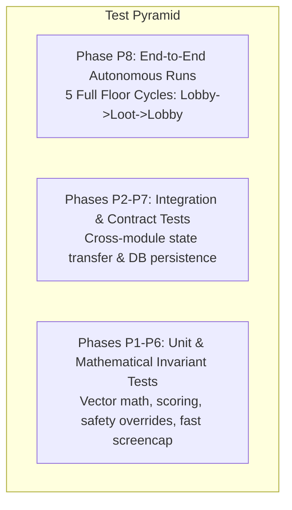

# TESTING & ACCEPTANCE CRITERIA SPECIFICATION
## TribalIslandBot – Verification, Safety Invariants & Quality Assurance Framework

> **Document Version:** 1.0  
> **Scope:** Full System Verification across Phases P1–P8  
> **Last Updated:** 2026-11-17  
> **Status:** APPROVED FOR IMPLEMENTATION  

---

## 1. Testing Philosophy & Verification Pyramid

TribalIslandBot operates in an asynchronous, physical emulation environment (BlueStacks on Windows). Standard mock-only testing is insufficient because touch latency, screen jitter, and obstacle collision can cause silent behavioral failure.

### Testing Principles:
1. **Safety Invariants Are Non-Negotiable:** Any test run where a Safety Rule fails to override a lower-tier command is an automatic, total build failure.
2. **Confidence-Gated Testing:** Visual perception tests must verify not only the returned bounding box/coordinates but also that `confidence \in [0.0, 1.0]` accurately reflects degraded conditions.
3. **Deterministic Unit Tests + Live Simulation:** Unit tests use synthetic arrays and frozen image assets; integration tests validate live ADB connectivity and database persistence.
4. **Zero Flakiness Tolerance:** Retries are forbidden in unit assertion suites; flaky tests indicate unhandled race conditions in the vision or actuation loops.



---

## 2. Mandatory Architecture Safety Invariant Tests

Before merging code in any phase, the following 5 invariant test suites must pass:

### Invariant Suite 1: Safety Rule Absolute Preemption
- **Target:** `core/decision/safety_rules.py` & `core/decision/decision_engine.py`
- **Assertion:** When `player_hp < 35.0%`, `DecisionEngine.decide()` must return `action_type="HEAL"` regardless of what `VectorSteering` or `ConditionalStrategyReplayer` proposes.
- **Assertion:** When nearest enemy $< 160\text{ px}$, the generated direction must point in the half-plane opposing the enemy ($\Delta \theta \ge 90^\circ$ away from enemy vector).
- **Pass Criterion:** 100/100 synthetic dangerous world states trigger emergency intervention.

### Invariant Suite 2: Single Action Executor Rule
- **Target:** Full codebase audit
- **Assertion:** No module other than `ActionEngine` executes subprocess calls to `HD-Adb.exe` or imports `pydirectinput`.
- **Pass Criterion:** Static analysis check (`grep` / AST inspection) finds 0 occurrences of input execution outside `core/action/action_engine.py`.

### Invariant Suite 3: Immutable Source Code & Safety Thresholds
- **Target:** `core/memory/` & learning modules
- **Assertion:** `StrategyUpdater` and `MemoryManager` have zero file write handlers targeting `*.py` or `config/settings.json`.
- **Assertion:** Safety thresholds (`hp_critical_percent = 35.0`, `danger_enemy_dist = 160.0`) remain constant regardless of database updates.
- **Pass Criterion:** Verify file hashes of source code remain identical before and after 1,000 learning update iterations.

### Invariant Suite 4: Sub-Second Rollback Verification
- **Target:** `MemoryManager.rollback_to_baseline()`
- **Assertion:** Invoking rollback restores weights to `(0.35, 0.25, 0.25, 0.15)` within $< 10\text{ ms}$.
- **Pass Criterion:** Measured execution time $\le 10\text{ ms}$; state verified via `get_strategy_weights()`.

### Invariant Suite 5: Heal Cooldown Enforcement
- **Target:** `SafetyRules.heal_cooldown`
- **Assertion:** Two consecutive heal signals separated by $< 3.0\text{ s}$ must reject the second heal attempt.
- **Pass Criterion:** 0 duplicate heal signals within cooldown window.

---

## 3. Phase-by-Phase Acceptance Criteria (P1 – P8)

### Phase P1: Unified Action Engine
| Test ID | Level | Test Description | Success Condition |
|---|---|---|---|
| **T-P1-01** | Unit | Vector math polar-to-Cartesian conversion | $0^\circ \implies (510, 750)$, $90^\circ \implies (350, 590)$ ($\pm 1\text{px}$) |
| **T-P1-02** | Unit | `fast_capture_screen` RAM benchmark | Latency $< 100\text{ ms}$ over 20 consecutive captures |
| **T-P1-03** | Int | 30s background actuation | 0 mouse focus interruptions on host OS |
| **T-P1-04** | Int | Reconnection on ADB port restart | Recovers connection in $< 5\text{ s}$ without bot crash |

---

### Phase P2: Demonstration Recorder
| Test ID | Level | Test Description | Success Condition |
|---|---|---|---|
| **T-P2-01** | Unit | Frame-to-State synchronization | Recorded timestamp matches frame capture time within $\pm 20\text{ ms}$ |
| **T-P2-02** | Unit | Data provenance labeling | 100% of recorded frames tagged with `source="HUMAN"` or `source="BOT"` |
| **T-P2-03** | Int | Continuous 5-minute recording | Zero memory leaks; DB writes consume $< 15\text{ MB}$ RAM |

---

### Phase P3: Behavior Segmentation
| Test ID | Level | Test Description | Success Condition |
|---|---|---|---|
| **T-P3-01** | Unit | Phase state machine transitions | Correct classification of `APPROACH` $\rightarrow$ `COMBAT` $\rightarrow$ `RETREAT` |
| **T-P3-02** | Unit | Stuck recovery segment identification | Flags segment as `STUCK_RECOVERY` when position delta $< 30\text{ px}$ |
| **T-P3-03** | Int | Batch extraction from reference video | Produces valid JSON trajectory with $\ge 90\%$ phase accuracy |

---

### Phase P4: Conditional Strategy Replay
| Test ID | Level | Test Description | Success Condition |
|---|---|---|---|
| **T-P4-01** | Unit | Precondition verification | Replay rejected if character HP $< 50\%$ or enemy distance $< 150\text{ px}$ |
| **T-P4-02** | Unit | Abort condition trigger | Replay terminates within $< 50\text{ ms}$ if HP drops by $> 15\%$ |
| **T-P4-03** | Int | Replay to VectorSteering fallback | Smooth transition between Replay and Tier 4 scoring with 0 frame stalls |

---

### Phase P5: Perception & World State
| Test ID | Level | Test Description | Success Condition |
|---|---|---|---|
| **T-P5-01** | Unit | Line of Sight stump occlusion | Returns `has_clear_shot=False` when stump intersects line to target |
| **T-P5-02** | Unit | Character detection accuracy | Green HP bar detected with confidence $\ge 0.90$ across reference assets |
| **T-P5-03** | Unit | OCR floor detection | Correctly reads numeric floor value with zero character misreads |

---

### Phase P6: Hybrid Decision Engine
| Test ID | Level | Test Description | Success Condition |
|---|---|---|---|
| **T-P6-01** | Unit | 4-tier single ownership enforcement | Exactly one tier issues command; upstream tiers always take priority |
| **T-P6-02** | Unit | VectorSteering 8-direction scoring | Evaluates all 8 candidates and selects highest positive score in $< 15\text{ ms}$ |
| **T-P6-03** | Int | Combat rhythm continuity | Character maintains continuous movement + attack rhythm without pauses |

---

### Phase P7: Long-Term Memory & Adaptive Learning
| Test ID | Level | Test Description | Success Condition |
|---|---|---|---|
| **T-P7-01** | Unit | Utility score formula verification | $U = 0.4C + 0.3S + 0.2E + 0.1T$ computes exact floating-point value |
| **T-P7-02** | Unit | Safe weight bounds clamping | Weights never exceed $[0.05, 0.60]$ intervals under any update |
| **T-P7-03** | Int | Multi-session persistence | Close bot, re-open $\implies$ 100% of run history and stats preserved |
| **T-P7-04** | Int | Automated rollback on simulated failure | Rollback fires and baseline weights restored after 3 simulated wipeouts |

---

### Phase P8: Full Integration
| Test ID | Level | Test Description | Success Condition |
|---|---|---|---|
| **T-P8-01** | System | Complete floor progression | Climbs from Floor 1 to Target Floor autonomously |
| **T-P8-02** | System | Fixed End Condition (Suicide Mode) | Upon reaching Target Floor, character stands still, dies, and loots chest |
| **T-P8-03** | System | 5-Run stress test | Bot executes 5 continuous runs without unhandled crash or freeze |

---

## 4. Performance Benchmarks

| Metric | Target | Hard Upper Limit | Test Measurement Method |
|---|---|---|---|
| **ADB Fast Screencap** | $\le 85\text{ ms}$ | $110\text{ ms}$ | Timestamp delta across `cv2.imdecode` |
| **Perception Analysis** | $\le 60\text{ ms}$ | $90\text{ ms}$ | Time spent in `PerceptionEngine.analyze()` |
| **Spatial Model Update** | $\le 10\text{ ms}$ | $20\text{ ms}$ | Time spent in `WorldModel.update()` |
| **Decision Formulation**| $\le 15\text{ ms}$ | $30\text{ ms}$ | Time spent in `DecisionEngine.decide()` |
| **Full Vision-to-Action** | $\le 170\text{ ms}$ | $250\text{ ms}$ | Total loop cycle from frame capture to swipe dispatch |
| **Database Transaction** | $\le 20\text{ ms}$ | $50\text{ ms}$ | SQLite commit latency in WAL mode |
| **Rollback Execution** | $\le 5\text{ ms}$ | $10\text{ ms}$ | Reset execution time in RAM |

---

## 5. Automated Regression Test Suite

All developers and automated agents must run the standard test suite prior to committing changes:

```powershell
# Run the complete test suite
python -m unittest discover -s tests -p "test_*.py" -v
```

### Pre-merge Checklist:
- [ ] Zero test failures or errors.
- [ ] Code formatting conforms to PEP 8 standards.
- [ ] No hardcoded file paths outside config files.
- [ ] No `pydirectinput` imports in the active codebase.
- [ ] All database queries use parameterized inputs (SQL injection prevention).
