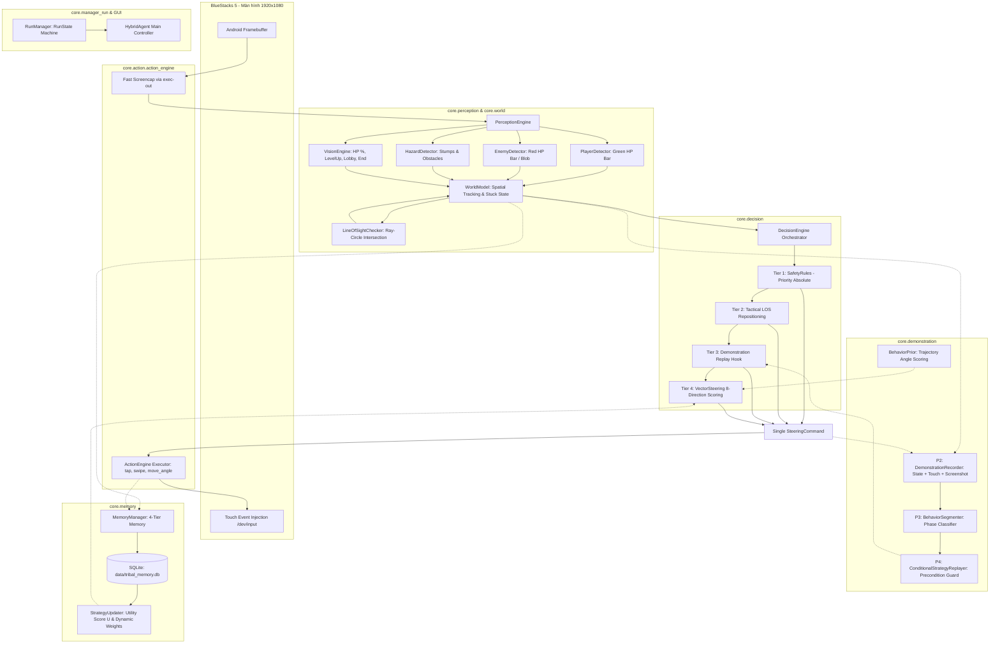
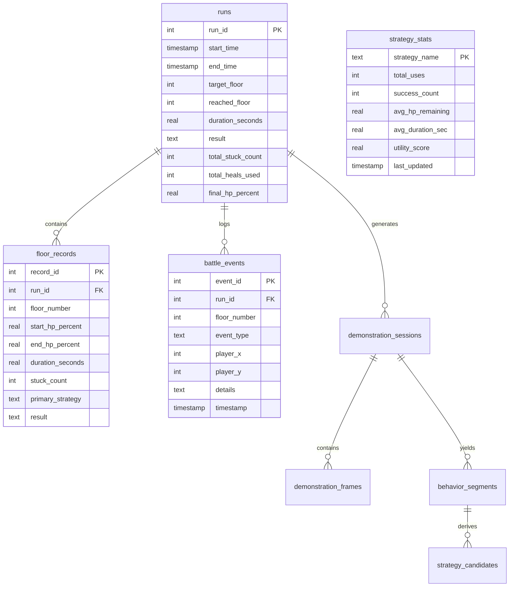

# TECHNICAL DESIGN SPECIFICATION (TDS)
# TRIBAL ISLAND BOT – AUTONOMOUS HYBRID AGENT (LEVEL 3)
## Hybrid Demonstration Learning + Long-Term Persistent Memory + Adaptive Decision

> **Document Identifier:** `TRIBAL_ISLAND_BOT_TDS.md`  
> **Master Architecture Version:** 3.0  
> **Status:** APPROVED MASTER ARCHITECTURE SPECIFICATION  
> **Target Platform:** BlueStacks 5 (Android 11 x86_64, 1920×1080), Python 3.11, Windows 11, SQLite 3  
> **Last Updated:** 2026-11-17  

---

## 1. MỤC TIÊU & TỔNG QUAN HỆ THỐNG

**TribalIslandBot** là hệ thống AI chơi game tự động hoàn chỉnh (Autonomous Hybrid Agent - Level 3) cho tựa game *Tribal Island* trên giả lập Android BlueStacks 5. Bot được thiết kế để thay thế thao tác thủ công của người chơi thông qua vòng lặp nhận thức - hành động - học hỏi liên tục:

$$\text{Quan sát} \longrightarrow \text{Mô hình hóa} \longrightarrow \text{Quyết định} \longrightarrow \text{Hành động} \longrightarrow \text{Ghi nhớ} \longrightarrow \text{Cải thiện}$$

### 9 Năng Lực Cốt Lõi:
1. **Quan sát:** Ghi nhận toàn bộ luồng game qua fast screencap ADB $(< 100\text{ ms})$ và trích xuất thực thể bằng Computer Vision (OpenCV).
2. **Ghi nhận:** Lưu vết đồng bộ trạng thái thế giới, ảnh chụp màn hình, thao tác chạm/vuốt, nhãn nguồn dữ liệu (HUMAN vs BOT) và kết quả.
3. **Phân tích:** Phân đoạn chuỗi hành vi liên tục thành các pha chiến thuật rõ rệt (`APPROACH`, `COMBAT`, `RETREAT`, `STUCK_RECOVERY`).
4. **Trích xuất chiến thuật:** Rút trích phân phối hướng di chuyển, cự ly giữ khoảng cách và quỹ đạo vuốt mượt mà từ dữ liệu thị phạm (Demonstration Learning).
5. **Conditional Replay:** Tái sử dụng chiến thuật mẫu của con người khi và chỉ khi thỏa mãn đầy đủ các điều kiện tiên quyết (Preconditions), có giám sát ngắt khẩn cấp (Abort Conditions).
6. **Thích ứng linh hoạt:** Tự động né cọc gỗ che khuất đường đạn (Line of Sight), thoát kẹt góc và điều chỉnh vector di chuyển 360° theo hàm chấm điểm 5 thành phần.
7. **Ghi nhớ dài hạn:** Lưu giữ kinh nghiệm qua 4 tầng bộ nhớ (Working, Episodic, Semantic, Procedural) trên cơ sở dữ liệu SQLite bền vững.
8. **Đánh giá & Cải tiến:** Đánh giá điểm tiện ích (Utility Score $U$) của từng chiến lược sau mỗi tầng/ván và tự động tinh chỉnh trọng số quyết định.
9. **Tự vận hành toàn diện:** Tự động điều phối toàn bộ vòng đời ván chơi (Lobby $\rightarrow$ Leo tầng $\rightarrow$ Tự sát nhận rương $\rightarrow$ Quay về sảnh) mà không chiếm chuột/bàn phím của máy tính.

---

## 2. CÁC QUYẾT ĐỊNH KIẾN TRÚC BẤT KHẢ XÂM PHẠM

Hệ thống tuân thủ nghiêm ngặt bảng quyết định kiến trúc cốt lõi đã được phê duyệt:

| Thành phần | Quyết định Bắt buộc | Diễn giải Kỹ thuật |
|---|---|---|
| **AI Architecture** | **Hybrid AI** | Kết hợp phân tầng: Rule-based Safety Layer (tối thượng) + Tactical LOS + Demonstration Learning + Adaptive Vector Scoring. Không dùng Deep Learning cồng kềnh khi Computer Vision cổ điển đáp ứng tốt. |
| **Learning** | **Demonstration Learning + Replay** | Học từ dữ liệu thị phạm thực tế của con người (Video/Live Touch) kết hợp Conditional Replay có kiểm tra điều kiện an toàn. |
| **Learning Scope** | **Toàn bộ quá trình chơi** | Thu thập dữ liệu từ Sảnh, Vượt ải, Kiting, Chọn Perk đến Kết thúc trận. Phân biệt rõ nguồn `HUMAN` vs `BOT`. |
| **Memory** | **Long-term Persistent Memory** | 4 tầng bộ nhớ: Working (RAM), Episodic (Lịch sử trận), Semantic (Trọng số & tri thức), Procedural (Mẫu thao tác). |
| **Priority** | **Balanced** | Cân bằng hài hòa giữa tỉ lệ sống sót, lượng máu bảo toàn, tốc độ vượt ải và tiết kiệm đùi gà hồi máu. |
| **Combat** | **Sequence** | Di chuyển Kiting nhịp nhàng (vòng cung/tiếp tuyến) kết hợp xả đạn liên tục 4 lần/giây, không bao giờ đứng yên trong trạng thái giao chiến. |
| **End Condition** | **Fixed** | Khi đạt tầng mục tiêu (Target Floor, mặc định tầng 71), tự động kích hoạt chế độ TỰ SÁT (đứng yên chờ quái hạ gục) để mở rương nhận thưởng. |
| **Skill Selection** | **Auto** | Tự động chọn kỹ năng tại thẻ perk số 1 (Thẻ bên trái: tọa độ `(755, 701)`) khi xuất hiện màn hình lên cấp. |
| **Database** | **SQLite** | Sử dụng duy nhất file cơ sở dữ liệu `data/tribal_memory.db`. Không thay thế bằng DBMS khác. Bật chế độ WAL mode. |
| **Implementation**| **Incremental P1–P8** | Triển khai theo lộ trình 8 giai đoạn tuần tự; nghiệm thu từng giai đoạn bằng kiểm thử độc lập trước khi tích hợp. |

---

## 3. SƠ ĐỒ KIẾN TRÚC TỔNG THỂ (MERMAID)



---

## 4. BỘ HỢP ĐỒNG DỮ LIỆU CỐT LÕI (CORE DATA CONTRACTS)

Tất cả các module bắt buộc giao tiếp thông qua các dataclass chuẩn hóa tại `core/common_types.py`:

```python
# 1. Thực thể trên sàn đấu
@dataclass
class Entity:
    id: int
    category: str        # 'player', 'enemy', 'boss', 'obstacle_stump', 'portal'
    center_x: int
    center_y: int
    radius: int = 40
    confidence: float = 1.0
    hp_percent: float = 100.0
    velocity: Tuple[float, float] = (0.0, 0.0)

# 2. Kết quả phân tích thị giác
@dataclass
class PerceptionResult:
    timestamp: float = field(default_factory=time.time)
    frame_id: int = 0
    player: Optional[Entity] = None
    enemies: List[Entity] = field(default_factory=list)
    obstacles: List[Entity] = field(default_factory=list)
    portal: Optional[Entity] = None
    hp_percent: float = 100.0
    current_floor: int = 1
    is_level_up: bool = False
    is_lobby: bool = False
    is_battle_end: bool = False
    end_btn_coords: Optional[Tuple[int, int]] = None
    overall_confidence: float = 1.0

# 3. Trạng thái thế giới game thống nhất
@dataclass
class WorldState:
    timestamp: float = field(default_factory=time.time)
    player_pos: Tuple[int, int] = (960, 540)
    player_hp: float = 100.0
    current_floor: int = 1
    game_state: str = "FIGHTING"    # 'LOBBY', 'FIGHTING', 'LEVEL_UP', 'FLOOR_EXIT', 'DEAD'
    nearest_enemy: Optional[Entity] = None
    nearest_enemy_dist: float = 9999.0
    enemies_count: int = 0
    has_clear_shot: bool = True     # Đường đạn có bị cọc gỗ chắn không
    blocking_obstacle: Optional[Entity] = None
    is_stuck: bool = False
    stuck_duration: float = 0.0
    suggested_escape_angle: Optional[float] = None
    confidence: float = 1.0

# 4. Lệnh hành động duy nhất gửi xuống ActionEngine
@dataclass
class SteeringCommand:
    action_type: str = "MOVE"       # 'MOVE', 'ATTACK', 'SKILL', 'HEAL', 'SELECT_PERK', 'HOLD'
    angle_degrees: float = 90.0     # 0=Phải, 90=Lên, 180=Trái, 270=Xuống
    distance_ratio: float = 1.0     # 0.2 -> 1.0
    duration_ms: int = 400
    perk_index: int = 1
    reason: str = "normal_kiting"
```

---

## 5. ĐẶC TẢ CHI TIẾT TỪNG PHASE (P1 – P8)

| Phase | Tên Giai Đoạn | Mục Tiêu & Trách Nhiệm | Input / Output | Module Trọng Tâm |
|---|---|---|---|---|
| **P1** | **Unified Action Engine** | Làm chủ 100% việc gửi lệnh chạm/vuốt ngầm qua ADB. Cấm hoàn toàn pydirectinput. Fast screencap $< 100\text{ ms}$. | Input: `SteeringCommand`<br>Output: ADB Touch Stream | `core/action/action_engine.py` |
| **P2** | **Demonstration Recorder** | Ghi nhận dữ liệu thị phạm đồng bộ: WorldState + Frame + Action + Event. Gắn nhãn `HUMAN` vs `BOT`. | Input: Live Game Loop<br>Output: Session Files & DB | `core/demonstration/demonstration_recorder.py` |
| **P3** | **Behavior Segmentation** | Phân đoạn luồng hành vi thành 4 pha: `APPROACH`, `COMBAT`, `RETREAT`, `STUCK_RECOVERY`. | Input: Trajectory Frames<br>Output: `List[BehaviorSegment]` | `core/demonstration/behavior_segmenter.py` |
| **P4** | **Conditional Strategy Replay** | Tái sử dụng chuỗi hành động mẫu khi thỏa mãn Preconditions. Tự động ngắt khi vi phạm Abort Conditions. | Input: WorldState, Segment<br>Output: `SteeringCommand` | `core/demonstration/conditional_replayer.py` |
| **P5** | **Perception & World State** | Nhận diện Player, Quái, Cọc gỗ; kiểm tra Line of Sight (LOS); xác định hướng thoát cọc và chống kẹt. | Input: Raw Frame<br>Output: `WorldState` | `core/perception/`, `core/world/` |
| **P6** | **Hybrid Decision Engine** | Thực hiện phân tầng 4 cấp: Safety $\rightarrow$ Tactical $\rightarrow$ Replay $\rightarrow$ Vector Scoring. Quy tắc Single Ownership. | Input: `WorldState`<br>Output: `SteeringCommand` | `core/decision/` |
| **P7** | **Long-term Memory & Adaptive** | Triển khai 4 loại bộ nhớ; tính điểm tiện ích $U$; cập nhật trọng số an toàn; cơ chế Rollback tự động. | Input: Floor / Run Results<br>Output: Tuned Weights | `core/memory/` |
| **P8** | **Full System Integration** | Tích hợp vào `HybridAgent` & `RunManager`; tự động hóa hoàn chỉnh 5 lượt chơi liên tục; GUI giám sát. | Input: Start Signal<br>Output: 5 Cleared Runs | `core/manager_run.py`, `core/hybrid_agent.py` |

---

## 6. QUY TẮC PHÂN CẤP QUYẾT ĐỊNH & THỨ TỰ ƯU TIÊN (P6)

Quyết định hành động tuân thủ cấu trúc 4 tầng với quyền phủ quyết tuyệt đối từ trên xuống dưới:

```
TIER 1: SAFETY RULES (Quyền tối thượng)
   ├── 1.1. HP < 35% & Cooldown > 3.0s => Bơm máu khẩn cấp (HEAL)
   ├── 1.2. Quái áp sát < 160px => Chạy giật ngược 180 độ thoát hiểm (MOVE)
   ├── 1.3. Bị kẹt địa hình > 1.2s => Kích hoạt Breakout Angle (MOVE)
   └── 1.4. Confidence thị giác < 40% => Chạy elip dự phòng an toàn (MOVE)
             │
             ▼ (Nếu An toàn)
TIER 2: TACTICAL DECISION (Tầm nhìn đạn)
   └── Đường đạn tới quái bị cọc gỗ cản (has_clear_shot == False)
       => Bẻ góc 45-90 độ mở góc bắn trực diện (MOVE)
             │
             ▼ (Nếu Đường đạn thông suốt)
TIER 3: DEMONSTRATION STRATEGY (Tái sử dụng chiến thuật người mẫu)
   └── Preconditions thỏa mãn & HP > 50% & Không kẹt
       => Thực thi chuỗi thao tác kiting mượt mà từ Demonstration
             │
             ▼ (Nếu Không có mẫu phù hợp hoặc vi phạm Abort Condition)
TIER 4: FALLBACK POLICY (Hàm chấm điểm thích ứng 8 hướng)
   └── Chấm điểm 8 góc ứng viên: Score(θ) = w_s*S + w_d*D + w_l*L + w_m*M + w_demo*Demo
       => Chọn góc có tổng điểm cao nhất
```

---

## 7. CẤU TRÚC BỘ NHỚ DÀI HẠN & DATABASE SCHEMA (P7)

Cơ sở dữ liệu SQLite duy nhất: `data/tribal_memory.db` (chế độ `PRAGMA journal_mode=WAL;`).



### Công thức Utility Score ($U$):
$$U = 0.4 \cdot C + 0.3 \cdot S + 0.2 \cdot E + 0.1 \cdot T$$
- $C$: Tỷ lệ qua màn $(\text{success} / \text{uses})$.
- $S$: Máu bảo toàn trung bình $(\text{avg\_hp} / 100.0)$.
- $E$: Mức tiết kiệm hồi máu $(1.0 - \text{heals\_used} / 5.0)$.
- $T$: Tốc độ vượt ải $(1.0 - \text{duration} / 120.0)$.

### Giới hạn an toàn & Cơ chế Rollback:
- Trọng số được giới hạn trong khoảng an toàn: $w_s \in [0.20, 0.60], w_d \in [0.15, 0.40], w_l \in [0.15, 0.40], w_m \in [0.05, 0.30]$.
- **Rollback tức thì:** Nếu trong 3 ván liên tiếp, tỷ lệ chết sớm tăng $> 25\%$, hệ thống lập tức khôi phục về Baseline: $(0.35, 0.25, 0.25, 0.15)$ trong thời gian $< 10\text{ ms}$.

---

## 8. MỤC LỤC BỘ TÀI LIỆU CHI TIẾT (TDS SUITE INDEX)

Tài liệu này là đặc tả khung tổng thể. Chi tiết triển khai kỹ thuật chuyên sâu được quy định trong 10 tài liệu thành phần tại thư mục `docs/architecture/`:

1. [ARCHITECTURE_OVERVIEW.md](file:///d:/TribalIslandBot/docs/architecture/ARCHITECTURE_OVERVIEW.md) – Tổng quan kiến trúc hệ thống, sơ đồ tương tác thành phần và công nghệ.
2. [CORE_DATA_CONTRACTS.md](file:///d:/TribalIslandBot/docs/architecture/CORE_DATA_CONTRACTS.md) – Đặc tả chi tiết từng Dataclass, Type hints, validation rules và exception hierarchy.
3. [MODULE_INTERFACES.md](file:///d:/TribalIslandBot/docs/architecture/MODULE_INTERFACES.md) – Chữ ký hàm (Signatures), API interfaces và ràng buộc phụ thuộc giữa các module.
4. [ACTION_ENGINE_DESIGN.md](file:///d:/TribalIslandBot/docs/architecture/ACTION_ENGINE_DESIGN.md) – Thiết kế tầng thực thi P1: ADB fast-capture, analog joystick 360°, tọa độ chuẩn 1080p.
5. [DEMONSTRATION_LEARNING_DESIGN.md](file:///d:/TribalIslandBot/docs/architecture/DEMONSTRATION_LEARNING_DESIGN.md) – Thiết kế hệ thống học thị phạm P2–P4: Recorder, Segmenter, Conditional Replay.
6. [HYBRID_DECISION_DESIGN.md](file:///d:/TribalIslandBot/docs/architecture/HYBRID_DECISION_DESIGN.md) – Thiết kế bộ não quyết định P5–P6: 4 tầng phân cấp, Safety Rules, Vector Steering.
7. [MEMORY_DATABASE_SCHEMA.md](file:///d:/TribalIslandBot/docs/architecture/MEMORY_DATABASE_SCHEMA.md) – Thiết kế cơ sở dữ liệu P7: 4 tầng bộ nhớ, schema SQL, indexes, migration, utility score.
8. [IMPLEMENTATION_ROADMAP.md](file:///d:/TribalIslandBot/docs/architecture/IMPLEMENTATION_ROADMAP.md) – Lộ trình triển khai P1–P8, ma trận rủi ro và tiêu chuẩn chuyển giao.
9. [TESTING_AND_ACCEPTANCE_CRITERIA.md](file:///d:/TribalIslandBot/docs/architecture/TESTING_AND_ACCEPTANCE_CRITERIA.md) – Tiêu chuẩn nghiệm thu Pass/Fail, bộ kiểm thử bất biến an toàn và benchmark.
10. [ARCHITECTURE_GAP_ANALYSIS.md](file:///d:/TribalIslandBot/docs/architecture/ARCHITECTURE_GAP_ANALYSIS.md) – Bảng phân tích chi tiết khoảng cách giữa mã nguồn hiện tại và mục tiêu.

---

## 9. QUY TẮC RÀNG BUỘC KHI TRIỂN KHAI THỰC TẾ

1. **Tuyệt đối không sửa code khi đang trong bước tài liệu thiết kế.**
2. **Khi lập trình, không được viết lại từ đầu mà phải kế thừa các module đã kiểm chứng.**
3. **Mọi sửa đổi cơ sở dữ liệu phải thông qua bảng `schema_migrations`, không sửa schema trực tiếp trên file database đang chạy.**
4. **Không bao giờ cho phép AI tự sửa code nguồn hoặc tự nới lỏng các ngưỡng an toàn.**
5. **Giữ nguyên 3 hằng số gameplay:** Chuỗi kiting combat liên tục, Tự sát tại tầng mục tiêu (Fixed End), Tự chọn perk thẻ 1 (Auto Skill).

